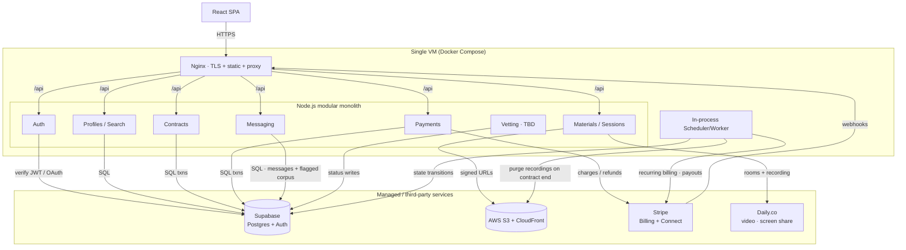
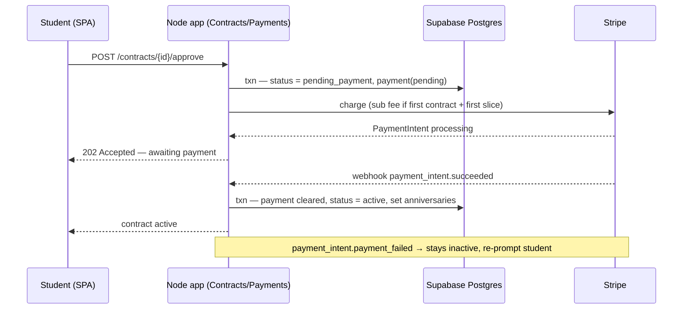
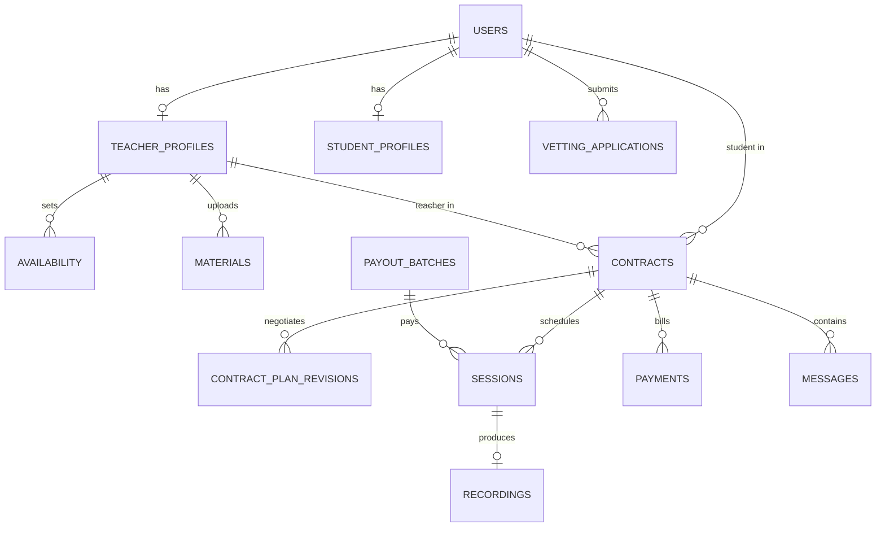

# Nisbah Learning — System Design Document

## 1. Overview

Nisbah Learning is a **web-only** two-sided marketplace connecting students with Islamic teachers for paid one-on-one lessons (Quran, Hadith, Arabic, Fiqh, Usul, Aqidah). Students discover teachers, negotiate a contract, pay on a recurring monthly schedule, attend live video sessions, watch recordings, and read uploaded materials. Teachers list themselves, run sessions, and receive biweekly payouts net of platform commission. Admins resolve vetting edge cases, flagged messages, and disputes.

The system is deliberately sized for **product validation**, not scale: 300 MAU, ~100 video-hours/month. The architecture is a **modular monolith** (Node.js + TypeScript) on a **single VM behind Nginx**, leaning on managed services (Supabase, Stripe, Daily.co for video, AWS S3 + CloudFront) so the team writes business logic, not infrastructure.

**Out of scope:** native mobile apps; the automated vetting *algorithm* (the pipeline boundary and status machine are designed, the scoring logic is TBD); group/multi-party classes; in-house video infrastructure; the exact commission percentage and platform subscription fee amount.

## 2. Requirements

### 2.1 Functional Requirements

- **Auth & roles.** Email+password and Google OAuth, identical flow for both roles; role (`student` | `teacher`) chosen at signup. Admin is an internal role.
- **Teacher profile (public to signed-in users).** Photo (≤5 MB, optional), name + verified tick, hourly rate, subjects, certifications (required), ijaza (required), experience (optional), 1–2 min intro video, languages, preferred session length (≤2 h), availability (own timezone, displayed converted), ratings/reviews, expected reply time, completion badges, credibility score.
- **Student profile (private).** Photo, name, prior studies — visible only to a teacher in an active contract with that student.
- **Verification.** Every teacher is vetted at signup → `verified` (composite ≥0.85, no anomalies), `listed` unverified (0.55–0.85), or `rejected` (<0.55 or anomalies); ambiguous/anomalous cases go to an admin queue. Process completes ≤24 h. Unverified teachers are fully bookable; the tick is a trust signal, not a gate. Admin can promote/revoke verification.
- **Search & filters.** Subject, price band, rating floor, language, timezone (UTC−11..+13), availability day or Open Availability, gender.
- **Contract negotiation.** Student requests a teacher → teacher proposes a plan (subject, total duration, sessions/week, session length, total price) → student approves or requests changes (loop) → on approval **and** first-charge clearing, the contract is `active`. Terms: ≥1 month, ≥4 sessions.
- **Recurring payments.** Per active contract, monthly charge = `total_price ÷ length_months` on the contract anniversary. One platform subscription fee per student per month on the student's subscription anniversary (day their first-ever contract activated). First charge (subscription fee if first contract + first month's slice) taken at approval; contract activates only when it clears.
- **Failed charges.** 3 retries at +1 h / +6 h / +24 h; all fail → contract `paused` (chat, video, recordings, materials locked); 14 days paused → auto-cancel.
- **Refunds.** Mid-contract student cancel: current-month subscription fee not refunded, current-month contract slice refunded, future months never billed. Cancel ≥24 h before contract start: full refund.
- **Teacher payouts.** Biweekly, for sessions actually delivered, minus commission. If a slice is refunded mid-contract, the teacher is still paid for delivered sessions; the platform absorbs the gap. No teacher subscription.
- **In-app messaging.** All student↔teacher conversation is in-app; **every message is screened for contact-info / PII by an in-process regex/heuristic filter before delivery, strictly and uniformly — regardless of contract state**; flagged messages are held for admin and **persisted as a labelled corpus** for a future classifier. There is no relaxed mode; off-platform contact stays disallowed for the lifetime of the relationship.
- **Materials.** Teachers upload books/PDFs; students read in-app while the contract is active.
- **Sessions, timezones, rescheduling.** Times stored in UTC, displayed in viewer-local time with the teacher's original local time in brackets (`Mon 3:00 PM EST (originally 8:00 PM PKT)`). Students may request out-of-availability times; teacher accepts or counters. Cancel/reschedule requires ≥24 h notice; rescheduled into the same or following week.
- **Recordings.** Each session is cloud-recorded and available to the student and teacher **for the lifetime of the contract**; recordings are purged when the contract reaches a terminal state (`completed` or `cancelled`). While a contract is `paused`, recordings are locked (not deleted) and become available again on resume.

### 2.2 Non-Functional Requirements

- **Scale.** ~300 MAU; ~100 concurrent-equivalent video-hours/month. Single VM is sufficient; no horizontal scaling required.
- **Durability & consistency.** Contracts and payments require full **ACID** — handled via Postgres transactions and Stripe as the system of record for money; payment state changes are idempotent against Stripe webhook IDs.
- **Recordings retention.** Retained for the contract lifetime; deleted from S3 when the contract reaches `completed` or `cancelled`.
- **Availability.** Best-effort single-VM (~99% — SPOF accepted at this stage). RTO of minutes-to-hours via daily VM image rebuild; **RPO for business data is effectively zero** because all durable state lives in Supabase / S3 / Stripe, not on the VM.
- **Security.** TLS at Nginx; private media (recordings, contract PDFs, student photos) served only via short-lived **CloudFront signed URLs** minted after an authz check, buckets locked down with Origin Access Control; student-profile access enforced by Supabase Row-Level Security; secrets in environment, not image.
- **Observability.** Structured app logs, Stripe webhook audit trail, scheduler job logs (billing runs, retries, payout batches, recording purges), and a **`recording_view` event** emitted whenever a recording signed URL is minted — the metric that later informs the optional-recording cost lever and which recordings are cold enough to tier (see §8).

## 3. Architecture

**Components.**

- **React SPA → Nginx → Node monolith.** Nginx terminates TLS, serves the built SPA's static assets, and reverse-proxies `/api` to the Node process. Both run as containers via a single Docker Compose file on one VM.
- **Auth module.** Delegates identity to **Supabase Auth** (email/password + Google OAuth); the app verifies Supabase-issued JWTs and maps them to a `users` row and role.
- **Profiles + Search.** Reads/writes profile data in Postgres; filtered search is a parameterized SQL query (300 users — no search engine needed). Computes timezone-converted availability for display.
- **Contracts.** Owns the request → propose → revise → approve state machine. Approval and first-charge clearing are committed together so a contract is never `active` without cleared payment.
- **Payments.** Wraps **Stripe Billing** (recurring contract slices + monthly platform subscription fee + retry schedule) and **Stripe Connect** (biweekly teacher payouts with commission split). Stripe is the source of truth for money; webhooks (received through Nginx) drive local payment state idempotently.
- **Messaging.** Persists messages in Postgres; every message passes through an **in-process regex/heuristic PII filter** (emails, phone numbers incl. spelled-out, URLs, social/IM handles, common app names) before delivery — no external service, no per-message cost, message content never leaves the VM (consistent with RLS + disabled Daily chat). Filtering is **strict and uniform on every message regardless of contract state** — there is no relaxed/post-contract mode. Flagged items are routed to the admin queue **and stored with their match metadata as a training corpus** (see §8 — a traditional classifier later, not an LLM). This is the *only* text channel — Daily's native in-call chat is switched off so no student↔teacher text can route around the filter. *Intentional MVP trade-off: regex accepts lower recall now in exchange for zero cost/latency/dependency; policy + account penalties are the backstop for what it misses.*
- **Materials & Sessions.** Binary files (photos, intro videos, PDFs, recordings) live in **AWS S3**; Postgres holds only the object key — never the bytes (see Storage below and the Trade-offs note on Postgres BLOBs). All media is fronted by **CloudFront**: public assets (profile photo, intro video) via a plain public distribution; private assets (recordings, contract PDFs, student photos) via short-lived **CloudFront signed URLs** the API mints *after* checking contract/role authorization. Live sessions use **Daily.co** (standard package: video/audio + screen sharing). **Daily's built-in in-call text chat is disabled** (`enable_chat: false` on the room) so *all* student↔teacher text stays in the app's own PII-moderated messaging — closing what would otherwise be a moderation bypass. Cloud **recording is a paid Daily add-on**, delivering a "recording ready" webhook the Sessions module consumes to register the recording (retained for the contract lifetime, purged on contract `completed`/`cancelled`).
- **Scheduler / Worker.** An in-process scheduler (single VM, single instance — no distributed locking needed) runs: daily recurring-billing sweep on contract & subscription anniversaries, the 3-retry ladder, pause-after-3-fails, auto-cancel after 14 days paused, the biweekly payout batch, and the recording purge when a contract reaches `completed`/`cancelled`.

**Infrastructure justification.** No message queue or cache: at 300 MAU the load fits one VM with direct Postgres access; introducing Kafka/Redis would be unjustified operational weight for product validation. Supabase removes auth + DB ops. Stripe removes PCI scope and billing-engine complexity. S3 + CloudFront decouples large media from the disposable VM and keeps image/video bytes off the Postgres connection pool.

**Storage.** Bytes in S3, only the key in Postgres. Class is chosen per access pattern; CloudFront fronts everything (cache + lower latency for a timezone-spread user base):

| Asset | S3 class | CloudFront | Access |
|---|---|---|---|
| Profile photo | Standard | Public dist. | Any signed-in user |
| Intro video (1–2 min) | Standard-IA | Public dist. | Public on profile |
| Session recording | Standard | Signed URLs | Private; retained for contract lifetime, purged on contract end |
| Books / PDFs | Standard | Signed URLs | Private; contract-gated |

Profile photos sit on **Standard**, not Infrequent Access: they render on every search card and profile view, and IA's per-GB *retrieval* fee penalizes exactly that hot pattern (IA also has 128 KB-billable and 30-day minimums). The intro video is on **Standard-IA** — watched rarely, and CloudFront absorbs the occasional cache-miss retrieval. Private buckets are reachable only through CloudFront via **Origin Access Control**; the API mints a short-lived **CloudFront signed URL** after the authz check (no public object URLs ever leave the server).

**Critical flow — contract approval, first charge, activation:**

A **Deployment & Recovery** note: the app is shipped as a Docker Compose stack (Nginx + Node) on a single VM; the VM **provider is left open** (Hetzner/DigitalOcean/Vultr vs AWS/GCP). The VM is **stateless** — all durable state is in Supabase, S3, and Stripe. A provider-scheduled **daily image snapshot** is taken; on VM failure a new VM is created from the latest image and DNS is repointed (minutes-to-hours RTO). No warm standby — unjustified cost at this scale.

## 4. API Design

REST over HTTPS, JSON, Supabase JWT in `Authorization`. Core, non-obvious endpoints:

| Method & Path | Request (key fields) | Response (key fields) | Status |
|---|---|---|---|
| `POST /auth/signup` | `email`, `password` \| OAuth token, `role` | `user_id`, `role` | 201 / 409 |
| `POST /teachers/applications` | `certifications[]`, `ijaza[]`, `experience[]?`, `intro_video` (object keys) | `application_id`, `status=processing` | 202 |
| `GET /teachers` | filters: `subject`, `price_band`, `rating_min`, `language`, `tz`, `day`\|`open`, `gender` | `teachers[]` (profile + `verified`, availability in viewer tz w/ original) | 200 |
| `POST /contracts` | `teacher_id` | `contract_id`, `status=requested` | 201 |
| `POST /contracts/{id}/plan` | `subject`, `total_months`, `sessions_per_week`, `session_length`, `total_price` | `revision_id`, `status=proposed` | 201 |
| `POST /contracts/{id}/approve` | — | `status=pending_payment`, `payment_intent` | 202 / 402 |
| `POST /contracts/{id}/cancel` | — | `refund` (slice refunded; sub fee not; or full if ≥24 h pre-start) | 200 |
| `POST /contracts/{id}/messages` | `body` | `message_id`, `status=delivered`\|`flagged` | 201 |
| `GET /media/{object_key}/url` | — (authz: active contract / role) | `signed_url`, `expires_in` | 200 / 403 |
| `POST /webhooks/stripe` | Stripe event (signed) | `received` | 200 |

Non-obvious contracts: `approve` returns `202` — activation is asynchronous, confirmed by the Stripe webhook, not synchronously. `GET /media/.../url` never returns the object directly; it returns a short-lived signed URL only after an authorization check. `messages` may return `status=flagged` (held for admin) rather than an error.

## 5. Data Model

Postgres (Supabase). Money stored in **integer minor units** (cents); all timestamps **UTC `timestamptz`**; teacher availability also stores the teacher's IANA timezone for the "(originally …)" display. Student-profile rows protected by **RLS**: readable only by the owner and by a teacher joined through an `active` contract.

Key tables (selected columns):

- **`users`** — `id`, `email`, `role` (`student|teacher|admin`), `auth_provider`, `created_at`.
- **`teacher_profiles`** — `user_id`, `photo_key?`, `hourly_rate_cents`, `subjects[]`, `certifications[]`, `ijaza[]`, `experience[]?`, `intro_video_key`, `languages[]`, `pref_session_minutes` (≤120), `verification_status` (`verified|listed|rejected`), `credibility_score`, `expected_reply_minutes`. Index: `(verification_status)`, GIN on `subjects`, `languages`.
- **`student_profiles`** — `user_id`, `photo_key?`, `name`, `prior_studies`. RLS-restricted.
- **`availability`** — `teacher_id`, `weekday`, `start_utc`, `end_utc`, `teacher_tz` (IANA), `open_availability` (bool).
- **`contracts`** — `id`, `student_id`, `teacher_id`, `subject`, `total_months`, `sessions_per_week`, `session_minutes`, `total_price_cents`, `status` (`requested|proposed|pending_payment|active|paused|cancelled|completed`), `start_at`, `contract_anniversary_dom`, `paused_at?`. Index: `(status)`, `(teacher_id)`, `(student_id)`.
- **`contract_plan_revisions`** — `contract_id`, `proposed_by`, terms snapshot, `created_at` (negotiation history).
- **`payments`** — `id`, `contract_id?`, `student_id`, `kind` (`first_charge|slice|subscription_fee`), `amount_cents`, `status` (`pending|cleared|failed|refunded`), `retry_count`, `next_retry_at?`, `stripe_payment_intent_id` (unique — webhook idempotency).
- **`payout_batches`** — `id`, `teacher_id`, `period_start`, `period_end`, `gross_cents`, `commission_cents`, `net_cents`, `stripe_transfer_id`, `status`.
- **`sessions`** — `id`, `contract_id`, `scheduled_start_utc`, `scheduled_end_utc`, `status` (`scheduled|delivered|cancelled|rescheduled`), `delivered_at?`, `payout_batch_id?`.
- **`recordings`** — `session_id`, `object_key`, `created_at`. Lifetime is bound to the parent contract; when the contract becomes `completed`/`cancelled` the worker deletes the rows + S3 objects for all its sessions.
- **`messages`** — `id`, `contract_id`, `sender_id`, `body`, `status` (`delivered|flagged`), `matched_rules[]?` (which regex patterns fired), `admin_label?` (`pii|clean|null` — set when an admin reviews a flag), `created_at`. The last two columns are the seed of the future-classifier training set (§8).
- **`vetting_applications`** — `user_id`, `document_keys[]`, `composite_score?`, `status` (`processing|auto_verified|auto_listed|admin_queue|rejected`), `decided_at`. *(Scoring algorithm TBD.)*

No sharding/partitioning — single small Postgres instance is far within capacity at this scale.

## 6. Trade-offs & Alternatives

- **Modular monolith on one VM → vs microservices.** *Why:* 300 MAU and a small team; one deployable maximizes iteration speed and minimizes ops. *Gave up:* independent scaling and fault isolation per module, and the single VM is a SPOF — accepted because all durable state is external and recovery is a daily-image rebuild.
- **Postgres (Supabase-managed) → vs a NoSQL store or self-hosted Postgres.** *Why:* contracts and payments demand **ACID** — a half-charged contract or a lost payment row is unacceptable; relational transactions + constraints give that directly. Supabase additionally removes auth/OAuth/DB ops and RLS cleanly enforces student-profile privacy. *Gave up:* some control and a vendor dependency; mitigated since the data is standard, portable Postgres.
- **Media bytes in S3, key in Postgres → vs storing photos as Postgres BLOBs.** *Why:* even at ≤5 MB/photo, BLOBs bloat every backup and daily snapshot, tie up a scarce single-instance connection for the whole transfer (competing with contract/payment queries), and can't sit behind a CDN. Keys-in-DB keeps the same code path as recordings/PDFs. *Gave up:* a second system (S3) in the data path — acceptable, it's already required for recordings.
- **S3 Standard for hot media, Standard-IA only for the intro video → vs IA everywhere to cut storage cost.** *Why:* IA's per-GB retrieval fee makes frequently-viewed objects (profile photos) *more* expensive, not less. Class is matched to the actual access pattern. *Gave up:* marginally higher per-GB storage on Standard — negligible at this volume.
- **Stripe Billing + Connect → vs a custom billing/payout engine.** *Why:* the recurring model (per-contract anniversaries + separate subscription anniversary), retry ladder, refunds, and marketplace split payouts are exactly Stripe's domain; keeps PCI scope out. *Gave up:* fee per transaction and Stripe-shaped data modeling; acceptable versus building a correct money system from scratch.
- **Daily.co → vs self-hosted SFU (or Agora).** *Why:* 1:1 video + screen share + cloud recording + "recording ready" webhook is commodity; self-hosting WebRTC is disproportionate at ~100 h/mo, and Daily's room flags let us cleanly disable native chat to keep the moderation guarantee. *Gave up:* per-minute cost, a separate paid add-on for recording, and provider lock-in for recordings (bounded — recordings are copied to our own S3 and purged at contract end, so retention is finite and the stored bytes are ours, not Daily's).
- **Regex/heuristic PII filter now → vs a managed moderation API (Hive) or self-hosted ML (Presidio / OSS NER).** *Why:* at validation scale the goal is enough friction that going off-platform costs more than staying on it, not a perfect PII firewall — regex delivers that at zero cost/latency and keeps message content on the VM (a paid API would also be a recurring per-message cost and would send every message to a third party, against the privacy posture). The regex flags double as a free labelled corpus. *Gave up:* recall on obfuscated/novel attempts — accepted, with policy + account penalties as the backstop and a documented upgrade path (§8) to a traditional classifier (Hive/Presidio remain fallbacks if accuracy proves insufficient). *Explicitly not an LLM/SLM:* short-text contact-info detection is textbook linear/NER classification; an LLM is unjustified cost and latency here.
- **No queue/cache → vs Redis + a job queue.** *Why:* request volume and the scheduler's daily/biweekly cadence fit a single in-process scheduler against Postgres; one instance means no distributed-lock complexity. *Gave up:* horizontal worker scaling and sub-second fan-out — neither is needed yet; revisit if MAU grows an order of magnitude.

**Cost:** see **§7 Pricing** for the itemized monthly run-rate (~$201/month at this scale, excluding Stripe pass-through).

## 7. Pricing

Itemized monthly cost at the stated validation scale. **Assumptions:** 100 video-hours/month = **6,000 session-minutes**; 1:1 sessions → 2 participants → **12,000 user-minutes**; every session is recorded → **6,000 recorded minutes**.

| Component | Unit price | Monthly basis | Monthly cost |
|---|---|---|---|
| Daily.co — video | $0.004 / user-min | 12,000 user-min | **$48.00** |
| Daily.co — recording add-on | $0.013 / min | 6,000 min | **$78.00** |
| Supabase — database | $25 + $10 compute | flat | **$35.00** |
| AWS CloudFront | ~$0.085 / GB egress + request fees (pay-as-you-go, no flat fee) | ~100 GB/mo³ | **~$10.00** |
| AWS S3 (Standard) | $0.023 / GB-mo | ~450 GB resident¹ | **~$10.00** |
| Single VM | ~$10–40 | flat (provider TBD) | **~$20.00** |
| **Platform run-rate** | | | **≈ $201 / month** |
| PII filtering | in-process regex | — | **$0** |
| Stripe | ~2.9% + $0.30 / charge | per transaction | *pass-through²* |

¹ Recordings are now retained for the contract lifetime, so storage is no longer a rounding error. Assumptions: ~1.5 GB per recorded hour; 100 recorded h/mo → ~150 GB/mo added; average active contract ~3 months → steady-state ~450 GB resident. All on S3 Standard here; the §8 lifecycle policy (Standard → Standard-IA for older recordings) would cut this materially once adopted. Photos/PDFs remain negligible on top. ² Stripe fees are a variable pass-through on student charges, not a platform run cost — excluded from the run-rate total. PII filtering adds $0 (in-process regex; no third-party provider). ³ CloudFront is **pay-as-you-go** (per-GB egress + per-10k requests, no fixed/committed fee); ~100 GB/mo assumes recordings are streamed roughly once each plus light photo/video traffic, free tier deliberately not counted. Scales with playback volume.

**Shape of the bill:** usage-variable Daily.co (video $48 + recording $78 = **$126**, ~66% of the total) dominates, with CloudFront (~$10) the only other usage-driven line; fixed infrastructure (Supabase + VM ≈ **$55**) plus S3 storage (~$10, now that recordings persist for the contract) make up the rest. Cost scales almost entirely with delivered/recorded/streamed video minutes — if usage doubles, Daily and CloudFront roughly double, S3 grows with retained recording volume, while the fixed tier holds. The recording add-on is the single largest line; making per-session recording optional is the highest-leverage cost lever (see §8).

## 8. Future Considerations

Deliberately **not built now** — recorded here so the current design stays minimal but the path is known:

- **S3 lifecycle tiering for recordings.** Recordings now live for the whole contract (months), and access is front-loaded — heavily watched in the days after a session, rarely later. A lifecycle rule aging objects **Standard → Standard-IA** after ~30 days matches that curve and materially cuts the storage line in §7 (the ~$10 figure assumes all-Standard; tiering the older ~⅔ to IA roughly halves it). Deferred only because it's a pure cost optimization, not correctness — ship retention first, add the policy once volume confirms the spend.
- **Storage-tier monitoring.** Tiering is only safe with visibility into per-object access; the `recording_view` event stream plus CloudFront access logs are the inputs to tuning the age threshold above.
- **Optional per-session recording (cost lever).** Recording is ~40% of the monthly bill (§7). Once `recording_view` data shows how often recordings are actually watched, making recording opt-in per contract/session — rather than recording 100% — directly cuts the largest variable line.
- **Traditional ML PII classifier (regex → learned model).** The regex filter runs in production as a weak-supervision *labelling function*: every decision is logged so a small classifier (logistic regression / linear SVM / small NER on char+word n-grams — **not** an LLM/SLM) can later be trained to beat regex on obfuscated/novel attempts. **Data to collect now so the dataset exists when it's needed:** (1) every flagged message with `matched_rules[]`; (2) `admin_label` whenever an admin reviews a flag (true/false-positive ground truth); (3) a **small random sample of *un*flagged delivered messages** for periodic human spot-labelling — without this the model only relearns the regex and can never measure or close false-negatives; (4) post-hoc signals already available — messages shortly followed by an off-platform-contact report or contract dispute — as additional positives. Train only once volume justifies it; deploy the model as a same-VM CPU sidecar (no GPU/hosted inference at this scale). Hive / self-hosted Presidio remain documented fallbacks if regex accuracy proves insufficient before then.
- **Scale-out triggers.** If MAU grows ~10×, revisit: a managed VM with autoscaling or container platform, a Redis-backed job queue for the scheduler, and read replicas — none justified at 300 MAU.

---

*Open items deferred by design: automated vetting scoring algorithm, VM provider, commission percentage, and platform subscription fee amount. (PII moderation is now decided: regex-first, ML-later — see §3 / §6 / §8.)*
