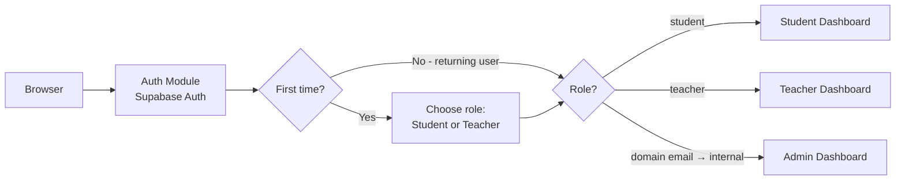
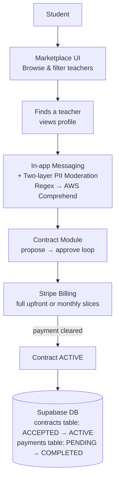
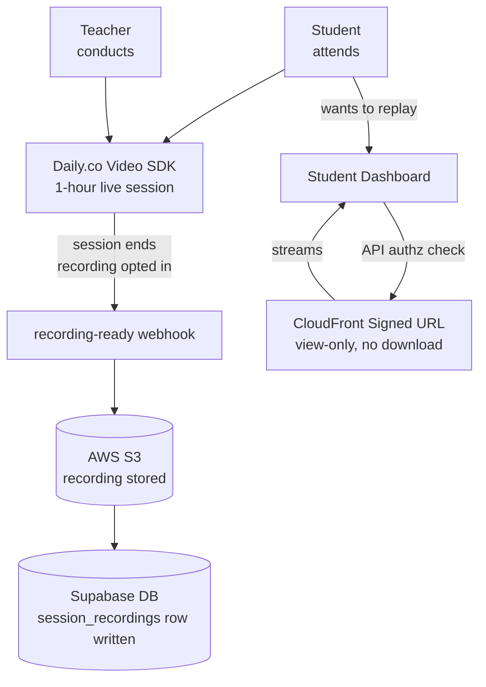
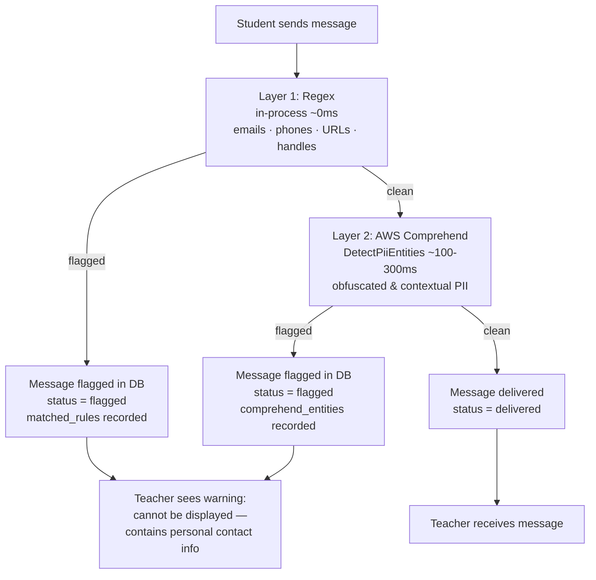

# Nisbah Learning — System Design Document

## 1. Overview

Nisbah Learning is a **web-only** two-sided marketplace connecting students with Islamic teachers for paid one-on-one lessons (Quran, Hadith, Arabic, Fiqh, Usul, Aqidah). Students discover teachers, sign up a contract, and attend sessions. Teachers list themselves, run sessions. Admins resolve vetting edge cases, flagged messages, and disputes.

## 2. Requirements

### 2.1 Functional Requirements

- **Auth & roles.** Email+password and Google OAuth, identical flow for both roles; role (`student` | `teacher`) chosen at signup. Admin is an internal role.
- **Teacher profile (public to signed-in users).** Photo (≤5 MB, optional), name, hourly rate, subjects, certifications (required), ijaza (required), experience (optional), 1–2 min intro video, languages, availability (own timezone, displayed converted), ratings/reviews, expected reply time, completion badges. (Sessions are a fixed 1 hour — see Contract negotiation.)

- **Student profile (private).** Photo (≤5 MB, optional), name, prior studies (optional, if any) — visible only to a teacher in an active contract with that student.

- **Search & filters.** Subject, price band, rating floor, language, timezone (UTC−11..+13), availability day or Open Availability, gender.

- **Contract negotiation.** Student requests a teacher → teacher proposes a plan (subject, session duration, total price) → student approves or requests changes (loop) → on approval **and** first-charge clearing, the contract is `active`. **Every session is a fixed 1 hour.** Terms: ≥1 month, ≥4 sessions.

- **Contract payments.** All charges are in **USD** (business is registered in Canada; USD is the marketplace standard). At approval the student picks one of **two payment options**: (a) **pay the full amount upfront** in a single charge, or (b) **pay in monthly anniversary slices** = `total_price ÷ length_months`, one charge per contract anniversary.
A **1-month / 4-session contract is full-payment only** (there is nothing to slice).
**Revenue comes entirely from commission on teacher payouts.** 
The first charge (full amount, or first slice) is taken at approval; the contract activates only when it clears. For sliced contracts, **the anniversary day clamps to the last available day of a shorter month** (e.g. start Jan 29 → next charge Feb 28; start Mar 31 → next charge Apr 30; the original day resumes the next month it exists). **No cap on the number of concurrent active contracts a student may hold.** Pause, refund, no-show, and cancellation billing rules are specified in [Section 2.3](#23-contract-lifecycle).

- **Teacher payouts.** Paid **monthly on the 28th**, for sessions actually delivered, minus a **flat 30 % commission**. Each teacher's accrued, pending, and paid **earnings are shown in the UI**. A teacher who wants their money before the 28th can trigger an **instant payout**; doing so deducts a **Stripe fee (3.7 % + \$0.30)** *on top of* the 30 % commission. Which sessions count as payable (no-shows, make-ups, pauses, cancellations) is governed by [Section 2.3](#23-contract-lifecycle). The platform also tracks each teacher's cumulative delivered hours in `teacher_profiles.delivered_hours_total` so a seniority-based commission tier can be enabled later without backfilling history (see [Section 8](#8-future-considerations)); at launch the counter has no payout effect.

- **In-app messaging.** All student↔teacher conversation is in-app; **every message is screened for contact-info / PII by a two-layer filter before delivery, strictly and uniformly — regardless of contract state**: (1) an in-process **regex** pass (fast, zero-cost, covers emails/phones/URLs/social handles) followed by (2) **AWS Comprehend `DetectPiiEntities`** (NLP-based, catches obfuscated and contextual contact info the regex misses).
Either layer flagging withholds the message. A flagged message is **not delivered**: the recipient sees a warning placeholder stating the message can't be displayed. **There are no account bans or penalties.** **Every message (clean and flagged) is stored in Postgres** as a labelled corpus for future ML training (see [Section 8](#8-future-considerations)).
Off-platform contact stays disallowed for the lifetime of the relationship. The added Comprehend latency (~100–300 ms per message) is accepted — users leaving the platform is the highest-priority risk.

- **Materials.** Teachers upload books/PDFs; students **view them in-app only — no download** — while the contract is active.

- **Sessions, timezones, rescheduling.** Sessions are a **fixed 1 hour**. Times stored in UTC, displayed in viewer-local time with the teacher's original local time in brackets (`Mon 3:00 PM EST (originally 8:00 PM PKT)`). Students may request out-of-availability times; teacher accepts or counters. Cancel/reschedule requires ≥24 h notice; rescheduled into the same or following week or before the contract end time.

- **Hours tracking.** Every delivered 1-hour session is tracked so the platform can (a) confirm the contracted number of sessions is completed within each contract and (b) accumulate `teacher_profiles.delivered_hours_total` for future teacher-time milestones (see [Section 8](#8-future-considerations)).

- **Recordings.** Recording is **opt-in per contract**, **default off**. Either participant can toggle `recording_enabled` from the contract view between sessions; the state at session start time is the state used for that session. When **on**, the session is recorded by **Daily.co's cloud recording** (`enable_recording: true` on the room); on session end the recording-ready webhook lands the file in **our S3** and writes a metadata row, and the recording is offered **view-only via a CloudFront signed URL** (no download). When **off**, recording is disabled at the room level — nothing is captured and no recording cost is incurred. For sessions that *were* recorded: recordings are available to students **for the lifetime of the contract**, locked (not deleted) while a contract is `paused`, and purged on `completed`/`cancelled`. The setting is visible on the contract page and in the pre-session lobby so both parties always know whether the upcoming session will be recorded.

- **Transactional email.** Three business triggers, all sent through **Resend** as the single provider: (1) **contract established** → email to the student with the contract details **and** the amount charged / to be charged; (2) **teacher payout sent** (via Stripe) → email to the teacher; (3) **a student approaches a teacher for a contract** → email to the teacher. Supabase Auth additionally delivers its own auth emails (verification, password reset, magic link) via Resend SMTP, so every outbound email shares one domain, one set of DKIM/SPF/DMARC records, and one set of delivery logs.

### 2.2 Non-Functional Requirements

- **Scale.** **300 total users = 200 students + 100 teachers**; ~**200 one-on-one video-hours/month**. Single VM is sufficient; no horizontal scaling required.

- **Durability & consistency.** Contracts and payments require full **ACID** — handled via Postgres transactions and Stripe as the system of record for money; payment state changes are idempotent against Stripe webhook IDs.

- **Recordings retention.** Recording media held in S3 Standard with a metadata row in Postgres for the contract lifetime; both purged when the contract reaches `completed` or `cancelled`. Footprint is bounded by purge-on-terminal (no indefinite media accumulation).

- **Availability.** Best-effort single-VM (~99% — SPOF accepted at this stage). RTO of minutes-to-hours via daily VM image rebuild; **RPO for business data is effectively zero** because all durable state lives in Supabase / S3 / Stripe, not on the VM.

- **Security.** TLS at Nginx; private media (contract PDFs, student photos, session recordings) served only via short-lived **CloudFront signed URLs** minted after an authz check, buckets locked down with Origin Access Control; **materials and recordings are view-only / non-downloadable** (signed URLs delivered with inline content-disposition into an in-app viewer/player that disables download); recording-metadata and student-profile access enforced by Supabase Row-Level Security; secrets in environment, not image.

- **Observability.** At this scale there is **nothing dedicated to build for observability** — the platform relies on the host/managed-service default logs (Supabase, Stripe dashboard, the VM's container logs). A purpose-built observability stack is unjustified at 300 users.

### 2.3 Contract Lifecycle

The full lifecycle of a contract, from discovery to a terminal state. This section is authoritative for billing, pause, no-show, and cancellation behavior; the Section-2.1 payment and payout bullets defer their edge-case rules here.

**States (`contracts.status`):**

```
PENDING_PAYMENT → ACTIVE → (PAUSED ⇄ ACTIVE) → COMPLETED | CANCELLED
```

A request/proposal is **not** a committed contract row — during negotiation it lives in the teacher's inbox. The contract is persisted **only when the student accepts** (as `PENDING_PAYMENT`). If the student declines, nothing is saved.

**Happy path:**

1. **Browse.** The student finds a teacher.
2. **Request.** The student sends a request, choosing a slot from the teacher's stated availability. *Edge case:* if no listed slot works, the student requests a custom time via the teacher's **Open Availability**.
3. **Propose.** The teacher reviews the student profile and proposes a study plan — **1-hour sessions**, **minimum 4 sessions**. The teacher may **reject** with no justification required (optional to give one).
4. **Student decision.** **Accept** → contract written as `ACCEPTED' in contract_status column and 'PENDING` in payments table. Student redirected to the payments page · **Request modification** → teacher modifies (loop) or declines · **Decline** → nothing persisted.
5. **Pay.** One of two options: **full upfront** (single charge of `total_price`), or **slices** (`slice = total_price ÷ months`, where `months = total_sessions ÷ 4`; one charge per monthly anniversary, first slice now). A 1-month / 4-session contract is upfront-only.
6. **Activate.** On payment cleared → `ACTIVE` on contract status column and 'COMPELETED' in payments table. The status flips to `ACTIVE` **only after** payment succeeds (atomicity — the redirect latency is acceptable). If payment is not completed within **24 h**, contract auto-voids and is dropped; the student can start a new contract anytime.
7. **Schedule.** The student books **all sessions upfront**, and may later **reschedule in the UI** (the ≥24 h-notice rule applies). **Rescheduling never changes payment.**
8. **Deliver.** Sessions run over the term; every delivered 1-hour session is tracked (hours tracking).
9. **Completion (time-based).** Driven by the same tracked-time variable used for teacher hours. When the contract's full contracted time is consumed, **5 minutes after the last session ends** both parties get an **Extend / Complete** prompt that stays open for **5 minutes**. If **Extend** is not chosen within that window, the contract auto-sets to `COMPLETED`. **Extend** adds more sessions at the **same per-session rate**, paid immediately via the same payment option; an extension must itself be **≥4 sessions** (the minimum-length rule applies to extensions too). After completion, any further extension requires a **new contract**.
10. **Terminal cleanup (on `COMPLETED`).** Recurring charges stop; **recordings are purged**; the **student's access to materials is revoked**; the **teacher's uploaded textbook is retained in S3 Standard** (teacher-only access afterward).

**Request expiry (pre-acceptance).** A request sits in the teacher's inbox for **7 days**: email on receipt, then reminders at **day 3**, **day 5**, and **day 7**. If still not actioned by **midnight in the teacher's local timezone** after the day-7 email, the request **expires** and the student is notified. The student may re-request **any number of times**.

**No-show (contract `ACTIVE`, not paused):**

- **Both present** → student charged, teacher paid (normal).
- **Teacher absent, student present** → the teacher may run a **make-up class before the term ends**, in which case the teacher **is paid** for that session. If **no make-up** is run, the session is **refunded to the student** — the teacher is not paid and the platform keeps nothing.
- **Student absent, teacher present** → the student **is charged** and the teacher **is paid**.
- **Both absent** → the charge is **absorbed by the platform** (student charged, platform keeps it, teacher not paid), **unless** the student has an **admin-accepted legitimate reason**, in which case it is **refunded**.

**Pause (`PAUSED`):**

- **Either party** can pause **unilaterally**; a reason is encouraged but not mandatory.
- **While paused, everything is locked except messaging** (video, recordings, and materials are all locked).
- **Billing — two sub-cases.** *Pause with refund requested:* remaining (future) months are **refunded**; for the current month, attended (chargeable) sessions are charged and unattended sessions are not. *Pause without refund:* no money moves; the current month's attended sessions are charged and the remaining current-month + upcoming sessions are not — for an upfront-paid contract, the unused prepaid portion is **held as credit** until resume.
- **"Attended"** means sessions that are **chargeable** under the no-show rules above (delivered sessions + student no-shows; teacher no-shows without a make-up are refunded, so excluded).
- **Maximum pause duration is 6 months.** If a contract stays paused for 6 months with no resume, it is **auto-cancelled** with an email to both parties; any unused prepaid credit is **refunded**.
- **On resume,** the resumed month is billed and the schedule continues; because rescheduling never changes payment, **billing continues on the original contract cadence set at contract start**.
- Teacher payout remains on the **28th** for delivered sessions throughout.

**Cancellation (`CANCELLED`).** The reference point for the 24-hour window is **24 h before the contract's start time** (first session):

- **Pre-start (>24 h before start):** **full refund minus the Stripe cut.**
- **Student-initiated, mid-contract:** charged for **attended sessions only**; the remainder is refunded.
- **Teacher-initiated, mid-contract:** charged for **attended sessions only**; the remainder is refunded.

On cancellation the same terminal cleanup as completion applies (recordings purged, student access revoked, teacher textbook retained).

## 3. Architecture

The system is a **modular monolith** (Node.js + TypeScript) on a single **Hetzner VPS** behind **Cloudflare** (reverse proxy, edge caching, DDoS protection) and Nginx, leaning on managed services. This section details each component on its own, then shows how they connect.

### 3.1 Components

**1. Frontend — React + TypeScript SPA.** A single-page app built and served as static assets by Nginx, which also terminates TLS and reverse-proxies `/api` to the Node backend. All user interaction (discovery, contract negotiation, messaging, the in-app PDF viewer, the video/recording screens, the teacher earnings view) lives here. It holds a Supabase-issued JWT and sends it on every API call.

**2. Auth module.** Delegates identity to **Supabase Auth** (email/password + Google OAuth). The backend verifies the Supabase JWT and maps it to a `users` row and a role: **admin** (internal dashboard), **student**, or **teacher**. Role is chosen at signup; admin is internal-only. Student-profile rows are protected by Supabase Row-Level Security.

**3. Contract module.** Owns the request → propose → revise → approve state machine and the contract's `payment_option`. Approval and first-charge clearing are committed together so a contract is never `active` without cleared payment. On establishment it triggers the contract-established email; on a new student request it triggers the teacher-notification email.

**4. Payment module.** Wraps **Stripe Billing** (full-upfront charge, or monthly anniversary slices) and **Stripe Connect** (monthly teacher payouts on the 28th, flat 30 % commission, plus an optional instant payout that deducts a Stripe fee of 3.7 % + $0.30). Stripe is the source of truth for money; webhooks (received through Nginx) drive local payment state idempotently against Stripe event IDs. Teacher earnings (accrued / pending / paid) are read back to the UI. `delivered_hours_total` is tracked for a future seniority tier ([Section 8](#8-future-considerations)) but unused at launch.

**5. PII-moderation messaging.** The only text channel between student and teacher. Every message passes through a **two-layer PII filter** before delivery, strictly and uniformly regardless of contract state:

- **Layer 1 — Regex (in-process, ~0 ms).** Catches emails, phone numbers (incl. spelled-out), URLs, social/IM handles, and common app names. If Layer 1 fires, Layer 2 is skipped (short-circuit — no unnecessary latency or cost on obvious violations).
- **Layer 2 — AWS Comprehend `DetectPiiEntities` (~100–300 ms, synchronous).** NLP-based detection for obfuscated or contextual contact info that regex misses (e.g. a name + neighbourhood combination, or a "spelled out" number that evades a regex). Runs only when Layer 1 does not flag the message.

Either layer flagging withholds the message. A flagged message is **not delivered** — the recipient sees a warning placeholder — and there are **no account bans**. The Comprehend latency is accepted: users leaving the platform is the highest-priority risk, and false positives (an occasional over-flagged message) are preferable to false negatives (off-platform contact). **Every message (clean and flagged), with its match metadata and Comprehend entity types, is stored in Postgres** as a training corpus for a future classifier ([Section 8](#8-future-considerations)). Daily's native in-call chat is disabled so no text routes around this filter.

**6. Materials — AWS S3 + CloudFront.** Binary files — profile photos, 1–2 min intro videos, and textbooks/PDFs — live in a single **S3 Standard** bucket; Postgres holds only the object key, never the bytes. **CloudFront** fronts everything. Private assets (contract PDFs, student photos) are served via short-lived **CloudFront signed URLs** the API mints *after* an authz check; public assets (profile photo, intro video) via a public distribution. **All materials are view-only — no download** (signed URLs are delivered inline into an in-app viewer with download disabled). S3 lifecycle / IA tiering / multi-bucket splits are deferred ([Section 8](#8-future-considerations)).

**7. Daily.co video SDK.** Live 1:1 sessions (video/audio + screen sharing), fixed 1 hour. **Daily's in-call text chat is disabled** (`enable_chat: false`) on every room; **cloud recording is set conditionally** from `contracts.recording_enabled` (`enable_recording` true only when the contract has opted in).

**8. Daily.co cloud recording.** Recording is **opt-in per contract** (default off). When the contract's `recording_enabled` toggle is on, the room is created with `enable_recording: true`; on session end Daily fires a recording-ready webhook and the backend stores the recording file in **S3** and writes a `session_recordings` metadata row keyed by the session id. Recordings stay **within the platform** (S3 media + RLS-gated metadata in Postgres), are playable **view-only via signed URL** for as long as the contract is up, and are purged on contract `completed`/`cancelled`. When off, nothing is recorded and no recording cost is incurred.

**Supporting services.**

- **Resend (email, external).** Sends the three transactional emails — contract established, teacher payout sent, student-approaches-teacher — triggered by the Contract and Payment modules. Supabase Auth also ships its auth mails (verification / reset / magic link) via Resend SMTP, so all email shares one domain and one set of DKIM/SPF/DMARC records and logs.
- **In-process scheduler (internal).** A single-instance scheduler (no distributed locking needed) runs the time-based jobs: triggering due Stripe charges on contract anniversaries for sliced contracts, the **monthly payout batch on the 28th**, incrementing `delivered_hours_total` when a session transitions to `delivered`, and the recording purge when a contract reaches a terminal state.

### 3.2 System Flows

#### Flow 1 — Authentication & Role Routing



#### Flow 2 — Student → Contract Happy Path



#### Flow 3 — Session Delivery & Recording



#### Flow 4 — In-app Messaging & PII Moderation



### 3.3 Storage

Bytes in S3, only the key in Postgres. **All media sits in one S3 Standard bucket** at launch (lifecycle/IA tiering deferred — [Section 8](#8-future-considerations)); CloudFront fronts everything (cache + lower latency for a timezone-spread user base). **Nothing is downloadable — all assets are view-only.**

| Asset | S3 class | CloudFront | Access |
|---|---|---|---|
| Profile photo | Standard | Public dist. | Any signed-in user · view-only |
| Intro video (1–2 min) | Standard | Public dist. | Public on profile · view-only |
| Books / PDFs | Standard | Signed URLs | Private; contract-gated · view-only, no download |

Private buckets are reachable only through CloudFront via **Origin Access Control**; the API mints a short-lived **CloudFront signed URL** after the authz check (no public object URLs ever leave the server), delivered inline to an in-app viewer/player that disables download. Recordings live in S3 as media (played back view-only via the same signed-URL path); their metadata rows are protected by RLS on the `session_recordings` table.

## 4. API Design

REST over HTTPS, JSON, Supabase JWT in `Authorization`. All endpoints are prefixed with `/api`.

### 4.1 Auth

| Method & Path | Request (key fields) | Response (key fields) | Status |
|---|---|---|---|
| `POST /api/auth/signup` | `email`, `password` \| OAuth token, `role` | `user_id`, `role` | 201 / 409 |
| `POST /api/auth/login` | `email`, `password` \| OAuth token | `user_id`, `role` | 200 / 401 |
| `POST /api/auth/logout` | — | — | 200 |

Token refresh, session persistence, and Google OAuth redirect are handled automatically by Supabase Auth.

### 4.2 Teacher Discovery

| Method & Path | Request (key fields) | Response (key fields) | Status |
|---|---|---|---|
| `GET /api/teachers` | filters: `subject`, `price_band`, `rating_min`, `language`, `tz`, `day`\|`open`, `gender` | `teachers[]` (profile + availability in viewer tz w/ original) | 200 |
| `GET /api/teachers/{teacher_id}` | — | full profile incl. availability, ratings, reviews | 200 / 404 |
| `PATCH /api/teachers/{teacher_id}/profile` | updatable profile fields | updated profile | 200 / 403 |

### 4.3 Student Profile

| Method & Path | Request (key fields) | Response (key fields) | Status |
|---|---|---|---|
| `GET /api/students/{student_id}/profile` | — (authz: owner or teacher with active contract) | `name`, `prior_studies` | 200 / 403 |
| `PATCH /api/students/{student_id}/profile` | `name?`, `prior_studies?` | updated profile | 200 / 403 |

### 4.4 Contract Negotiation

| Method & Path | Request (key fields) | Response (key fields) | Status |
|---|---|---|---|
| `POST /api/contracts` | `teacher_id`, `subject`, `time_slot` \| `open_availability` | `contract_id`, `status=requested` | 201 |
| `GET /api/contracts` | `?student_id=` \| `?teacher_id=` | `contracts[]` with status | 200 |
| `GET /api/contracts/{contract_id}` | — | full contract detail + revision history | 200 / 404 |
| `POST /api/contracts/{contract_id}/plan` | `subject`, `total_months`, `sessions_per_week`, `total_price` | `revision_id`, `status=proposed` | 201 |
| `POST /api/contracts/{contract_id}/revise` | `reason?` (PII filtered) | `revision_id`, `status=revision_requested` | 200 |
| `POST /api/contracts/{contract_id}/decline` | `reason?` (PII filtered) | `status=declined` | 200 |

`reason?` on `revise` and `decline` is optional free text, run through the same two-layer PII filter as messages, and stored as a system-tagged entry in the `messages` table (not delivered to the recipient if flagged).

### 4.5 Payments

| Method & Path | Request (key fields) | Response (key fields) | Status |
|---|---|---|---|
| `POST /api/contracts/{contract_id}/approve` | (Student-side) `payment_option` (`upfront` \| `installments`) | `payment_url` (Stripe redirect) | 202 / 402 |
| `GET /api/payments/{contract_id}` | (Student-side) — | `status` (`pending`\|`cleared`\|`failed`\|`refunded`) | 200 |
| `POST /api/payout/instant` | (Teacher-side) — | `transfer_id`, `fee_cents` (Stripe 3.7%+\$0.30) | 200 / 402 |

`approve` returns `202` — contract activation is async, confirmed by the Stripe webhook. Both `upfront` and `installments` use the same endpoint; the backend sets up the correct Stripe flow based on `payment_option`.

### 4.6 Messaging

| Method & Path | Request (key fields) | Response (key fields) | Status |
|---|---|---|---|
| `POST /api/contracts/{contract_id}/messages` | `body` | `message_id`, `status=delivered`\|`flagged` | 201 |
| `GET /api/contracts/{contract_id}/messages` | — | `messages[]` (flagged messages shown as warning placeholder to recipient) | 200 |

Every message passes the two-layer PII filter (regex → AWS Comprehend) before delivery. Flagged messages are stored but not delivered — the recipient sees a warning placeholder. All messages (clean and flagged) are retained as a labelled ML corpus.

### 4.7 Sessions

| Method & Path | Request (key fields) | Response (key fields) | Status |
|---|---|---|---|
| `POST /api/contracts/{contract_id}/sessions` | session slots | `sessions[]` with `session_id` | 201 |
| `GET /api/contracts/{contract_id}/sessions` | — | `sessions[]` with status | 200 |
| `PATCH /api/sessions/{session_id}/reschedule` | `new_slot` | `session_id`, `status=rescheduled` | 200 / 400 |
| `PATCH /api/sessions/{session_id}/cancel` | `reason?` | `status=cancelled` | 200 / 400 |

Reschedule and cancel enforce the ≥24 h notice rule. Session status (`delivered`) is set internally by the scheduler on session end — not exposed as a public endpoint.

### 4.8 Recordings

| Method & Path | Request (key fields) | Response (key fields) | Status |
|---|---|---|---|
| `PATCH /api/contracts/{contract_id}/recording` | `recording_enabled` (bool) | updated `recording_enabled` state | 200 |
| `GET /api/sessions/{session_id}/recording` | — (authz: student in contract only) | `signed_url` (CloudFront, view-only), `expires_in` | 200 / 403 |

The signed URL hides the S3 object key from the client entirely. Recording is opt-in per contract (default off); state at session start time applies.

### 4.9 Materials

| Method & Path | Request (key fields) | Response (key fields) | Status |
|---|---|---|---|
| `POST /api/contracts/{contract_id}/materials` | `file` (PDF/book) | `material_id` | 201 |
| `GET /api/contracts/{contract_id}/materials` | — | `materials[]` with `material_id` | 200 |
| `GET /api/materials/{material_id}` | — (authz: active contract participants) | `signed_url` (CloudFront, view-only), `expires_in` | 200 / 403 |
| `DELETE /api/materials/{material_id}` | — (authz: teacher owner) | — | 200 / 403 |

Access is gated by an authz check at request time — no separate purge endpoint needed. Teacher retains file access after contract ends; student access is revoked automatically.

### 4.10 Dashboards

| Method & Path | Request (key fields) | Response (key fields) | Status |
|---|---|---|---|
| `GET /api/teacher-dashboard/{teacher_id}` | — | active contracts, upcoming + completed sessions, `delivered_hours_total`, earnings (`accrued`, `pending`, `paid`, `next_payout_at`), ratings, reviews | 200 / 403 |
| `GET /api/student-dashboard/{student_id}` | — | active contracts, upcoming sessions | 200 / 403 |

### 4.11 Webhooks

| Method & Path | Request (key fields) | Response (key fields) | Status |
|---|---|---|---|
| `POST /api/webhooks/stripe` | Stripe event (signature-verified) | `received` | 200 |
| `POST /api/webhooks/daily` | Daily.co recording-ready event (signature-verified) | `received` | 200 |

Both are internal — not called by the frontend. Stripe webhook drives payment/payout state idempotently against Stripe event IDs. Daily webhook fires only when `recording_enabled = true`; stores recording to S3 and writes a `session_recordings` metadata row.

## 5. Data Model

Postgres (Supabase). Money stored in **integer minor units** (cents); all timestamps **UTC `timestamptz`**; teacher availability also stores the teacher's IANA timezone for the "(originally …)" display. Student-profile rows protected by **RLS**: readable only by the owner and by a teacher joined through an `active` contract.


Key tables (selected columns).

**`users`**

| Column | Type | Notes |
|---|---|---|
| `id` | uuid PK | |
| `email` | text | unique |
| `role` | enum | `student` \| `teacher` \| `admin` |
| `auth_provider` | text | email \| google |
| `created_at` | timestamptz | |

**`teacher_profiles`**

| Column | Type | Notes |
|---|---|---|
| `user_id` | uuid PK/FK → users | |
| `photo_key?` | text | S3 object key |
| `hourly_rate_cents` | int | USD |
| `subjects[]` | text[] | GIN index |
| `certifications[]` | text[] | required |
| `ijaza[]` | text[] | required |
| `experience[]?` | text[] | optional |
| `intro_video_key` | text | S3 object key |
| `languages[]` | text[] | GIN index |
| `expected_reply_minutes` | int | |
| `delivered_hours_total` | int, default 0 | incremented on session `delivered`; unused at launch — kept for the future seniority tier ([Section 8](#8-future-considerations)) |

**`student_profiles`** — RLS-restricted (owner + teacher in an active contract)

| Column | Type | Notes |
|---|---|---|
| `user_id` | uuid PK/FK → users | |
| `photo_key?` | text | S3 object key |
| `name` | text | |
| `prior_studies` | text | |

**`availability`**

| Column | Type | Notes |
|---|---|---|
| `teacher_id` | uuid FK | |
| `weekday` | int | 0–6 |
| `start_utc` / `end_utc` | time | |
| `teacher_tz` | text | IANA, for "(originally …)" display |
| `open_availability` | bool | |

**`contracts`**

| Column | Type | Notes |
|---|---|---|
| `id` | uuid PK | |
| `student_id` / `teacher_id` | uuid FK | indexed |
| `subject` | text | |
| `total_months` | int | ≥1 |
| `sessions_per_week` | int | each session fixed 1 h; ≥4 sessions total |
| `total_price_cents` | int | USD |
| `payment_option` | enum | `upfront` \| `installments` (installments = monthly anniversary slices; 1-month contracts are `upfront` only) |
| `status` | enum | `requested\|proposed\|pending_payment\|active\|paused\|cancelled\|completed`. `requested`/`proposed` are pre-acceptance inbox states; a committed row begins at `pending_payment` (see [Section 2.3](#23-contract-lifecycle)) |
| `start_at` | timestamptz | |
| `contract_anniversary_dom` | int | clamps to last day of shorter months |
| `paused_at?` | timestamptz | |
| `recording_enabled` | bool, default false | toggles Daily cloud recording; state at session start applies |

Index: `(status)`, `(teacher_id)`, `(student_id)`.

**`contract_plan_revisions`** — negotiation history

| Column | Type | Notes |
|---|---|---|
| `contract_id` | uuid FK | |
| `proposed_by` | uuid FK → users | |
| terms snapshot | jsonb | subject, total_months, sessions_per_week, total_price |
| `created_at` | timestamptz | |

**`payments`**

| Column | Type | Notes |
|---|---|---|
| `id` | uuid PK | |
| `contract_id` / `student_id` | uuid FK | |
| `kind` | enum | `full` \| `slice` |
| `amount_cents` | int | USD |
| `currency` | text | `'USD'` (single value at MVP) |
| `status` | enum | `pending\|cleared\|failed\|refunded` |
| `stripe_payment_intent_id` | text | unique — webhook idempotency |
| `stripe_invoice_id?` | text | |

**`payout_batches`** — monthly, paid on the 28th

| Column | Type | Notes |
|---|---|---|
| `id` | uuid PK | |
| `teacher_id` | uuid FK | |
| `period_start` / `period_end` | date | calendar month |
| `gross_cents` | int | delivered-session earnings |
| `commission_bps` | int | always 3000 at launch (future tier — [Section 8](#8-future-considerations)) |
| `commission_cents` | int | |
| `payout_type` | enum | `scheduled` (28th, free) \| `instant` (on-demand) |
| `instant_fee_cents` | int, default 0 | Stripe 3.7%+\$0.30 when `instant` |
| `net_cents` | int | gross − commission − instant fee |
| `stripe_transfer_id` | text | |
| `status` | enum | |

**`sessions`**

| Column | Type | Notes |
|---|---|---|
| `id` | uuid PK | |
| `contract_id` | uuid FK | |
| `scheduled_start_utc` / `scheduled_end_utc` | timestamptz | fixed 1 h apart |
| `status` | enum | `scheduled\|delivered\|cancelled\|rescheduled` |
| `delivered_at?` | timestamptz | drives hours tracking |
| `payout_batch_id?` | uuid FK | |

**`session_recordings`** — RLS-gated to participants; media in S3, purged on contract terminal state

| Column | Type | Notes |
|---|---|---|
| `session_id` | uuid PK/FK → sessions | |
| `s3_key` | text | object key for the recording media (bytes never in Postgres) |
| `duration_sec` | int | recorded length |
| `size_bytes` | bigint | media size; drives storage/egress |
| `status` | enum | `processing\|ready\|failed` |
| `created_at` | timestamptz | |

**`messages`** — all rows retained as ML corpus

| Column | Type | Notes |
|---|---|---|
| `id` | uuid PK | |
| `contract_id` / `sender_id` | uuid FK | |
| `body` | text | stored even when flagged |
| `status` | enum | `delivered` \| `flagged` (flagged → warning placeholder to recipient) |
| `matched_rules[]?` | text[] | which regex patterns fired (Layer 1) |
| `comprehend_entities[]?` | text[] | entity types detected by AWS Comprehend (Layer 2; null when Layer 1 short-circuited) |
| `filter_layer` | enum | `none` \| `regex` \| `comprehend` — which layer flagged the message |
| `created_at` | timestamptz | |

No sharding/partitioning — a single small Postgres instance is far within capacity at this scale.

## 6. Trade-offs & Alternatives

- **Modular monolith on one VM → vs microservices.** *Why:* 300 users and a small team; one deployable maximizes iteration speed and minimizes ops. *Gave up:* independent scaling and fault isolation per module, and the single VM is a SPOF — accepted because all durable state is external and recovery is a daily-image rebuild.
- **Postgres (Supabase-managed) → vs a NoSQL store or self-hosted Postgres.** *Why:* contracts and payments demand **ACID** — a half-charged contract or a lost payment row is unacceptable; relational transactions + constraints give that directly. Supabase additionally removes auth/OAuth/DB ops and RLS cleanly enforces student-profile privacy. *Gave up:* some control and a vendor dependency; mitigated since the data is standard, portable Postgres.
- **Media bytes in S3, key in Postgres → vs storing photos as Postgres BLOBs.** *Why:* even at ≤5 MB/photo, BLOBs bloat every backup and daily snapshot, tie up a scarce single-instance connection for the whole transfer (competing with contract/payment queries), and can't sit behind a CDN. Keys-in-DB keeps the same code path as PDFs. *Gave up:* a second system (S3) in the data path — acceptable, it's already required for PDFs and intro videos.
- **All media in one S3 Standard bucket → vs IA / lifecycle tiering from day one.** *Why:* at this volume the storage bill is a rounding error, and IA's per-GB retrieval fee penalizes frequently-viewed objects (profile photos) — tiering optimizes a cost that isn't material yet while adding operational rules. One Standard bucket is the simplest correct default. *Gave up:* marginal per-GB savings on cold objects (old intro videos, ended-contract PDFs) — deferred to [Section 8](#8-future-considerations) once volume justifies it.
- **Stripe Billing + Connect → vs a custom billing/payout engine.** *Why:* per-contract charges (full upfront or monthly anniversary slices), monthly payouts on the 28th, instant on-demand payouts, and marketplace split payouts (a flat 30 % at launch; Stripe's split-payout model would also accommodate a future per-teacher rate, kept open in [Section 8](#8-future-considerations)) are exactly Stripe's domain; keeps PCI scope out. *Gave up:* fee per transaction (and the Stripe instant-payout fee passed to teachers who draw early) and Stripe-shaped data modeling; acceptable versus building a correct money system from scratch.
- **Daily.co (video + opt-in cloud recording) → vs self-hosted SFU (or Agora).** *Why:* 1:1 video + screen share + cloud recording with a recording-ready webhook is commodity; self-hosting WebRTC and a recording pipeline is disproportionate at ~200 h/mo, and Daily's room flag still lets us cleanly disable native chat to keep moderation guarantees. Recording reverses the earlier no-recording stance: the privacy controls are now **per-contract opt-in (consent), view-only playback, and purge at contract end** rather than not capturing at all. *Gave up:* per-minute cost on video + recording (recording is **opt-in per contract** — see [Section 2.1](#21-functional-requirements) — so the recording line in [Section 7](#7-pricing) is a *cap*, not a fixed cost, and scales with adoption), added S3 storage + playback egress, and a soft provider lock-in — bounded because recordings land in our own S3. A future move to self-hosted video (LiveKit, recording to the same S3) is in [Section 8](#8-future-considerations).
- **Two-layer PII filter (regex + AWS Comprehend) → vs regex-only or a fully custom ML model.** *Why:* users leaving the platform is the highest-priority risk — a regex-only filter has acceptable precision but poor recall on obfuscated or contextual contact info (spelled-out phone numbers, name + neighbourhood combinations). AWS Comprehend `DetectPiiEntities` adds NLP-based recall as Layer 2, running only on messages that pass Layer 1 (short-circuit keeps cost and latency low on obvious violations). The added latency (~100–300 ms per clean message) is an explicit, accepted trade-off: false negatives (off-platform contact) are structurally worse than the UX cost of slightly slower messaging. Cost is negligible (~$1.50/month at this scale — Comprehend runs only on the subset of messages that pass regex). *Gave up:* the "content never leaves the VM" posture — message bodies are sent to AWS Comprehend for the Layer 2 check. Comprehend is an AWS managed service (not an LLM) so no model training on customer data. *Explicitly not an LLM/SLM:* short-text contact-info detection is textbook NER classification; an LLM is unjustified cost and latency here. Every message (with regex rules + Comprehend entity types) is retained as a labelled corpus for a future purpose-trained classifier ([Section 8](#8-future-considerations)).
- **No queue/cache → vs Redis + a job queue.** *Why:* request volume and the scheduler's daily/monthly cadence fit a single in-process scheduler against Postgres; one instance means no distributed-lock complexity. *Gave up:* horizontal worker scaling and sub-second fan-out — neither is needed yet; revisit if the user base grows an order of magnitude.

**Cost:** see **[Section 7](#7-pricing) Pricing** for the itemized monthly run-rate (~\$181–\$367/month at this scale depending on recording opt-in, excluding Stripe pass-through).

## 7. Pricing

Itemized monthly cost at the stated validation scale. **Assumptions:** 200 one-on-one video-hours/month. Daily bills **video per participant-hour** — 200 hours × 2 participants (1 teacher + 1 student) = **400 participant-hours = 24,000 user-minutes**. Daily bills **cloud recording per recording-minute** (one composite stream per session) = **200 hours = 12,000 recording-minutes**, but recording is **opt-in per contract** (default off), so that figure is a *ceiling* and the realistic launch figure is lower until adoption ramps.

| Component | Unit price | Monthly basis | Monthly cost |
|---|---|---|---|
| Daily.co — video | \$0.0040 / user-min | 24,000 user-min (400 participant-hrs) | **\$96.00** |
| Daily.co — cloud recording | \$0.01349 / recording-min ⁴ | ≤12,000 recording-min (opt-in; bills only on enabled sessions) | **≤\$161.88** |
| Supabase — database | \$25 | flat | **\$25.00** |
| AWS CloudFront | ~\$0.085 / GB egress + request fees (pay-as-you-go, no flat fee) | ~120 GB/mo³ (incl. recording playback) | **~\$10.00** |
| AWS S3 (Standard) | \$0.023 / GB-mo | ~150 GB resident¹ (incl. recordings) | **~\$3.50** |
| Hetzner VPS (2 vCPU / 4 GB) | ~€6–8/month | flat | **~\$9.65 - $12.85** |
| Cloudflare | free tier | flat | **\$0** |
| Resend — transactional email | \$20 / mo (paid plan, 50k emails) | flat | **\$20.00** |
| PII filtering — regex (Layer 1) | in-process | — | **\$0** |
| PII filtering — AWS Comprehend (Layer 2) | \$0.0001 / unit (min 3 units / call) | ~5,000 calls/mo passing Layer 1 | **~\$1.50** |
| **Platform run-rate** | | | **≈ \$168.85 / month** (no recording opt-in) **to ≈ \$330.73 / month** (full opt-in) |
| Stripe | 3.7% + \$0.30 / charge | per transaction | *pass-through²* |

¹ S3 holds profile photos, intro videos (1–2 min each), uploaded PDFs, and — when contracts opt in — session recordings (video ≫ text). The ~150 GB figure assumes moderate recording adoption; it is **bounded by purge-on-terminal** (recordings drop out at contract `completed`/`cancelled`) and stays near the ~60 GB media-only baseline until adoption ramps.

² Stripe fees are a variable pass-through on student charges, not a platform run cost — excluded from the run-rate total. The **same 3.7 % + \$0.30** also applies as an instant-payout fee deducted from any teacher who draws earnings before the 28th. PII filtering is ~\$1.50/month (AWS Comprehend Layer 2; regex Layer 1 is \$0 — Comprehend is only called on messages that pass the regex short-circuit). Daily's cloud recording is billed only for sessions whose contract has `recording_enabled = true`; the \$161.88 line is a ceiling, not a fixed monthly charge.

³ CloudFront is **pay-as-you-go** (per-GB egress + per-10k requests, no fixed/committed fee); the ~120 GB/mo covers profile-photo views, intro-video previews on the discovery page, PDF reads, and **recording playback** for opted-in contracts. Playback egress scales with recording adoption and views; at launch (recording off) it stays near the ~60 GB media-only baseline.

⁴ \$0.01349/recording-min is Daily's current cloud-recording rate as of the last doc update; confirm against Daily's live price list before relying on this figure.

**Shape of the bill:** Daily.co — video (\$96, ~57 % of the launch-floor total) is the dominant variable line and scales with delivered participant-minutes. Daily.co — cloud recording (≤\$161.88) is *conditionally* variable and becomes the **largest line when fully adopted**: it bills only for opted-in sessions, so at launch (default off) it starts near \$0 and grows toward its cap as adoption ramps — pulling its S3 storage and CloudFront playback egress up with it. Everything else is fixed (Supabase + VM + Resend = **~\$55–\$58**). At launch (recording off) the bill sits at the ~\$168.85 floor; recording is the single driver pushing it toward the ~\$330.73 ceiling.

## 8. Future Considerations

Deliberately **not built now** — recorded here so the current design stays minimal but the path is known:

- **Purpose-trained ML PII classifier (to eventually replace or augment Comprehend).** The two-layer filter (regex + Comprehend) acts as weak supervision: every decision — `matched_rules[]` from Layer 1 and `comprehend_entities[]` from Layer 2 — is logged so a small purpose-trained classifier (logistic regression / linear SVM / small NER on char+word n-grams — **not** an LLM/SLM) can later be trained on domain-specific patterns (Islamic names, schools, common community venues) that a generic Comprehend model may over- or under-flag. **Data to collect now so the dataset exists when it's needed:** (1) every flagged message with `matched_rules[]` and `comprehend_entities[]`; (2) `admin_label` whenever an admin reviews a flag (true/false-positive ground truth); (3) a **small random sample of *un*flagged delivered messages** for periodic human spot-labelling — without this the model only relearns the existing filters and can never measure or close false-negatives; (4) post-hoc signals already available — messages shortly followed by an off-platform-contact report or contract dispute — as additional positives. Train only once volume justifies it; deploy as a same-VM CPU sidecar that slots in as a third layer (or replaces Comprehend for cost reduction) without changing the message API. *Decision criteria:* Comprehend false-positive rate on domain-specific benign content proves material (e.g. teacher names flagged), or Comprehend monthly cost exceeds a purpose-trained sidecar's amortized compute cost.
- **Seniority commission tier (30 % → 15 % after 500 delivered hours).** The `delivered_hours_total` counter on `teacher_profiles` already increments at launch (see [Section 5](#5-data-model)), and `payout_batches.commission_bps` is already the per-batch rate column — only the payout-time rate selection (`commission_bps = 1500 if delivered_hours_total ≥ 500 else 3000`, read at batch open time) needs turning on. *Decision criteria:* at least one teacher within a quarter of crossing the threshold, and unit economics confirmed to support 15 % at that teacher's hourly rate — below roughly \$8/hr the 15 % tier is structurally unprofitable once Daily video + Stripe + recording costs are netted out.
- **Self-hosted video SDK (LiveKit).** Daily.co is the launch video provider for speed and zero ops. Once the user base is large enough that Daily's per-minute pricing exceeds the cost of running infrastructure, replace it with **self-hosted LiveKit** (open-source WebRTC SFU) on the same/adjacent VM. *Decision criteria:* monthly Daily video bill exceeds the amortized cost of LiveKit hosting (VM/bandwidth + TURN + ops overhead). The session-join layer is abstracted behind our own room API so the swap is provider-internal; opt-in recordings continue to land in the same S3 bucket and `session_recordings` table (LiveKit's egress records straight to S3) — only the producer changes.
- **Teacher vetting / verification.** The full automated vetting pipeline — document intake, a composite scoring algorithm, an admin review queue for ambiguous cases, and the `verified` trust tick on profiles — is deferred entirely. At launch teachers are simply listed (no badge). The intended pipeline boundary and status machine (`processing → auto_verified | auto_listed | admin_queue | rejected`) are recorded so verification can be added later as an additive layer on the existing teacher-profile model, without reworking it.
- **S3 storage tiering & lifecycle.** At launch all media sits in one S3 Standard bucket. Later, once volume justifies the retrieval-fee tradeoffs: move cold objects (old intro videos, ended-contract PDFs) to Standard-IA / Glacier via lifecycle rules, and/or split public vs private buckets.
- **Scale-out triggers.** If users grow ~10×, revisit: a managed VM with autoscaling or container platform, a Redis-backed job queue for the scheduler, and read replicas — none justified at 300 users.

## 9. Pre-Implementation Checklist

A surface-area inventory used as a checkpoint before implementation begins. Each item is marked **✅ ready** (the design above is sufficient to start), **🟡 needs clarity** (open questions remaining within this design's scope), or **⏸ deferred** (intentionally out of scope per [Section 1](#1-overview) / [Section 8](#8-future-considerations)). This list is the working catalogue — update as items resolve.

### 9.1 User-facing features

| # | Feature | Status | Open questions / notes |
|---|---|---|---|
| 1 | Auth & accounts (student / teacher / admin roles) | ✅ ready | Supabase Auth + Google OAuth; role chosen at signup; admin internal. |
| 2 | Teacher discovery & search (browse, filter, profile view) | ✅ ready | Parameterized SQL; filter set fixed in [Section 2.1](#21-functional-requirements). |
| 3 | Teacher onboarding & vetting (application, admin review) | ⏸ deferred | Entire vetting pipeline + scoring + verified tick deferred to [Section 8](#8-future-considerations); teachers are simply listed at launch. |
| 4 | Contract lifecycle (proposal → approval → active → paused/completed/cancelled) | ✅ ready | Full state machine, no-show, pause, and cancellation (incl. teacher-initiated) specified in [Section 2.3](#23-contract-lifecycle). |
| 5 | Scheduling & calendar (session slots, reminders) | ✅ ready | Fixed 1 h sessions; UTC + viewer-local display; 24 h reschedule rule. |
| 6 | Video conferencing (Daily.co) | ✅ ready | 1:1, fixed 1 h; native chat disabled; recording set conditionally per contract. |
| 7 | Session recordings (Daily cloud recording) | ✅ ready | **Opt-in per contract** (default off); media in S3, view-only via signed URL, viewable while the contract is up, purged on terminal state. Toggle = `contracts.recording_enabled`. |
| 8 | In-platform messaging (with PII moderation) | ✅ ready | Two-layer filter: regex (Layer 1) + AWS Comprehend (Layer 2); flagged → warning placeholder, no bans; **all messages stored** (with `matched_rules[]`, `comprehend_entities[]`, `filter_layer`) for [Section 8](#8-future-considerations) ML. |
| 9 | Materials sharing (photos/PDFs in S3) | ✅ ready | Single Standard bucket; contract-gated signed URLs; **view-only, no download**. |
| 10 | Reviews / ratings (post-contract) | 🟡 needs clarity | Referenced on profiles ([Section 2.1](#21-functional-requirements)) but **submission flow, schema, moderation, and edit/delete policy are not yet designed.** |
| 11 | Payments — student-side (contract billing) | ✅ ready | Two options decided: **full upfront** or **monthly anniversary slices** (1-month contracts upfront-only); lifecycle billing (pause/no-show/cancel) in [Section 2.3](#23-contract-lifecycle). Mid-term slice **decline** handling still open ([Section 8](#8-future-considerations)). |
| 12 | Payouts — teacher-side (Stripe Connect) | 🟡 needs clarity | Core decided: **monthly on the 28th**, flat 30 %, **instant payout with Stripe 3.7%+\$0.30 fee**, earnings shown in UI. `delivered_hours_total` increments (unread; future tier). Edge cases open: KYC gate, dispute holdback, tax forms, FX. |
| 13 | Refunds & cancellation | ✅ ready | Refund, no-show, pause, and cancellation rules fully specified in [Section 2.3](#23-contract-lifecycle). Stripe **chargeback/dispute** handling still open ([Section 8](#8-future-considerations)). |
| 14 | Notifications (email) | ✅ ready | Resend; three triggers (contract established, payout sent, student-approaches-teacher) + Supabase auth SMTP. |
| 15 | Admin console (dispute review, PII flag review) | 🟡 needs clarity | Admin role exists, but the **admin UI surface, permissions, and audit-log expectations are not designed.** |

### 9.2 Internal services / modules (modular monolith)

| # | Module | Status | Open questions / notes |
|---|---|---|---|
| 1 | Identity / Auth (Supabase) | ✅ ready | JWT verify → `users` row + role; RLS for student profiles. |
| 2 | Profiles & Discovery | ✅ ready | SQL + GIN indexes on `subjects`, `languages`. |
| 3 | Contracts | ✅ ready | State machine and all transitions (incl. teacher-initiated cancellation) specified in [Section 2.3](#23-contract-lifecycle). |
| 4 | Scheduling | ✅ ready | UTC storage + viewer-local display; reschedule rules in [Section 2.1](#21-functional-requirements). |
| 5 | Messaging (incl. two-layer PII filter) | ✅ ready | Regex (Layer 1) + AWS Comprehend (Layer 2) pipeline; short-circuit on regex hit; corpus schema includes `matched_rules[]`, `comprehend_entities[]`, `filter_layer`; flagged → warning placeholder, no bans; purpose-trained classifier deferred to [Section 8](#8-future-considerations). |
| 6 | Media (S3 + CloudFront, signed URLs) | ✅ ready | Single Standard bucket; OAC + inline signed URLs; **view-only, no download**; tiering deferred ([Section 8](#8-future-considerations)). |
| 7 | Video integration (Daily.co webhooks) | ✅ ready | Room flags (`enable_chat: false`; `enable_recording` set conditionally from `contracts.recording_enabled`) + recording-ready webhook handler (only fires when recording is on; persists media to S3 + metadata row). |
| 8 | Billing (Stripe — per-contract charges, webhooks) | ✅ ready | Two options decided (full upfront / monthly anniversary slices); idempotent against Stripe event IDs; lifecycle billing in [Section 2.3](#23-contract-lifecycle). Mid-term slice **decline** handling still open ([Section 8](#8-future-considerations)). |
| 9 | Payouts (Stripe Connect — Transfers, KYC) | 🟡 needs clarity | Monthly on the 28th, flat 30 %, instant payout (Stripe fee), earnings API. `delivered_hours_total` increments (future tier — [Section 8](#8-future-considerations)). Edge cases: KYC, dispute holdback, tax forms, FX. |
| 10 | Notifications | ✅ ready | Resend API (three triggers) + Supabase Auth via Resend SMTP; React Email templates colocated with module. |
| 11 | Scheduler / Worker (cron: anniversary charges, 28th payouts, recording purges, delivered-hours counter) | ✅ ready | In-process; jobs enumerated in [Section 3](#3-architecture). |
| 12 | Admin module | 🟡 needs clarity | Backend endpoints implied but **API surface + UI not specified** (see row 15 above). |
