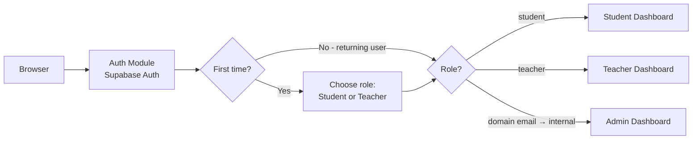
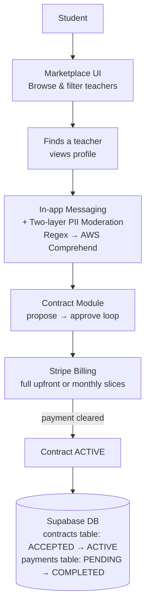
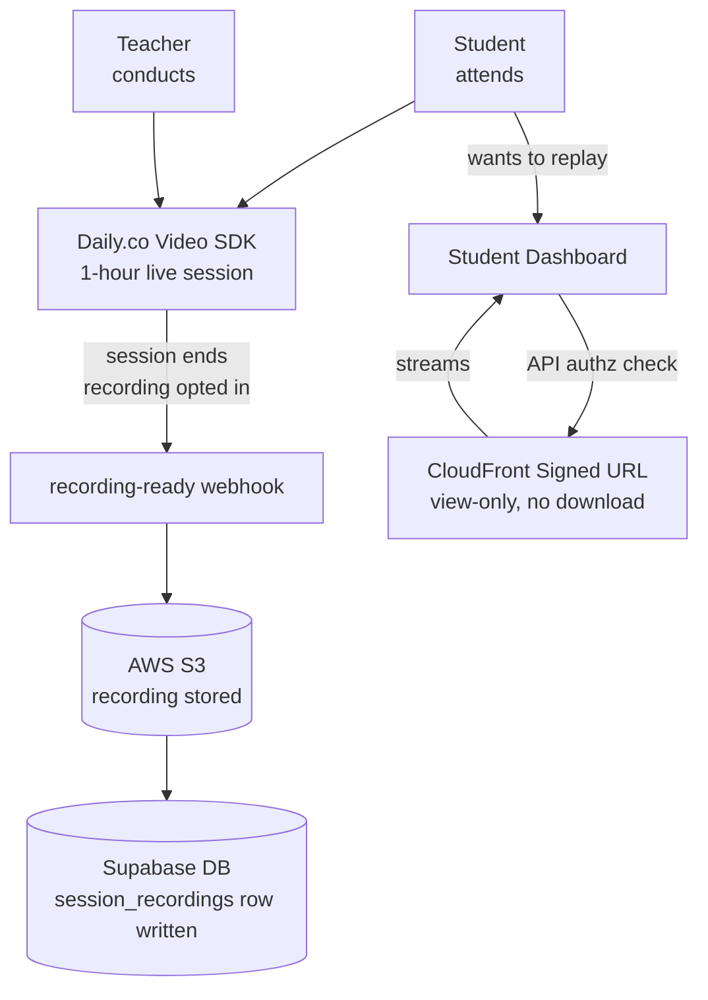
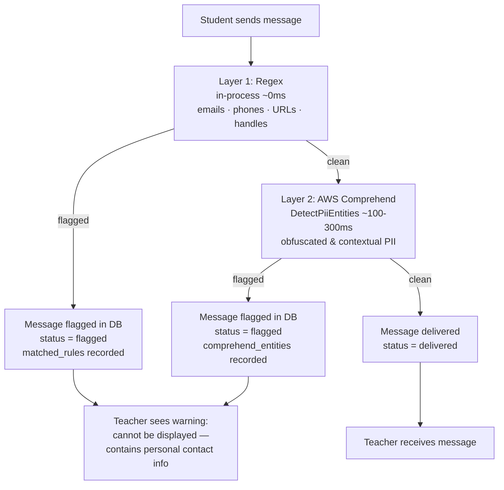

# Nisbah Learning — System Design Document

## 1. Overview

Nisbah Learning is a **web-only** two-sided marketplace connecting students with Islamic teachers for paid one-on-one lessons (Quran, Hadith, Arabic, Fiqh, Usul, Aqidah). Students discover teachers, sign up a contract, and attend sessions. Teachers list themselves, run sessions. Admins resolve vetting edge cases, flagged messages, and disputes.

## 2. Requirements

### 2.1 Functional Requirements

- **Auth & roles.** Email+password and Google OAuth, identical flow for both roles; role (`student` | `teacher`) chosen at signup. Admin is an internal role.
- **Teacher profile (public to signed-in users).** Photo (≤5 MB, optional), name, hourly rate, subjects, certifications (optional), ijaza (optional), experience (optional), 1–2 min intro video, languages, availability (own timezone, displayed converted), ratings/reviews, expected reply time, completion badges. (Sessions are a fixed 1 hour — see Contract negotiation.)

- **Student profile (private).** Photo (≤5 MB, optional), name, prior studies (optional, if any) — visible only to a teacher in an active contract with that student.

- **Search & filters.** Subject, price band, rating floor, language, timezone (UTC−11..+13), availability day or Open Availability, gender.

- **Contract negotiation.** Student requests a teacher → teacher proposes a plan (subject, session duration, total price) → student approves or requests changes (loop) → on approval **and** first-charge clearing, the contract is `active`. **Every session is a fixed 1 hour.** Terms: 4–100 sessions total.

- **Contract payments.** All charges are in **USD** (business is registered in Canada; USD is the marketplace standard). At approval the student picks one of **two payment options**: (a) **pay the full amount upfront** in a single charge, or (b) **pay in monthly anniversary slices** = `total_amount_cents ÷ (total_sessions ÷ sessions_per_week ÷ 4)`, one charge per contract anniversary.
A **1-month / 4-session contract is full-payment only** (there is nothing to slice).
**Revenue comes entirely from commission on teacher payouts.** 
The first charge (full amount, or first slice) is taken at approval; the contract activates only when it clears. For sliced contracts, **the anniversary day clamps to the last available day of a shorter month** (e.g. start Jan 29 → next charge Feb 28; start Mar 31 → next charge Apr 30; the original day resumes the next month it exists). **No cap on the number of concurrent active contracts a student may hold.** Pause, refund, no-show, and cancellation billing rules are specified in [Section 2.3](#23-contract-lifecycle).

- **Teacher payouts.** Paid **monthly on the 28th**, for sessions actually delivered, minus a **flat 30 % commission**. Each teacher's accrued, pending, and paid **earnings are shown in the UI**. A teacher who wants their money before the 28th can trigger an **instant payout**; doing so deducts a **Stripe fee (3.7 % + \$0.30)** *on top of* the 30 % commission. Which sessions count as payable (no-shows, make-ups, pauses, cancellations) is governed by [Section 2.3](#23-contract-lifecycle). The platform also tracks each teacher's cumulative delivered hours in `teacher_profiles.delivered_hours` so a seniority-based commission tier can be enabled later without backfilling history (see [Section 8](#8-future-considerations)); at launch the counter has no payout effect.

- **In-app messaging.** All student↔teacher conversation is in-app; **every message is screened for contact-info / PII by a two-layer filter before delivery, strictly and uniformly — regardless of contract state**: (1) an in-process **regex** pass (fast, zero-cost, covers emails/phones/URLs/social handles) followed by (2) **AWS Comprehend `DetectPiiEntities`** (NLP-based, catches obfuscated and contextual contact info the regex misses).
Either layer flagging withholds the message. A flagged message is **not delivered**: the recipient sees a warning placeholder stating the message can't be displayed. **There are no account bans or penalties.** **Every message (clean and flagged) is stored in Postgres** as a labelled corpus for future ML training (see [Section 8](#8-future-considerations)).
Off-platform contact stays disallowed for the lifetime of the relationship. The added Comprehend latency (~100–300 ms per message) is accepted — users leaving the platform is the highest-priority risk.

- **Materials.** Teachers upload books/PDFs; students **view them in-app only — no download** — while the contract is active.

- **Sessions, timezones, rescheduling.** Sessions are a **fixed 1 hour**. Times stored in UTC, displayed in viewer-local time with the teacher's original local time in brackets (`Mon 3:00 PM EST (originally 8:00 PM PKT)`). Students may request out-of-availability times; teacher accepts or counters. Cancel/reschedule requires ≥24 h notice; rescheduled into the same or following week or before the contract end time.

- **Hours tracking.** Every delivered 1-hour session is tracked so the platform can (a) confirm the contracted number of sessions is completed within each contract and (b) accumulate `teacher_profiles.delivered_hours` for future teacher-time milestones (see [Section 8](#8-future-considerations)).

- **Recordings.** Recording is **opt-in per contract**, **default off**. Either participant can toggle `recording_enabled` from the contract view between sessions; the state at session start time is the state used for that session. When **on**, the session is recorded by **Daily.co's cloud recording** (`enable_recording: true` on the room); on session end the recording-ready webhook lands the file in **our S3** and writes a metadata row, and the recording is offered **view-only via a CloudFront signed URL** (no download). When **off**, recording is disabled at the room level — nothing is captured and no recording cost is incurred. For sessions that *were* recorded: recordings are available to students **for the lifetime of the contract**, locked (not deleted) while a contract is `paused`, and purged on `completed`/`cancelled`. The setting is visible on the contract page and in the pre-session lobby so both parties always know whether the upcoming session will be recorded.

- **Transactional email.** Three business triggers, all sent through **Resend** as the single provider: (1) **contract established** → email to the student with the contract details **and** the amount charged / to be charged; (2) **teacher payout sent** (via Stripe) → email to the teacher; (3) **a student approaches a teacher for a contract** → email to the teacher. Supabase Auth additionally delivers its own auth emails (verification, password reset, magic link) via Resend SMTP, so every outbound email shares one domain, one set of DKIM/SPF/DMARC records, and one set of delivery logs.

### 2.2 Non-Functional Requirements

- **Scale.** **300 total users = 200 students + 100 teachers**; ~**200 one-on-one video-hours/month**. Single VM is sufficient; no horizontal scaling required.

- **Durability & consistency.** Contracts and payments require full **ACID** — handled via Postgres transactions and Stripe as the system of record for money; payment state changes are idempotent against Stripe webhook IDs.

- **Recordings retention.** Recording media held in S3 Standard with a metadata row in Postgres for the contract lifetime; both purged when the contract reaches `completed` or `cancelled`. Footprint is bounded by purge-on-terminal (no indefinite media accumulation).

- **Availability.** Best-effort single-VM (~99% — SPOF accepted at this stage). RTO of minutes-to-hours via daily VM image rebuild; **RPO for business data is effectively zero** because all durable state lives in Supabase / S3 / Stripe, not on the VM.

- **Security.** TLS at Nginx; private media (contract PDFs, student photos, session recordings) served only via short-lived **CloudFront signed URLs** minted after an authz check, buckets locked down with Origin Access Control; **materials and recordings are view-only / non-downloadable** (signed URLs delivered with inline content-disposition into an in-app viewer/player that disables download); recording-metadata and student-profile access enforced by Supabase Row-Level Security; secrets in environment, not image.

- **Observability.** At this scale there is **nothing dedicated to build for observability** — the platform relies on the host/managed-service default logs (Supabase, Stripe dashboard, the VM's container logs). A purpose-built observability stack is unjustified at 300 users.

### 2.3 Contract Lifecycle

The full lifecycle of a contract, from discovery to a terminal state. This section is authoritative for billing, pause, no-show, and cancellation behavior; the Section-2.1 payment and payout bullets defer their edge-case rules here.

**States (`contracts.status`):**

```
ACCEPTED → ACTIVE → (PAUSED ⇄ ACTIVE) → COMPLETED | CANCELLED
```

A request/proposal is **not** a committed contract row — during negotiation it lives in the teacher's inbox. The contract is persisted **only when the student accepts** (as `ACCEPTED`). If the student declines, nothing is saved.

**Happy path:**

1. **Browse.** The student finds a teacher.
2. **Request.** The student sends a request, choosing a slot from the teacher's stated availability. *Edge case:* if no listed slot works, the student requests a custom time via the teacher's **Open Availability**.
3. **Propose.** The teacher reviews the student profile and proposes a study plan — **1-hour sessions**, **minimum 4 sessions**. The teacher may **reject** with no justification required (optional to give one).
4. **Student decision.** **Accept** → contract written as `ACCEPTED' in contract_status column and 'PENDING` in payments table. Student redirected to the payments page · **Request modification** → teacher modifies (loop) or declines · **Decline** → nothing persisted.
5. **Pay.** One of two options: **full upfront** (single charge of `total_amount_cents`), or **slices** (`slice_amount_cents = total_amount_cents ÷ (total_sessions ÷ sessions_per_week ÷ 4)`; one charge per monthly anniversary, first slice now). A 4-session contract is upfront-only.
6. **Activate.** On payment cleared → `ACTIVE` on contract status column and 'COMPELETED' in payments table. The status flips to `ACTIVE` **only after** payment succeeds (atomicity — the redirect latency is acceptable). If payment is not completed within **24 h**, contract auto-voids and is dropped; the student can start a new contract anytime.
7. **Schedule.** The student books **all sessions upfront**, and may later **reschedule in the UI** (the ≥24 h-notice rule applies). **Rescheduling never changes payment.**
8. **Deliver.** Sessions run over the term; every delivered 1-hour session is tracked (hours tracking).
9. **Completion (time-based).** Driven by the same tracked-time variable used for teacher hours. When the contract's full contracted time is consumed, **5 minutes after the last session ends** both parties get an **Extend / Complete** prompt that stays open for **5 minutes**. If **Extend** is not chosen within that window, the contract auto-sets to `COMPLETED`. **Extend** adds more sessions at the **same per-session rate**, paid immediately via the same payment option; an extension must itself be **4–100 sessions** (same contract limits apply). After completion, any further extension requires a **new contract**.
10. **Terminal cleanup (on `COMPLETED`).** Recurring charges stop; **recordings are purged**; the **student's access to materials is revoked**; the **teacher's uploaded textbook is retained in S3 Standard** (teacher-only access afterward).

**Request expiry (pre-acceptance).** A request sits in the teacher's inbox for **7 days**: email on receipt, then reminders at **day 3**, **day 5**, and **day 7**. If still not actioned by **midnight in the teacher's local timezone** after the day-7 email, the request **expires** and the student is notified. The student may re-request **any number of times**.

**No-show (contract `ACTIVE`, not paused):**

- **Both present** → student charged, teacher paid (normal).
- **Teacher absent, student present** → the teacher may run a **make-up class before the term ends**, in which case the teacher **is paid** for that session. If **no make-up** is run, the session is **refunded to the student** — the teacher is not paid and the platform keeps nothing.
- **Student absent, teacher present** → the student **is charged** and the teacher **is paid**.
- **Both absent** → the charge is **absorbed by the platform** (student charged, platform keeps it, teacher not paid), **unless** the student has an **admin-accepted legitimate reason**, in which case it is **refunded**.

**Pause (`PAUSED`):**

- **Either party** can pause **unilaterally**; a reason is encouraged but not mandatory.
- **While paused, everything is locked except messaging** (video, recordings, and materials are all locked).
- **Billing — two sub-cases.** *Pause with refund requested:* remaining (future) months are **refunded**; for the current month, attended (chargeable) sessions are charged and unattended sessions are not. *Pause without refund:* no money moves; the current month's attended sessions are charged and the remaining current-month + upcoming sessions are not — for an upfront-paid contract, the unused prepaid portion is **held as credit** until resume.
- **"Attended"** means sessions that are **chargeable** under the no-show rules above (delivered sessions + student no-shows; teacher no-shows without a make-up are refunded, so excluded).
- **Maximum pause duration is 6 months.** If a contract stays paused for 6 months with no resume, it is **auto-cancelled** with an email to both parties; any unused prepaid credit is **refunded**.
- **On resume,** the resumed month is billed and the schedule continues; because rescheduling never changes payment, **billing continues on the original contract cadence set at contract start**.
- Teacher payout remains on the **28th** for delivered sessions throughout.

**Cancellation (`CANCELLED`).** The reference point for the 24-hour window is **24 h before the contract's start time** (first session):

- **Pre-start (>24 h before start):** **full refund minus the Stripe cut.**
- **Student-initiated, mid-contract:** charged for **attended sessions only**; the remainder is refunded.
- **Teacher-initiated, mid-contract:** charged for **attended sessions only**; the remainder is refunded.

On cancellation the same terminal cleanup as completion applies (recordings purged, student access revoked, teacher textbook retained).

## 3. Architecture

The system is a **modular monolith** (Node.js + TypeScript) on a single **Hetzner VPS** behind **Cloudflare** (reverse proxy, edge caching, DDoS protection) and Nginx, leaning on managed services. This section details each component on its own, then shows how they connect.

### 3.1 Components

**1. Frontend — React + TypeScript SPA.** A single-page app built and served as static assets by Nginx, which also terminates TLS and reverse-proxies `/api` to the Node backend. All user interaction (discovery, contract negotiation, messaging, the in-app PDF viewer, the video/recording screens, the teacher earnings view) lives here. It holds a Supabase-issued JWT and sends it on every API call.

**2. Auth module.** Delegates identity to **Supabase Auth** (email/password + Google OAuth). The backend verifies the Supabase JWT and maps it to a `users` row and a role: **admin** (internal dashboard), **student**, or **teacher**. Role is chosen at signup; admin is internal-only. Student-profile rows are protected by Supabase Row-Level Security.

**3. Contract module.** Owns the `INITIATED → PROPOSED → REVISION → ACCEPTED → ACTIVE` state machine and the contract's `payment_options`. Approval and first-charge clearing are committed together so a contract is never `active` without cleared payment. On establishment it triggers the contract-established email; on a new student request it triggers the teacher-notification email.

**4. Payment module.** Wraps **Stripe Billing** (full-upfront charge, or monthly anniversary slices) and **Stripe Connect** (monthly teacher payouts on the 28th, flat 30 % commission, plus an optional instant payout that deducts a Stripe fee of 3.7 % + $0.30). Stripe is the source of truth for money; webhooks (received through Nginx) drive local payment state idempotently against Stripe event IDs. Teacher earnings (accrued / pending / paid) are read back to the UI. `delivered_hours` is tracked for a future seniority tier ([Section 8](#8-future-considerations)) but unused at launch.

**5. PII-moderation messaging.** The only text channel between student and teacher. Every message passes through a **two-layer PII filter** before delivery, strictly and uniformly regardless of contract state:

- **Layer 1 — Regex (in-process, ~0 ms).** Catches emails, phone numbers (incl. spelled-out), URLs, social/IM handles, and common app names. If Layer 1 fires, Layer 2 is skipped (short-circuit — no unnecessary latency or cost on obvious violations).
- **Layer 2 — AWS Comprehend `DetectPiiEntities` (~100–300 ms, synchronous).** NLP-based detection for obfuscated or contextual contact info that regex misses (e.g. a name + neighbourhood combination, or a "spelled out" number that evades a regex). Runs only when Layer 1 does not flag the message.

Either layer flagging withholds the message. A flagged message is **not delivered** — the recipient sees a warning placeholder — and there are **no account bans**. The Comprehend latency is accepted: users leaving the platform is the highest-priority risk, and false positives (an occasional over-flagged message) are preferable to false negatives (off-platform contact). **Every message (clean and flagged), with its match metadata and Comprehend entity types, is stored in Postgres** as a training corpus for a future classifier ([Section 8](#8-future-considerations)). Daily's native in-call chat is disabled so no text routes around this filter.

**6. Materials — AWS S3 + CloudFront.** Binary files — profile photos, 1–2 min intro videos, and textbooks/PDFs — live in a single **S3 Standard** bucket; Postgres holds only the object key, never the bytes. **CloudFront** fronts everything. Private assets (contract PDFs, student photos) are served via short-lived **CloudFront signed URLs** the API mints *after* an authz check; public assets (profile photo, intro video) via a public distribution. **All materials are view-only — no download** (signed URLs are delivered inline into an in-app viewer with download disabled). S3 lifecycle / IA tiering / multi-bucket splits are deferred ([Section 8](#8-future-considerations)).

**7. Daily.co video SDK.** Live 1:1 sessions (video/audio + screen sharing), fixed 1 hour. **Daily's in-call text chat is disabled** (`enable_chat: false`) on every room; **cloud recording is set conditionally** from `contracts.recording_enabled` (`enable_recording` true only when the contract has opted in).

**8. Daily.co cloud recording.** Recording is **opt-in per contract** (default off). When the contract's `recording_enabled` toggle is on, the room is created with `enable_recording: true`; on session end Daily fires a recording-ready webhook and the backend stores the recording file in **S3** and writes a `session_recordings` metadata row keyed by the session id. Recordings stay **within the platform** (S3 media + RLS-gated metadata in Postgres), are playable **view-only via signed URL** for as long as the contract is up, and are purged on contract `completed`/`cancelled`. When off, nothing is recorded and no recording cost is incurred.

**Supporting services.**

- **Resend (email, external).** Sends the three transactional emails — contract established, teacher payout sent, student-approaches-teacher — triggered by the Contract and Payment modules. Supabase Auth also ships its auth mails (verification / reset / magic link) via Resend SMTP, so all email shares one domain and one set of DKIM/SPF/DMARC records and logs.
- **In-process scheduler (internal).** A single-instance scheduler (no distributed locking needed) runs the time-based jobs: triggering due Stripe charges on contract anniversaries for sliced contracts, the **monthly payout batch on the 28th**, incrementing `delivered_hours` when a session transitions to `delivered`, and the recording purge when a contract reaches a terminal state. For anniversary billing, the scheduler computes the charge date as `EXTRACT(DAY FROM start_at)` clamped to the last available day of the target month (e.g. start Jan 31 → charge Feb 28; original day resumes next month it exists) — no DOM column stored.

### 3.2 System Flows

#### Flow 1 — Authentication & Role Routing



#### Flow 2 — Student → Contract Happy Path



#### Flow 3 — Session Delivery & Recording



#### Flow 4 — In-app Messaging & PII Moderation



### 3.3 Storage

Bytes in S3, only the key in Postgres. **All media sits in one S3 Standard bucket** at launch (lifecycle/IA tiering deferred — [Section 8](#8-future-considerations)); CloudFront fronts everything (cache + lower latency for a timezone-spread user base). **Nothing is downloadable — all assets are view-only.**

| Asset | S3 class | CloudFront | Access |
|---|---|---|---|
| Profile photo | Standard | Public dist. | Any signed-in user · view-only |
| Intro video (1–2 min) | Standard | Public dist. | Public on profile · view-only |
| Books / PDFs | Standard | Signed URLs | Private; contract-gated · view-only, no download |

Private buckets are reachable only through CloudFront via **Origin Access Control**; the API mints a short-lived **CloudFront signed URL** after the authz check (no public object URLs ever leave the server), delivered inline to an in-app viewer/player that disables download. Recordings live in S3 as media (played back view-only via the same signed-URL path); their metadata rows are protected by RLS on the `session_recordings` table.

## 4. API Design

REST over HTTPS, JSON, Supabase JWT in `Authorization`. All endpoints are prefixed with `/api`.

### 4.1 Auth

| Method & Path | Request (key fields) | Response (key fields) | Status |
|---|---|---|---|
| `POST /api/auth/signup` | `email`, `password` \| OAuth token, `role` | `user_id`, `role` | 201 / 409 |
| `POST /api/auth/login` | `email`, `password` \| OAuth token | `user_id`, `role` | 200 / 401 |
| `POST /api/auth/logout` | — | — | 200 |

Token refresh, session persistence, and Google OAuth redirect are handled automatically by Supabase Auth.

### 4.2 Teacher Discovery

| Method & Path | Request (key fields) | Response (key fields) | Status |
|---|---|---|---|
| `GET /api/teachers` | filters: `subject`, `price_band`, `rating_min`, `language`, `tz`, `day`\|`open`, `gender` | `teachers[]` (profile + availability in viewer tz w/ original) | 200 |
| `GET /api/teachers/{teacher_id}` | — | full profile incl. availability, ratings, reviews | 200 / 404 |
| `PATCH /api/teachers/{teacher_id}/profile` | updatable profile fields | updated profile | 200 / 403 |

### 4.3 Student Profile

| Method & Path | Request (key fields) | Response (key fields) | Status |
|---|---|---|---|
| `GET /api/students/{student_id}/profile` | — (authz: owner or teacher with active contract) | `name`, `prior_subjects[]` | 200 / 403 |
| `PATCH /api/students/{student_id}/profile` | `name?`, `prior_subjects[]?` | updated profile | 200 / 403 |

### 4.4 Contract Negotiation

| Method & Path | Request (key fields) | Response (key fields) | Status |
|---|---|---|---|
| `POST /api/contracts` | `teacher_id`, `subject`, `time_slot` \| `open_availability` | `contract_id`, `status=INITIATED` | 201 |
| `GET /api/contracts` | `?student_id=` \| `?teacher_id=` | `contracts[]` with status | 200 |
| `GET /api/contracts/{contract_id}` | — | full contract detail + revision history | 200 / 404 |
| `POST /api/contracts/{contract_id}/plan` | `subject`, `total_sessions`, `sessions_per_week`, `total_amount_cents` | `revision_id`, `status=PROPOSED` | 201 |

| `POST /api/contracts/{contract_id}/revise` | `reason?` (PII filtered) | `revision_id`, `status=REVISION` | 200 |
| `POST /api/contracts/{contract_id}/decline` | `reason?` (PII filtered) | `status=declined` | 200 |

`reason?` on `revise` and `decline` is optional free text, run through the same two-layer PII filter as messages, and stored as a system-tagged entry in the `messages` table (not delivered to the recipient if flagged).

### 4.5 Payments

| Method & Path | Request (key fields) | Response (key fields) | Status |
|---|---|---|---|
| `POST /api/contracts/{contract_id}/approve` | (Student-side) `payment_options` (`FULL` \| `INSTALLMENTS`) | `payment_url` (Stripe redirect) | 202 / 402 |
| `GET /api/payments/{contract_id}` | (Student-side) — | `status` (`pending`\|`cleared`\|`failed`\|`refunded`) | 200 |
| `POST /api/payout/instant` | (Teacher-side) — | `transfer_id`, `fee_cents` (Stripe 3.7%+\$0.30) | 200 / 402 |

`approve` returns `202` — contract activation is async, confirmed by the Stripe webhook. Both `FULL` and `INSTALLMENTS` use the same endpoint; the backend sets up the correct Stripe flow based on `payment_options`.

### 4.6 Messaging

| Method & Path | Request (key fields) | Response (key fields) | Status |
|---|---|---|---|
| `POST /api/contracts/{contract_id}/messages` | `body` | `message_id`, `status=delivered`\|`flagged` | 201 |
| `GET /api/contracts/{contract_id}/messages` | — | `messages[]` (flagged messages shown as warning placeholder to recipient) | 200 |

Every message passes the two-layer PII filter (regex → AWS Comprehend) before delivery. Flagged messages are stored but not delivered — the recipient sees a warning placeholder. All messages (clean and flagged) are retained as a labelled ML corpus.

### 4.7 Sessions

| Method & Path | Request (key fields) | Response (key fields) | Status |
|---|---|---|---|
| `POST /api/contracts/{contract_id}/sessions` | session slots | `sessions[]` with `session_id` | 201 |
| `GET /api/contracts/{contract_id}/sessions` | — | `sessions[]` with status | 200 |
| `PATCH /api/sessions/{session_id}/reschedule` | `new_slot` | `session_id`, `status=rescheduled` | 200 / 400 |
| `PATCH /api/sessions/{session_id}/cancel` | `reason?` | `status=cancelled` | 200 / 400 |

Reschedule and cancel enforce the ≥24 h notice rule. Session status (`delivered`) is set internally by the scheduler on session end — not exposed as a public endpoint.

### 4.8 Recordings

| Method & Path | Request (key fields) | Response (key fields) | Status |
|---|---|---|---|
| `PATCH /api/contracts/{contract_id}/recording` | `recording_enabled` (bool) | updated `recording_enabled` state | 200 |
| `GET /api/sessions/{session_id}/recording` | — (authz: student in contract only) | `signed_url` (CloudFront, view-only), `expires_in` | 200 / 403 |

The signed URL hides the S3 object key from the client entirely. Recording is opt-in per contract (default off); state at session start time applies.

### 4.9 Materials

| Method & Path | Request (key fields) | Response (key fields) | Status |
|---|---|---|---|
| `POST /api/contracts/{contract_id}/materials` | `file` (PDF/book) | `material_id` | 201 |
| `GET /api/contracts/{contract_id}/materials` | — | `materials[]` with `material_id` | 200 |
| `GET /api/materials/{material_id}` | — (authz: active contract participants) | `signed_url` (CloudFront, view-only), `expires_in` | 200 / 403 |
| `DELETE /api/materials/{material_id}` | — (authz: teacher owner) | — | 200 / 403 |

Access is gated by an authz check at request time — no separate purge endpoint needed. Teacher retains file access after contract ends; student access is revoked automatically.

### 4.10 Dashboards

| Method & Path | Request (key fields) | Response (key fields) | Status |
|---|---|---|---|
| `GET /api/teacher-dashboard/{teacher_id}` | — | active contracts, upcoming + completed sessions, `delivered_hours`, earnings (`accrued`, `pending`, `paid`, `next_payout_at`), ratings, reviews | 200 / 403 |
| `GET /api/student-dashboard/{student_id}` | — | active contracts, upcoming sessions | 200 / 403 |

### 4.11 Webhooks

| Method & Path | Request (key fields) | Response (key fields) | Status |
|---|---|---|---|
| `POST /api/webhooks/stripe` | Stripe event (signature-verified) | `received` | 200 |
| `POST /api/webhooks/daily` | Daily.co recording-ready event (signature-verified) | `received` | 200 |

Both are internal — not called by the frontend. Stripe webhook drives payment/payout state idempotently against Stripe event IDs. Daily webhook fires only when `recording_enabled = true`; stores recording to S3 and writes a `session_recordings` metadata row.

## 5. Data Model

Postgres (Supabase). Money stored in **integer minor units** (cents); all timestamps **UTC `timestamptz`**; teacher availability also stores the teacher's IANA timezone for the "(originally …)" display. Student-profile rows protected by **RLS**: readable only by the owner and by a teacher joined through an `active` contract.

Key tables (selected columns).

**`users`**

| Column | Type | Notes |
|---|---|---|
| `id` | uuid PK | |
| `email` | text | unique |
| `role` | enum | `student` \| `teacher` \| `admin` |
| `auth_provider` | text | email \| google |
| `created_at` | timestamptz | |

**`teacher_profiles`**

| Column | Type | Notes |
|---|---|---|
| `user_id` | uuid PK/FK → users | |
| `photo_key?` | text | S3 object key |
| `hourly_rate_cents` | int | USD |
| `subjects[]` | text[] | GIN index |
| `certifications[]?` | text[] | optional; "Degree" tag shown in UI if present |
| `ijaza[]?` | text[] | optional; "Ijaza" tag shown in UI if present |
| `experience[]?` | text[] | optional; years shown in UI |
| `intro_video_key` | text | S3 object key |
| `languages[]` | text[] | GIN index |
| `expected_reply_minutes` | int | |
| `delivered_hours` | int, default 0 | used at launch; starts 0, incremented per delivered session — kept for the future seniority tier ([Section 8](#8-future-considerations)) |

**`student_profiles`** — RLS-restricted (owner + teacher in an active contract)

| Column | Type | Notes |
|---|---|---|
| `user_id` | uuid PK/FK → users | |
| `photo_key?` | text | S3 object key |
| `name` | text | |
| `prior_subjects[]?` | text[] | optional; values: Aqidah, Usul, Quran, Fiqh, Arabic, Hadith |

**`availability`**

| Column | Type | Notes |
|---|---|---|
| `teacher_id` | uuid FK | |
| `weekday` | int | 0–6 |
| `start_utc` / `end_utc` | time | |
| `teacher_tz` | text | IANA, for "(originally …)" display |
| `open_availability` | bool | |

**`contracts`**

| Column | Type | Notes |
|---|---|---|
| `id` | uuid PK | |
| `student_id` / `teacher_id` | uuid FK | indexed |
| `subject` | text | |
| `total_sessions` | int | 4–100; enforced at API layer on contract proposal |
| `sessions_per_week` | int | each session fixed 1 h; ≥4 sessions total |
| `total_amount_cents` | int | USD; full contract value |
| `payment_options` | enum | `FULL` \| `INSTALLMENTS` (`INSTALLMENTS` = monthly anniversary slices; 4-session contracts are `FULL` only) |
| `status` | enum | `INITIATED\|PROPOSED\|REVISION\|ACCEPTED\|ACTIVE\|PAUSED\|DECLINED\|CANCELLED\|COMPLETED`. `INITIATED` = student sent request, awaiting teacher; `PROPOSED` = teacher created/updated study plan, awaiting student; `REVISION` = student requested a change, awaiting teacher; `ACCEPTED` = student accepted plan, payment pending; `ACTIVE` = payment cleared; `DECLINED` = rejected pre-acceptance (terminal); `CANCELLED` = terminated post-`ACTIVE` (terminal) |
| `start_at` | timestamptz | |
| ~~`contract_anniversary_dom`~~ | — | dropped; scheduler derives DOM from `start_at` at runtime: `day = EXTRACT(DAY FROM start_at)`, clamped to last day of the target month if needed |
| `paused_at?` | timestamptz | |
| `recording_enabled` | bool, default false | toggles Daily cloud recording; state at session start applies |

Index: `(status)`, `(teacher_id)`, `(student_id)`.

**`contract_plan_revisions`** — negotiation history

| Column | Type | Notes |
|---|---|---|
| `contract_id` | uuid FK | |
| `proposed_by` | uuid FK → users | |
| terms snapshot | jsonb | subject, total_sessions, sessions_per_week, total_amount_cents |
| `created_at` | timestamptz | |

**`payments`**

| Column | Type | Notes |
|---|---|---|
| `id` | uuid PK | |
| `contract_id` | uuid FK | |
| `slice_amount_cents` | int | amount charged for this payment row; equals `total_amount_cents` for upfront, fraction for installment slices |
| `payment_status` | enum | `PENDING\|DONE\|FAILED\|REFUNDED` |
| `stripe_payment_intent_id` | text | unique — webhook idempotency key |
| `stripe_invoice_id?` | text | set for installment slices; Stripe Invoice ID |

**`payout_batches`** — monthly, paid on the 28th

| Column | Type | Notes |
|---|---|---|
| `id` | uuid PK | |
| `teacher_id` | uuid FK | |
| `period_start` / `period_end` | date | calendar month |
| `gross_cents` | int | delivered-session earnings |
| `commission_bps` | int | bps = basis points; 1 bps = 0.01%, so 3000 = 30%. Always 3000 at launch (future tier — [Section 8](#8-future-considerations)) |
| `commission_cents` | int | |
| `payout_type` | enum | `scheduled` (28th, free) \| `instant` (on-demand) |
| `instant_fee_cents` | int, default 0 | Stripe 3.7%+\$0.30 when `instant` |
| `net_profit_cents` | int | gross − commission − instant fee |
| `stripe_transfer_id` | text | |
| `status` | enum | `PENDING\|PROCESSING\|PAID\|FAILED`. `PENDING` = batch opened, awaiting 28th; `PROCESSING` = Stripe transfer initiated; `PAID` = transfer confirmed; `FAILED` = Stripe rejected |

**`sessions`**

| Column | Type | Notes |
|---|---|---|
| `id` | uuid PK | |
| `contract_id` | uuid FK | |
| `scheduled_start_utc` / `scheduled_end_utc` | timestamptz | fixed 1 h apart |
| `status` | enum | `SCHEDULED\|DELIVERED\|CANCELLED\|RESCHEDULED` |
| `delivered_at?` | timestamptz | drives hours tracking |
| `payout_batch_id?` | uuid FK | |

**`session_recordings`** — RLS-gated to participants; media in S3, purged on contract terminal state

| Column | Type | Notes |
|---|---|---|
| `session_id` | uuid PK/FK → sessions | |
| `s3_key` | text | object key for the recording media (bytes never in Postgres) |
| `duration_sec` | int | recorded length |
| `size_bytes` | bigint | media size; drives storage/egress |
| `status` | enum | `PROCESSING\|READY\|FAILED` |
| `created_at` | timestamptz | |

**`messages`** — all rows retained as ML corpus

| Column | Type | Notes |
|---|---|---|
| `id` | uuid PK | |
| `contract_id` / `sender_id` | uuid FK | |
| `body` | text | stored even when flagged |
| `status` | enum | `DELIVERED` \| `FLAGGED` (flagged → warning placeholder to recipient) |
| `matched_rules[]?` | text[] | which regex patterns fired (Layer 1) |
| `comprehend_entities[]?` | text[] | entity types detected by AWS Comprehend (Layer 2; null when Layer 1 short-circuited) |
| `filter_layer` | enum | `none` \| `regex` \| `comprehend` — which layer flagged the message |
| `created_at` | timestamptz | |

No sharding/partitioning — a single small Postgres instance is far within capacity at this scale.

## 6. Trade-offs & Alternatives

- **Modular monolith on one Hetzner VPS → vs microservices.** *Why:* product-market validation stage — one deployable, two Docker containers (frontend + backend) behind Nginx. Vertical scaling is the intended next step; the domain has no independent-scaling or fault-isolation requirements that would justify microservices. *Gave up:* SPOF — accepted because all durable state is in Supabase / S3 / Stripe and recovery is a daily-image rebuild.

- **Postgres (Supabase-managed) → vs a NoSQL store or self-hosted Postgres.** *Why:* (a) **ACID** — contracts and payments are fully structured; a partial write or lost payment row is unacceptable; (b) **Supabase** — managed DB + built-in auth provider (email/password, Google OAuth, JWT, RLS) removes an entire ops surface. *Gave up:* some vendor control — mitigated since the underlying data is standard, portable Postgres.

- **All media (photos, PDFs, intro videos, recordings) in S3; only the object key in Postgres → per-type buckets / IA tiering.** *Why:* One Standard bucket keeps operations simple; storage cost is a rounding error at this scale. *Gave up:* marginal savings from IA tiering on cold objects — deferred to [Section 8](#8-future-considerations).

- **Daily.co (video + opt-in cloud recording) → vs self-hosted SFU (or Agora).** *Why:* 1:1 video + screen share + cloud recording + recording-ready webhook is commodity; building and hosting a WebRTC/recording pipeline is disproportionate at this scale. Daily's room flags disable native in-call chat (keeping all text in our moderation pipeline) and conditionally enable cloud recording. *Gave up:* per-minute recording cost (opt-in per contract, so it's a cap not a fixed cost — [Section 7](#7-pricing)), S3 egress on playback, and a soft provider lock-in — bounded because recordings land in our own S3.

- **Two-layer PII filter (regex + AWS Comprehend) → vs regex-only or a custom ML model.** *Why:* off-platform contact is the highest-priority risk. Regex alone misses obfuscated/contextual PII (e.g. spelled-out numbers); Comprehend `DetectPiiEntities` covers these as Layer 2, running only on messages that pass Layer 1 (short-circuit keeps latency and cost low). False negatives are structurally worse than the ~100–300 ms added latency. Cost is ~$1.50/month. *Gave up:* message bodies leave the VM to reach Comprehend — mitigated: it's a managed NER service, not an LLM, so no model training on customer data.

## 7. Pricing

| Component | Unit price | Monthly basis | Monthly cost |
|---|---|---|---|
| Daily.co — video | \$0.0040 / user-min | 14,000 billable user-min (24,000 − 10,000 free) | **\$56.00** |
| Daily.co — cloud recording | \$0.01349 / recording-min ⁴ | ≤12,000 recording-min (opt-in; bills only on enabled sessions) | **≤\$161.88** |
| Supabase — database | \$25 | flat | **\$25.00** |
| AWS CloudFront | ~\$0.085 / GB egress + request fees (pay-as-you-go) | ~120 GB/mo³ (incl. recording playback) | **~\$10.00** |
| AWS S3 (Standard) | \$0.023 / GB-mo | ~150 GB resident¹ (incl. recordings) | **~\$3.50** |
| Hetzner VPS (2 vCPU / 4 GB) | ~€6–8/month | flat | **~\$9.65–\$12.85** |
| Cloudflare | free tier | flat | **\$0** |
| Resend — transactional email | free tier (3,000 emails/mo, 100/day cap²) | ~300–400 emails/mo at this scale | **\$0** |
| PII filtering — regex (Layer 1) | in-process | — | **\$0** |
| PII filtering — AWS Comprehend (Layer 2) | \$0.0001 / unit (min 3 units / call) | ~3,000–5,000 calls/mo (all in-app messages passing Layer 1) | **~\$1.50** |
| **Platform run-rate** | | | **≈ \$107 / month** (no recording opt-in) **to ≈ \$269 / month** (full opt-in) |
| Stripe | 3.7% + \$0.30 / charge | per transaction | *pass-through⁵* |

- **Daily.co — video.** Powers all 1:1 live sessions. 10,000 free participant-minutes/month; beyond that billed per user-minute (both participants count). At 200 session-hours, 14,000 minutes are billable. Scales directly with delivered sessions.
- **Daily.co — cloud recording.** Opt-in per contract (default off) — billed only for sessions where `recording_enabled = true`. The $161.88 ceiling assumes every session is recorded; at launch (default off) cost starts near $0. Confirm rate against Daily's live price list before relying on this figure.
- **Supabase.** Managed Postgres + built-in auth (email/password, Google OAuth, JWT, RLS). Pro plan is flat $25/month — covers the DB, auth, and realtime at this scale.
- **AWS CloudFront.** CDN fronting S3 — serves profile photos, intro videos, PDFs, and recording playback via signed URLs (view-only, no download). Pay-as-you-go; ~$10/month at moderate adoption, lower at launch before recording ramps.
- **AWS S3.** Stores all media (photos, PDFs, intro videos, recordings) — only the object key lives in Postgres. ~$3.50/month for ~150 GB. Footprint bounded by purge-on-terminal (recordings drop at contract `completed`/`cancelled`).
- **Hetzner VPS.** Single 2 vCPU / 4 GB VM running frontend + backend containers behind Nginx. Flat ~$9.65–$12.85/month. SPOF accepted at PMV stage; all durable state is off-VM (Supabase / S3 / Stripe).
- **Cloudflare.** Free tier — reverse proxy, DDoS protection, edge cache for static assets, hides server IP. No cost at this scale.
- **Resend.** Transactional email (contract established, payout sent, teacher approached). Free tier: 3,000 emails/month, **100 emails/day cap**. At ~300–400 emails/month this fits, but the 100/day cap is tight on the 28th (up to 100 payout emails in one batch). Upgrade to Pro ($20/mo) if that becomes an issue.
- **PII regex (Layer 1).** In-process function — runs inside the backend on every message. No external call, no cost.
- **AWS Comprehend (Layer 2).** NLP-based PII detection on all in-app messages that pass the regex. Runs on ~3,000–5,000 messages/month; cost ~$1.50/month. Only called if Layer 1 passes (short-circuit keeps cost low on obvious violations).
- **Stripe.** Pass-through only — 3.7% + $0.30 per student charge; same fee deducted from instant teacher payouts. Not a platform cost.

## 8. Future Considerations

Ordered by priority. Not built at launch — paths are recorded so the current design stays minimal.

1. **LiveKit (self-hosted video + recording).** Replace Daily.co once its per-minute bill exceeds the cost of running LiveKit on a dedicated VM. LiveKit is an open-source WebRTC SFU; cloud recording egresses directly to the same S3 bucket and `session_recordings` table — only the producer changes. The room API is abstracted so the swap is internal. *Trigger:* monthly Daily video bill > LiveKit hosting cost (VM + TURN + bandwidth).

2. **Seniority commission tiers (30% → 27% → 24% → 21% → 18%).** `delivered_hours` already increments on `teacher_profiles` and `payout_batches.commission_bps` is the per-batch rate column — only the tier-selection logic at batch-open time needs wiring. *Trigger:* unit economics confirmed to support the lower rate at the teacher's hourly rate and delivery volume.

3. **Automated teacher verification.** Teachers at launch are simply listed (no badge). The deferred pipeline: document intake (certifications, degree, Ijaza) → automated scoring → admin queue for edge cases → `verified` tick on the teacher's public profile. Adds trust signal for students without reworking the teacher-profile model. *Trigger:* teacher supply large enough that unverified listings create a trust problem.

4. **S3 bucket tiering + lifecycle rules.** All media currently in one S3 Standard bucket. Once volume justifies it: move cold objects (ended-contract PDFs, old intro videos) to Standard-IA or Glacier via lifecycle rules; optionally split public vs private buckets. *Trigger:* S3 storage cost becomes material.

5. **ML recommendation system.** Surface the right teachers for each student based on subject, learning history, session outcomes, and ratings — replacing pure filter-based discovery. Requires sufficient interaction data to train on. *Trigger:* student churn attributable to poor discovery; dataset large enough to train a meaningful model.

6. **AI-based slide / lesson material creation.** In-platform tooling for teachers to generate structured lesson slides or study materials using an LLM. Reduces teacher prep time and adds platform stickiness. *Trigger:* teacher retention data shows prep burden as a drop-off reason.

7. **Self-hosted ML/NLP PII moderation.** Replace or augment AWS Comprehend with a purpose-trained classifier (NER on char+word n-grams) fine-tuned on domain-specific patterns (Islamic names, schools, community venues). Every message + `matched_rules[]` + `comprehend_entities[]` + any admin labels are retained now as the training corpus. Deploy as a same-VM CPU sidecar; no message API change. *Trigger:* Comprehend false-positive rate on domain-specific content proves material, or Comprehend cost exceeds sidecar compute cost.