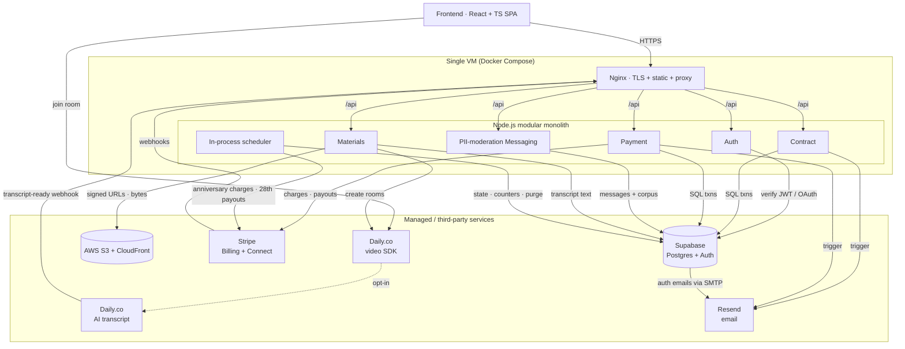
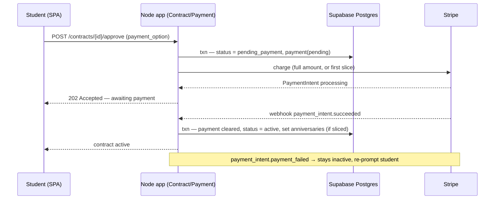
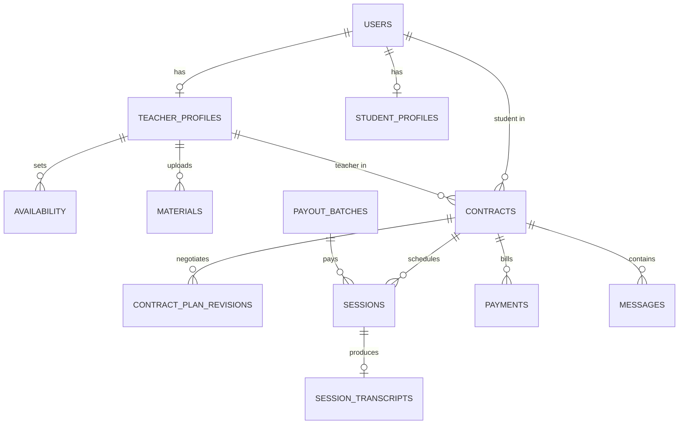

# Nisbah Learning — System Design Document

## 1. Overview

Nisbah Learning is a **web-only** two-sided marketplace connecting students with Islamic teachers for paid one-on-one lessons (Quran, Hadith, Arabic, Fiqh, Usul, Aqidah). Students discover teachers, negotiate a contract, pay on a recurring monthly schedule, attend live video sessions, review AI-generated session transcripts, and read uploaded materials. Teachers list themselves, run sessions, and receive biweekly payouts net of platform commission. Admins resolve vetting edge cases, flagged messages, and disputes.

The system is deliberately sized for **product validation**, not scale: 300 MAU, ~100 video-hours/month. The architecture is a **modular monolith** (Node.js + TypeScript) on a **single VM behind Nginx**, leaning on managed services (Supabase, Stripe, Daily.co for video, AWS S3 + CloudFront) so the team writes business logic, not infrastructure.

**Out of scope:** native mobile apps; the automated vetting *algorithm* (the pipeline boundary and status machine are designed, the scoring logic is TBD); group/multi-party classes; in-house video infrastructure; cloud recording of sessions (replaced by **opt-in AI transcripts**, see [Section 2.1](#21-functional-requirements)). Pricing — **flat 25 % commission; no platform subscription fee; no cap on concurrent contracts per student** — is now fixed ([Section 2.1](#21-functional-requirements)).

## 2. Requirements

### 2.1 Functional Requirements

- **Auth & roles.** Email+password and Google OAuth, identical flow for both roles; role (`student` | `teacher`) chosen at signup. Admin is an internal role.
- **Teacher profile (public to signed-in users).** Photo (≤5 MB, optional), name, hourly rate, subjects, certifications (required), ijaza (required), experience (optional), 1–2 min intro video, languages, availability (own timezone, displayed converted), ratings/reviews, expected reply time, completion badges. (Sessions are a fixed 1 hour — see Contract negotiation.)
- **Student profile (private).** Photo, name, prior studies — visible only to a teacher in an active contract with that student.
- **Search & filters.** Subject, price band, rating floor, language, timezone (UTC−11..+13), availability day or Open Availability, gender.
- **Contract negotiation.** Student requests a teacher → teacher proposes a plan (subject, total months, sessions/week, total price) → student approves or requests changes (loop) → on approval **and** first-charge clearing, the contract is `active`. **Every session is a fixed 1 hour.** Terms: ≥1 month, ≥4 sessions.
- **Contract payments.** All charges are in **USD** (business is registered in Canada; USD is the marketplace standard). At approval the student picks one of **two payment options**: (a) **pay the full amount upfront** in a single charge, or (b) **pay in monthly anniversary slices** = `total_price ÷ length_months`, one charge per contract anniversary. A **1-month / 4-session contract is full-payment only** (there is nothing to slice). **There is no platform subscription fee** — revenue comes entirely from commission on teacher payouts. The first charge (full amount, or first slice) is taken at approval; the contract activates only when it clears. For sliced contracts, **the anniversary day clamps to the last available day of a shorter month** (e.g. start Jan 29 → next charge Feb 28; start Mar 31 → next charge Apr 30; the original day resumes the next month it exists). **No cap on the number of concurrent active contracts a student may hold.** Pause, refund, no-show, and cancellation billing rules are specified in [Section 2.3](#23-contract-lifecycle).
- **Teacher payouts.** Paid **monthly on the 28th**, for sessions actually delivered, minus a **flat 25 % commission**. Each teacher's accrued, pending, and paid **earnings are shown in the UI**. A teacher who wants their money before the 28th can trigger an **instant payout**; doing so deducts a **Stripe fee (3.7 % + \$0.30)** *on top of* the 25 % commission. Which sessions count as payable (no-shows, make-ups, pauses, cancellations) is governed by [Section 2.3](#23-contract-lifecycle). The platform also tracks each teacher's cumulative delivered hours in `teacher_profiles.delivered_hours_total` so a seniority-based commission tier can be enabled later without backfilling history (see [Section 8](#8-future-considerations)); at launch the counter has no payout effect.
- **In-app messaging.** All student↔teacher conversation is in-app; **every message is screened for contact-info / PII by an in-process regex/heuristic filter before delivery, strictly and uniformly — regardless of contract state**. A flagged message is **not delivered**: the recipient sees a warning placeholder stating the message can't be displayed. **There are no account bans or penalties.** **Every message (clean and flagged) is stored in Postgres** as a labelled corpus for future ML training (see [Section 8](#8-future-considerations)). Off-platform contact stays disallowed for the lifetime of the relationship.
- **Materials.** Teachers upload books/PDFs; students **view them in-app only — no download** — while the contract is active.
- **Sessions, timezones, rescheduling.** Sessions are a **fixed 1 hour**. Times stored in UTC, displayed in viewer-local time with the teacher's original local time in brackets (`Mon 3:00 PM EST (originally 8:00 PM PKT)`). Students may request out-of-availability times; teacher accepts or counters. Cancel/reschedule requires ≥24 h notice; rescheduled into the same or following week.
- **Hours tracking.** Every delivered 1-hour session is tracked so the platform can (a) confirm the contracted number of sessions is completed within each contract and (b) accumulate `teacher_profiles.delivered_hours_total` for future teacher-time milestones (see [Section 8](#8-future-considerations)).
- **Transcripts.** Transcription is **opt-in per contract**, **default off**. Either participant can toggle `transcription_enabled` from the contract view between sessions; the state at session start time is the state used for that session. When **on**, the session is transcribed by **Daily.co's built-in AI transcription** (Deepgram-backed, `enable_transcription: true` on the room) and speaker-labelled, timestamped transcripts are produced; when **off**, transcription is disabled at the room level — no audio leaves Daily for Deepgram, no transcript is produced, no transcription cost is incurred. There is no video recording in either mode. For sessions that *were* transcribed: transcripts are stored as text in Postgres, available to both parties **for the lifetime of the contract**, locked (not deleted) while a contract is `paused`, and purged on `completed`/`cancelled`. The setting is visible on the contract page and in the pre-session lobby so both parties always know whether the upcoming session will be transcribed.
- **Transactional email.** Three business triggers, all sent through **Resend** as the single provider: (1) **contract established** → email to the student with the contract details **and** the amount charged / to be charged; (2) **teacher payout sent** (via Stripe) → email to the teacher; (3) **a student approaches a teacher for a contract** → email to the teacher. Supabase Auth additionally delivers its own auth emails (verification, password reset, magic link) via Resend SMTP, so every outbound email shares one domain, one set of DKIM/SPF/DMARC records, and one set of delivery logs.

### 2.2 Non-Functional Requirements

- **Scale.** **300 total users = 200 students + 100 teachers**; ~**200 one-on-one video-hours/month**. Single VM is sufficient; no horizontal scaling required.
- **Durability & consistency.** Contracts and payments require full **ACID** — handled via Postgres transactions and Stripe as the system of record for money; payment state changes are idempotent against Stripe webhook IDs.
- **Transcripts retention.** Transcript text retained in Postgres for the contract lifetime; deleted when the contract reaches `completed` or `cancelled`. No S3 involvement (transcripts are kilobytes of text, not media).
- **Availability.** Best-effort single-VM (~99% — SPOF accepted at this stage). RTO of minutes-to-hours via daily VM image rebuild; **RPO for business data is effectively zero** because all durable state lives in Supabase / S3 / Stripe, not on the VM.
- **Security.** TLS at Nginx; private media (contract PDFs, student photos) served only via short-lived **CloudFront signed URLs** minted after an authz check, buckets locked down with Origin Access Control; **materials are view-only / non-downloadable** (signed URLs delivered with inline content-disposition into an in-app viewer that disables download); transcript and student-profile access enforced by Supabase Row-Level Security; secrets in environment, not image.
- **Observability.** At this scale there is **nothing dedicated to build for observability** — the platform relies on the host/managed-service default logs (Supabase, Stripe dashboard, the VM's container logs). A purpose-built observability stack is unjustified at 300 users.

### 2.3 Contract Lifecycle

The full lifecycle of a contract, from discovery to a terminal state. This section is authoritative for billing, pause, no-show, and cancellation behavior; the §2.1 payment and payout bullets defer their edge-case rules here.

**States (`contracts.status`):**

```
PENDING_PAYMENT → ACTIVE → (PAUSED ⇄ ACTIVE) → COMPLETED | CANCELLED
```

A request/proposal is **not** a committed contract row — during negotiation it lives in the teacher's inbox. The contract is persisted **only when the student accepts** (as `PENDING_PAYMENT`). If the student declines, nothing is saved.

**Happy path:**

1. **Browse.** The student finds a teacher.
2. **Request.** The student sends a request, choosing a slot from the teacher's stated availability. *Edge case:* if no listed slot works, the student requests a custom time via the teacher's **Open Availability**.
3. **Propose.** The teacher reviews the student profile and proposes a study plan — **1-hour sessions**, **minimum 4 sessions**. The teacher may **reject** with no justification required (optional to give one).
4. **Student decision.** **Accept** → contract written as `PENDING_PAYMENT`, student redirected to the payments page · **Request modification** → teacher modifies (loop) or declines · **Decline** → nothing persisted.
5. **Pay.** One of two options: **full upfront** (single charge of `total_price`), or **slices** (`slice = total_price ÷ months`, where `months = total_sessions ÷ 4`; one charge per monthly anniversary, first slice now). A 1-month / 4-session contract is upfront-only.
6. **Activate.** On payment cleared → `ACTIVE`. The status flips to `ACTIVE` **only after** payment succeeds (atomicity — the redirect latency is acceptable). If payment is not completed within **24 h**, the `PENDING_PAYMENT` contract auto-voids and is dropped; the student can start a new contract anytime.
7. **Schedule.** The student books **all sessions upfront**, and may later **reschedule in the UI** (the ≥24 h-notice rule applies). **Rescheduling never changes payment.**
8. **Deliver.** Sessions run over the term; every delivered 1-hour session is tracked (hours tracking).
9. **Completion (time-based).** Driven by the same tracked-time variable used for teacher hours. When the contract's full contracted time is consumed, **5 minutes after the last session ends** both parties get an **Extend / Complete** prompt that stays open for **5 minutes**. If **Extend** is not chosen within that window, the contract auto-sets to `COMPLETED`. **Extend** adds more sessions at the **same per-session rate**, paid immediately via the same payment option; an extension must itself be **≥4 sessions** (the minimum-length rule applies to extensions too). After completion, any further extension requires a **new contract**.
10. **Terminal cleanup (on `COMPLETED`).** Recurring charges stop; **transcripts are purged**; the **student's access to materials is revoked**; the **teacher's uploaded textbook is retained in S3 Standard** (teacher-only access afterward).

**Request expiry (pre-acceptance).** A request sits in the teacher's inbox for **7 days**: email on receipt, then reminders at **day 3**, **day 5**, and **day 7**. If still not actioned by **midnight in the teacher's local timezone** after the day-7 email, the request **expires** and the student is notified. The student may re-request **any number of times**.

**No-show (contract `ACTIVE`, not paused):**

- **Both present** → student charged, teacher paid (normal).
- **Teacher absent, student present** → the teacher may run a **make-up class before the term ends**, in which case the teacher **is paid** for that session. If **no make-up** is run, the session is **refunded to the student minus the Stripe cut** — the teacher is not paid and the platform keeps nothing.
- **Student absent, teacher present** → the student **is charged** and the teacher **is paid**.
- **Both absent** → the charge is **absorbed by the platform** (student charged, platform keeps it, teacher not paid), **unless** the student has an **admin-accepted legitimate reason**, in which case it is **refunded minus the Stripe cut**.

**Pause (`PAUSED`):**

- **Either party** can pause **unilaterally**; a reason is encouraged but not mandatory.
- **While paused, everything is locked except messaging** (video, transcripts, and materials are all locked).
- **Billing — two sub-cases.** *Pause with refund requested:* remaining (future) months are **refunded**; for the current month, attended (chargeable) sessions are charged and unattended sessions are not. *Pause without refund:* no money moves; the current month's attended sessions are charged and the remaining current-month + upcoming sessions are not — for an upfront-paid contract, the unused prepaid portion is **held as credit** until resume.
- **"Attended"** means sessions that are **chargeable** under the no-show rules above (delivered sessions + student no-shows; teacher no-shows without a make-up are refunded, so excluded).
- **Maximum pause duration is 6 months.** If a contract stays paused for 6 months with no resume, it is **auto-cancelled** with an email to both parties; any unused prepaid credit is **refunded minus the Stripe cut**.
- **On resume,** the resumed month is billed and the schedule continues; because rescheduling never changes payment, **billing continues on the original contract cadence set at contract start**.
- Teacher payout remains on the **28th** for delivered sessions throughout.

**Cancellation (`CANCELLED`).** The reference point for the 24-hour window is **24 h before the contract's start time** (first session):

- **Pre-start (>24 h before start):** **full refund minus the Stripe cut.**
- **Student-initiated, mid-contract:** charged for **attended sessions only**; the remainder is refunded **minus the Stripe cut**.
- **Teacher-initiated, mid-contract:** charged for **attended sessions only**; the remainder is refunded **in full** (no Stripe deduction) — **no penalty to the student**.
- **Legitimate reason (admin-approved):** only the **Stripe cut** is deducted and the rest is **fully refunded**. The student contacts the **admin**, who makes the final decision.

On cancellation the same terminal cleanup as completion applies (transcripts purged, student access revoked, teacher textbook retained).

## 3. Architecture

The system is a **modular monolith** (Node.js + TypeScript) on a single VM behind Nginx, leaning on managed services. This section details each component on its own, then shows how they connect.

### 3.1 Components

**1. Frontend — React + TypeScript SPA.** A single-page app built and served as static assets by Nginx, which also terminates TLS and reverse-proxies `/api` to the Node backend. All user interaction (discovery, contract negotiation, messaging, the in-app PDF viewer, the video/transcript screens, the teacher earnings view) lives here. It holds a Supabase-issued JWT and sends it on every API call.

**2. Auth module.** Delegates identity to **Supabase Auth** (email/password + Google OAuth). The backend verifies the Supabase JWT and maps it to a `users` row and a role: **admin** (internal dashboard), **student**, or **teacher**. Role is chosen at signup; admin is internal-only. Student-profile rows are protected by Supabase Row-Level Security.

**3. Contract module.** Owns the request → propose → revise → approve state machine and the contract's `payment_option`. Approval and first-charge clearing are committed together so a contract is never `active` without cleared payment. On establishment it triggers the contract-established email; on a new student request it triggers the teacher-notification email.

**4. Payment module.** Wraps **Stripe Billing** (full-upfront charge, or monthly anniversary slices) and **Stripe Connect** (monthly teacher payouts on the 28th, flat 25 % commission, plus an optional instant payout that deducts a Stripe fee of 3.7 % + \$0.30). Stripe is the source of truth for money; webhooks (received through Nginx) drive local payment state idempotently against Stripe event IDs. Teacher earnings (accrued / pending / paid) are read back to the UI. `delivered_hours_total` is tracked for a future seniority tier ([Section 8](#8-future-considerations)) but unused at launch.

**5. PII-moderation messaging.** The only text channel between student and teacher. Every message passes through an **in-process regex/heuristic PII filter** (emails, phone numbers incl. spelled-out, URLs, social/IM handles, common app names) before delivery — no external service, no per-message cost, content never leaves the VM. Filtering is strict and uniform on every message regardless of contract state. A flagged message is **not delivered** — the recipient sees a warning placeholder — and there are **no account bans**. **Every message (clean and flagged), with its match metadata, is stored in Postgres** as a training corpus for a future classifier ([Section 8](#8-future-considerations)). Daily's native in-call chat is disabled so no text routes around this filter.

**6. Materials — AWS S3 + CloudFront.** Binary files — profile photos, 1–2 min intro videos, and textbooks/PDFs — live in a single **S3 Standard** bucket; Postgres holds only the object key, never the bytes. **CloudFront** fronts everything. Private assets (contract PDFs, student photos) are served via short-lived **CloudFront signed URLs** the API mints *after* an authz check; public assets (profile photo, intro video) via a public distribution. **All materials are view-only — no download** (signed URLs are delivered inline into an in-app viewer with download disabled). S3 lifecycle / IA tiering / multi-bucket splits are deferred ([Section 8](#8-future-considerations)).

**7. Daily.co video SDK.** Live 1:1 sessions (video/audio + screen sharing), fixed 1 hour. **Daily's in-call text chat is disabled** (`enable_chat: false`) and **cloud recording is disabled** (`enable_recording: false`) on every room.

**8. Daily.co AI transcript.** Transcription is **opt-in per contract** (default off). When the contract's `transcription_enabled` toggle is on, the room is created with `enable_transcription: true`; on session end Daily fires a transcript-ready webhook and the backend persists the speaker-labelled text in a `session_transcripts` row keyed by the session id. Transcripts stay **within the platform** (Postgres, RLS-gated to the participants), are viewable by the student for as long as the contract is up, and are purged on contract `completed`/`cancelled`. When off, no transcript is produced and no transcription cost is incurred.

**Supporting services.**

- **Resend (email, external).** Sends the three transactional emails — contract established, teacher payout sent, student-approaches-teacher — triggered by the Contract and Payment modules. Supabase Auth also ships its auth mails (verification / reset / magic link) via Resend SMTP, so all email shares one domain and one set of DKIM/SPF/DMARC records and logs.
- **In-process scheduler (internal).** A single-instance scheduler (no distributed locking needed) runs the time-based jobs: triggering due Stripe charges on contract anniversaries for sliced contracts, the **monthly payout batch on the 28th**, incrementing `delivered_hours_total` when a session transitions to `delivered`, and the transcript purge when a contract reaches a terminal state.

### 3.2 System overview



**Infrastructure justification.** No message queue or cache: at this scale the load fits one VM with direct Postgres access; introducing Kafka/Redis would be unjustified operational weight for product validation. Supabase removes auth + DB ops. Stripe removes PCI scope and billing-engine complexity. S3 + CloudFront decouples large media from the disposable VM and keeps image/video bytes off the Postgres connection pool.

### 3.3 Storage

Bytes in S3, only the key in Postgres. **All media sits in one S3 Standard bucket** at launch (lifecycle/IA tiering deferred — [Section 8](#8-future-considerations)); CloudFront fronts everything (cache + lower latency for a timezone-spread user base). **Nothing is downloadable — all assets are view-only.**

| Asset | S3 class | CloudFront | Access |
|---|---|---|---|
| Profile photo | Standard | Public dist. | Any signed-in user · view-only |
| Intro video (1–2 min) | Standard | Public dist. | Public on profile · view-only |
| Books / PDFs | Standard | Signed URLs | Private; contract-gated · view-only, no download |

Private buckets are reachable only through CloudFront via **Origin Access Control**; the API mints a short-lived **CloudFront signed URL** after the authz check (no public object URLs ever leave the server), delivered inline to an in-app viewer that disables download. Transcripts are not in S3 — they live in Postgres as text and are protected by RLS on the `session_transcripts` table.

### 3.4 Critical flow — contract approval, first charge, activation



### 3.5 Deployment & recovery

The app ships as a Docker Compose stack (Nginx + Node) on a single VM; the VM **provider is left open** (Hetzner/DigitalOcean/Vultr vs AWS/GCP). The VM is **stateless** — all durable state is in Supabase, S3, and Stripe. A provider-scheduled **daily image snapshot** is taken; on VM failure a new VM is created from the latest image and DNS is repointed (minutes-to-hours RTO). No warm standby — unjustified cost at this scale.

## 4. API Design

REST over HTTPS, JSON, Supabase JWT in `Authorization`. Core, non-obvious endpoints:

| Method & Path | Request (key fields) | Response (key fields) | Status |
|---|---|---|---|
| `POST /auth/signup` | `email`, `password` \| OAuth token, `role` | `user_id`, `role` | 201 / 409 |
| `GET /teachers` | filters: `subject`, `price_band`, `rating_min`, `language`, `tz`, `day`\|`open`, `gender` | `teachers[]` (profile + availability in viewer tz w/ original) | 200 |
| `POST /contracts` | `teacher_id` | `contract_id`, `status=requested` | 201 |
| `POST /contracts/{id}/plan` | `subject`, `total_months`, `sessions_per_week`, `total_price` | `revision_id`, `status=proposed` | 201 |
| `POST /contracts/{id}/approve` | `payment_option` (`upfront`\|`installments`) | `status=pending_payment`, `payment_intent` (full amount or first slice) | 202 / 402 |
| `POST /contracts/{id}/cancel` | `reason?` | `status=cancelled`, `refund` (computed per [Section 2.3](#23-contract-lifecycle)) | 200 |
| `POST /contracts/{id}/messages` | `body` | `message_id`, `status=delivered`\|`flagged` | 201 |
| `GET /payouts/summary` | — (authz: teacher) | `accrued_cents`, `pending_cents`, `paid_cents`, `next_payout_at` | 200 |
| `POST /payouts/instant` | — (authz: teacher) | `transfer_id`, `instant_fee_cents` (Stripe 3.7%+\$0.30) | 200 / 402 |
| `GET /media/{object_key}/url` | — (authz: active contract / role) | `signed_url` (inline, view-only), `expires_in` | 200 / 403 |
| `POST /webhooks/stripe` | Stripe event (signed) | `received` | 200 |

Non-obvious contracts: `approve` returns `202` — activation is asynchronous, confirmed by the Stripe webhook, not synchronously. `GET /media/.../url` never returns the object directly; it returns a short-lived signed URL (inline, view-only — no download) only after an authorization check. `messages` may return `status=flagged` (rendered to the recipient as a "can't be displayed" warning) rather than an error.

## 5. Data Model

Postgres (Supabase). Money stored in **integer minor units** (cents); all timestamps **UTC `timestamptz`**; teacher availability also stores the teacher's IANA timezone for the "(originally …)" display. Student-profile rows protected by **RLS**: readable only by the owner and by a teacher joined through an `active` contract.



Key tables (selected columns).

**`users`**

| Column | Type | Notes |
|---|---|---|
| `id` | uuid PK | |
| `email` | text | unique |
| `role` | enum | `student` \| `teacher` \| `admin` |
| `auth_provider` | text | email \| google |
| `created_at` | timestamptz | |

**`teacher_profiles`**

| Column | Type | Notes |
|---|---|---|
| `user_id` | uuid PK/FK → users | |
| `photo_key?` | text | S3 object key |
| `hourly_rate_cents` | int | USD |
| `subjects[]` | text[] | GIN index |
| `certifications[]` | text[] | required |
| `ijaza[]` | text[] | required |
| `experience[]?` | text[] | optional |
| `intro_video_key` | text | S3 object key |
| `languages[]` | text[] | GIN index |
| `expected_reply_minutes` | int | |
| `delivered_hours_total` | int, default 0 | incremented on session `delivered`; unused at launch — kept for the future seniority tier ([Section 8](#8-future-considerations)) |

**`student_profiles`** — RLS-restricted (owner + teacher in an active contract)

| Column | Type | Notes |
|---|---|---|
| `user_id` | uuid PK/FK → users | |
| `photo_key?` | text | S3 object key |
| `name` | text | |
| `prior_studies` | text | |

**`availability`**

| Column | Type | Notes |
|---|---|---|
| `teacher_id` | uuid FK | |
| `weekday` | int | 0–6 |
| `start_utc` / `end_utc` | time | |
| `teacher_tz` | text | IANA, for "(originally …)" display |
| `open_availability` | bool | |

**`contracts`**

| Column | Type | Notes |
|---|---|---|
| `id` | uuid PK | |
| `student_id` / `teacher_id` | uuid FK | indexed |
| `subject` | text | |
| `total_months` | int | ≥1 |
| `sessions_per_week` | int | each session fixed 1 h; ≥4 sessions total |
| `total_price_cents` | int | USD |
| `payment_option` | enum | `upfront` \| `installments` (installments = monthly anniversary slices; 1-month contracts are `upfront` only) |
| `status` | enum | `requested\|proposed\|pending_payment\|active\|paused\|cancelled\|completed` |
| `start_at` | timestamptz | |
| `contract_anniversary_dom` | int | clamps to last day of shorter months |
| `paused_at?` | timestamptz | |
| `transcription_enabled` | bool, default false | toggles Daily transcription; state at session start applies |

Index: `(status)`, `(teacher_id)`, `(student_id)`.

**`contract_plan_revisions`** — negotiation history

| Column | Type | Notes |
|---|---|---|
| `contract_id` | uuid FK | |
| `proposed_by` | uuid FK → users | |
| terms snapshot | jsonb | subject, total_months, sessions_per_week, total_price |
| `created_at` | timestamptz | |

**`payments`**

| Column | Type | Notes |
|---|---|---|
| `id` | uuid PK | |
| `contract_id` / `student_id` | uuid FK | |
| `kind` | enum | `full` \| `slice` |
| `amount_cents` | int | USD |
| `currency` | text | `'USD'` (single value at MVP) |
| `status` | enum | `pending\|cleared\|failed\|refunded` |
| `stripe_payment_intent_id` | text | unique — webhook idempotency |
| `stripe_invoice_id?` | text | |

**`payout_batches`** — monthly, paid on the 28th

| Column | Type | Notes |
|---|---|---|
| `id` | uuid PK | |
| `teacher_id` | uuid FK | |
| `period_start` / `period_end` | date | calendar month |
| `gross_cents` | int | delivered-session earnings |
| `commission_bps` | int | always 2500 at launch (future tier — [Section 8](#8-future-considerations)) |
| `commission_cents` | int | |
| `payout_type` | enum | `scheduled` (28th, free) \| `instant` (on-demand) |
| `instant_fee_cents` | int, default 0 | Stripe 3.7%+\$0.30 when `instant` |
| `net_cents` | int | gross − commission − instant fee |
| `stripe_transfer_id` | text | |
| `status` | enum | |

**`sessions`**

| Column | Type | Notes |
|---|---|---|
| `id` | uuid PK | |
| `contract_id` | uuid FK | |
| `scheduled_start_utc` / `scheduled_end_utc` | timestamptz | fixed 1 h apart |
| `status` | enum | `scheduled\|delivered\|cancelled\|rescheduled` |
| `delivered_at?` | timestamptz | drives hours tracking |
| `payout_batch_id?` | uuid FK | |

**`session_transcripts`** — RLS-gated to participants; purged on contract terminal state

| Column | Type | Notes |
|---|---|---|
| `session_id` | uuid PK/FK → sessions | |
| `transcript` | jsonb | Deepgram payload — speaker turns + timestamps |
| `created_at` | timestamptz | |

**`messages`** — all rows retained as ML corpus

| Column | Type | Notes |
|---|---|---|
| `id` | uuid PK | |
| `contract_id` / `sender_id` | uuid FK | |
| `body` | text | stored even when flagged |
| `status` | enum | `delivered` \| `flagged` (flagged → warning placeholder to recipient) |
| `matched_rules[]?` | text[] | which regex patterns fired |
| `created_at` | timestamptz | |

No sharding/partitioning — a single small Postgres instance is far within capacity at this scale.

## 6. Trade-offs & Alternatives

- **Modular monolith on one VM → vs microservices.** *Why:* 300 users and a small team; one deployable maximizes iteration speed and minimizes ops. *Gave up:* independent scaling and fault isolation per module, and the single VM is a SPOF — accepted because all durable state is external and recovery is a daily-image rebuild.
- **Postgres (Supabase-managed) → vs a NoSQL store or self-hosted Postgres.** *Why:* contracts and payments demand **ACID** — a half-charged contract or a lost payment row is unacceptable; relational transactions + constraints give that directly. Supabase additionally removes auth/OAuth/DB ops and RLS cleanly enforces student-profile privacy. *Gave up:* some control and a vendor dependency; mitigated since the data is standard, portable Postgres.
- **Media bytes in S3, key in Postgres → vs storing photos as Postgres BLOBs.** *Why:* even at ≤5 MB/photo, BLOBs bloat every backup and daily snapshot, tie up a scarce single-instance connection for the whole transfer (competing with contract/payment queries), and can't sit behind a CDN. Keys-in-DB keeps the same code path as PDFs. *Gave up:* a second system (S3) in the data path — acceptable, it's already required for PDFs and intro videos.
- **All media in one S3 Standard bucket → vs IA / lifecycle tiering from day one.** *Why:* at this volume the storage bill is a rounding error, and IA's per-GB retrieval fee penalizes frequently-viewed objects (profile photos) — tiering optimizes a cost that isn't material yet while adding operational rules. One Standard bucket is the simplest correct default. *Gave up:* marginal per-GB savings on cold objects (old intro videos, ended-contract PDFs) — deferred to [Section 8](#8-future-considerations) once volume justifies it.
- **Stripe Billing + Connect → vs a custom billing/payout engine.** *Why:* per-contract charges (full upfront or monthly anniversary slices), monthly payouts on the 28th, instant on-demand payouts, and marketplace split payouts (a flat 25 % at launch; Stripe's split-payout model would also accommodate a future per-teacher rate, kept open in [Section 8](#8-future-considerations)) are exactly Stripe's domain; keeps PCI scope out. *Gave up:* fee per transaction (and the Stripe instant-payout fee passed to teachers who draw early) and Stripe-shaped data modeling; acceptable versus building a correct money system from scratch.
- **Daily.co (video + opt-in AI transcription, no recording) → vs self-hosted SFU (or Agora).** *Why:* 1:1 video + screen share + built-in Deepgram-backed transcription with a transcript-ready webhook is commodity; self-hosting WebRTC and a transcription pipeline is disproportionate at ~200 h/mo, and Daily's room flags let us cleanly disable both native chat *and* video recording to keep moderation guarantees and avoid storing minors' video. *Gave up:* per-minute cost on video + transcription (transcription is **opt-in per contract** — see [Section 2.1](#21-functional-requirements) — so the transcription line in [Section 7](#7-pricing) is a *cap*, not a fixed cost, and scales with adoption), and a soft provider lock-in — bounded because the only artifact we keep is the transcript text, stored in our own Postgres. A future move to self-hosted transcription + summarization is in [Section 8](#8-future-considerations).
- **Regex/heuristic PII filter now → vs a managed moderation API (Hive) or self-hosted ML (Presidio / OSS NER).** *Why:* at validation scale the goal is enough friction that going off-platform costs more than staying on it, not a perfect PII firewall — regex delivers that at zero cost/latency and keeps message content on the VM (a paid API would also be a recurring per-message cost and would send every message to a third party, against the privacy posture). A flagged message is simply withheld (warning placeholder) with no account penalties; every message is retained as a free labelled corpus. *Gave up:* recall on obfuscated/novel attempts — accepted, with a documented upgrade path ([Section 8](#8-future-considerations)) to a traditional classifier (Hive/Presidio remain fallbacks if accuracy proves insufficient). *Explicitly not an LLM/SLM:* short-text contact-info detection is textbook linear/NER classification; an LLM is unjustified cost and latency here.
- **No queue/cache → vs Redis + a job queue.** *Why:* request volume and the scheduler's daily/monthly cadence fit a single in-process scheduler against Postgres; one instance means no distributed-lock complexity. *Gave up:* horizontal worker scaling and sub-second fan-out — neither is needed yet; revisit if the user base grows an order of magnitude.

**Cost:** see **[Section 7](#7-pricing) Pricing** for the itemized monthly run-rate (~\$179–\$250/month at this scale depending on transcription opt-in, excluding Stripe pass-through).

## 7. Pricing

Itemized monthly cost at the stated validation scale. **Assumptions:** 200 one-on-one video-hours/month. Daily bills **video per participant-hour** — 200 hours × 2 participants (1 teacher + 1 student) = **400 participant-hours = 24,000 user-minutes**. Daily bills **transcription per audio-hour** = **200 hours = 12,000 audio-minutes**, but transcription is **opt-in per contract** (default off), so that figure is a *ceiling* and the realistic launch figure is lower until adoption ramps.

| Component | Unit price | Monthly basis | Monthly cost |
|---|---|---|---|
| Daily.co — video | \$0.0040 / user-min | 24,000 user-min (400 participant-hrs) | **\$96.00** |
| Daily.co — AI transcription | \$0.0059 / audio-min | ≤12,000 audio-min (opt-in; bills only on enabled sessions) | **≤\$70.80** |
| Supabase — database | \$25 + \$10 compute | flat | **\$35.00** |
| AWS CloudFront | ~\$0.085 / GB egress + request fees (pay-as-you-go, no flat fee) | ~60 GB/mo³ | **~\$6.00** |
| AWS S3 (Standard) | \$0.023 / GB-mo | ~60 GB resident¹ | **~\$2.00** |
| Single VM | ~\$10–40 | flat (provider TBD) | **~\$20.00** |
| Resend — transactional email | \$20 / mo (paid plan, 50k emails) | flat | **\$20.00** |
| **Platform run-rate** | | | **≈ \$179 / month** (no transcription opt-in) **to ≈ \$250 / month** (full opt-in) |
| PII filtering | in-process regex | — | **\$0** |
| Stripe | 3.7% + \$0.30 / charge | per transaction | *pass-through²* |

¹ No video recording is stored, so S3 holds only profile photos, intro videos (1–2 min each), and uploaded PDFs — all on Standard, ~60 GB total at 300 users; storage cost is a rounding error.

² Stripe fees are a variable pass-through on student charges, not a platform run cost — excluded from the run-rate total. The **same 3.7 % + \$0.30** also applies as an instant-payout fee deducted from any teacher who draws earnings before the 28th. PII filtering adds \$0 (in-process regex; no third-party provider). Daily's transcription (\$0.0059/audio-min, Deepgram-backed) is billed only for sessions whose contract has `transcription_enabled = true`; the \$70.80 line is a ceiling, not a fixed monthly charge.

³ CloudFront is **pay-as-you-go** (per-GB egress + per-10k requests, no fixed/committed fee); ~60 GB/mo covers profile-photo views, intro-video previews on the discovery page, and PDF reads. No recording-playback egress.

**Shape of the bill:** Daily.co — video (\$96, ~54 % of the launch-floor total) is the dominant variable line and scales with delivered participant-minutes. Daily.co — transcription (≤\$70.80) is *conditionally* variable and becomes the second-largest line when fully adopted: it bills only for opted-in sessions, so at launch (default off) it starts near \$0 and grows toward its cap as adoption ramps. Everything else is fixed (Supabase + VM + Resend = **\$75**) or rounding-error (S3 + CloudFront ≈ \$8). The two Daily lines together drive almost all cost growth; the fixed tier holds and S3/CloudFront stay negligible.

## 8. Future Considerations

Deliberately **not built now** — recorded here so the current design stays minimal but the path is known:

- **Traditional ML PII classifier (regex → learned model).** The regex filter runs in production as a weak-supervision *labelling function*: every decision is logged so a small classifier (logistic regression / linear SVM / small NER on char+word n-grams — **not** an LLM/SLM) can later be trained to beat regex on obfuscated/novel attempts. **Data to collect now so the dataset exists when it's needed:** (1) every flagged message with `matched_rules[]`; (2) `admin_label` whenever an admin reviews a flag (true/false-positive ground truth); (3) a **small random sample of *un*flagged delivered messages** for periodic human spot-labelling — without this the model only relearns the regex and can never measure or close false-negatives; (4) post-hoc signals already available — messages shortly followed by an off-platform-contact report or contract dispute — as additional positives. Train only once volume justifies it; deploy the model as a same-VM CPU sidecar (no GPU/hosted inference at this scale). Hive / self-hosted Presidio remain documented fallbacks if regex accuracy proves insufficient before then.
- **Local payment methods.** USD-only card billing will see a steady tail of cross-border declines (foreign-issuer banks blocking USD). Once decline-rate data justifies the integration cost, add region-appropriate local methods (e.g. bKash / JazzCash / UPI / SEPA) — much higher acceptance and lower fees in those corridors, at the cost of additional provider integrations and settlement complexity.
- **Seniority commission tier (25 % → 15 % after 500 delivered hours).** The `delivered_hours_total` counter on `teacher_profiles` already increments at launch (see [Section 5](#5-data-model)), and `payout_batches.commission_bps` is already the per-batch rate column — only the payout-time rate selection (`commission_bps = 1500 if delivered_hours_total ≥ 500 else 2500`, read at batch open time) needs turning on. *Decision criteria:* at least one teacher within a quarter of crossing the threshold, and unit economics confirmed to support 15 % at that teacher's hourly rate — below roughly \$8/hr the 15 % tier is structurally unprofitable once Daily video + Stripe + transcription costs are netted out.
- **Self-hosted AI transcription + summarization.** Once meaningful opt-in adoption pushes the Daily transcription line toward its ceiling, replace it with faster-whisper (CPU on the same VM at low volume; small GPU once justified) plus an in-house LLM call for **post-session summarization and study-note generation** — capabilities Daily's built-in transcription does *not* provide. *Decision criteria:* monthly Daily transcription bill exceeds the amortized cost of running the self-hosted stack, OR product needs summaries / study-notes / searchable corpus that Deepgram-via-Daily cannot supply. Transcripts continue to land in the same `session_transcripts` table — only the producer changes; the room-level `enable_transcription` flag flips to disabled and audio is pulled via Daily's recording-less media stream into the self-hosted pipeline.
- **Teacher vetting / verification.** The full automated vetting pipeline — document intake, a composite scoring algorithm, an admin review queue for ambiguous cases, and the `verified` trust tick on profiles — is deferred entirely. At launch teachers are simply listed (no badge). The intended pipeline boundary and status machine (`processing → auto_verified | auto_listed | admin_queue | rejected`) are recorded so verification can be added later as an additive layer on the existing teacher-profile model, without reworking it.
- **S3 storage tiering & lifecycle.** At launch all media sits in one S3 Standard bucket. Later, once volume justifies the retrieval-fee tradeoffs: move cold objects (old intro videos, ended-contract PDFs) to Standard-IA / Glacier via lifecycle rules, and/or split public vs private buckets.
- **Scale-out triggers.** If users grow ~10×, revisit: a managed VM with autoscaling or container platform, a Redis-backed job queue for the scheduler, and read replicas — none justified at 300 users.

## 9. Pre-Implementation Checklist

A surface-area inventory used as a checkpoint before implementation begins. Each item is marked **✅ ready** (the design above is sufficient to start), **🟡 needs clarity** (open questions remaining within this design's scope), or **⏸ deferred** (intentionally out of scope per [Section 1](#1-overview) / [Section 8](#8-future-considerations)). This list is the working catalogue — update as items resolve.

### 9.1 User-facing features

| # | Feature | Status | Open questions / notes |
|---|---|---|---|
| 1 | Auth & accounts (student / teacher / admin roles) | ✅ ready | Supabase Auth + Google OAuth; role chosen at signup; admin internal. |
| 2 | Teacher discovery & search (browse, filter, profile view) | ✅ ready | Parameterized SQL; filter set fixed in [Section 2.1](#21-functional-requirements). |
| 3 | Teacher onboarding & vetting (application, admin review) | ⏸ deferred | Entire vetting pipeline + scoring + verified tick deferred to [Section 8](#8-future-considerations); teachers are simply listed at launch. |
| 4 | Contract lifecycle (proposal → approval → active → paused/completed/cancelled) | 🟡 needs clarity | State machine designed (fixed 1 h sessions, ≥4 sessions/≥1 month); **teacher-initiated cancellation** path is a gap. |
| 5 | Scheduling & calendar (session slots, reminders) | ✅ ready | Fixed 1 h sessions; UTC + viewer-local display; 24 h reschedule rule. |
| 6 | Video conferencing (Daily.co) | ✅ ready | 1:1, fixed 1 h; native chat + recording disabled. |
| 7 | Session transcripts (Daily AI transcription) | ✅ ready | **Opt-in per contract** (default off); kept in-platform (Postgres), viewable by the student while the contract is up, purged on terminal state. Toggle = `contracts.transcription_enabled`. |
| 8 | In-platform messaging (with PII moderation) | ✅ ready | Regex on every message; flagged → warning placeholder, no bans; **all messages stored** for [Section 8](#8-future-considerations) ML. |
| 9 | Materials sharing (photos/PDFs in S3) | ✅ ready | Single Standard bucket; contract-gated signed URLs; **view-only, no download**. |
| 10 | Reviews / ratings (post-contract) | 🟡 needs clarity | Referenced on profiles ([Section 2.1](#21-functional-requirements)) but **submission flow, schema, moderation, and edit/delete policy are not yet designed.** |
| 11 | Payments — student-side (contract billing) | ✅ ready | Two options decided: **full upfront** or **monthly anniversary slices** (1-month contracts upfront-only); lifecycle billing (pause/no-show/cancel) in [Section 2.3](#23-contract-lifecycle). Mid-term slice **decline** handling still open ([Section 8](#8-future-considerations)). |
| 12 | Payouts — teacher-side (Stripe Connect) | 🟡 needs clarity | Core decided: **monthly on the 28th**, flat 25 %, **instant payout with Stripe 3.7%+\$0.30 fee**, earnings shown in UI. `delivered_hours_total` increments (unread; future tier). Edge cases open: KYC gate, dispute holdback, tax forms, FX. |
| 13 | Refunds & cancellation | ✅ ready | Refund, no-show, pause, and cancellation rules fully specified in [Section 2.3](#23-contract-lifecycle). Stripe **chargeback/dispute** handling still open ([Section 8](#8-future-considerations)). |
| 14 | Notifications (email) | ✅ ready | Resend; three triggers (contract established, payout sent, student-approaches-teacher) + Supabase auth SMTP. |
| 15 | Admin console (dispute review, PII flag review) | 🟡 needs clarity | Admin role exists, but the **admin UI surface, permissions, and audit-log expectations are not designed.** |

### 9.2 Internal services / modules (modular monolith)

| # | Module | Status | Open questions / notes |
|---|---|---|---|
| 1 | Identity / Auth (Supabase) | ✅ ready | JWT verify → `users` row + role; RLS for student profiles. |
| 2 | Profiles & Discovery | ✅ ready | SQL + GIN indexes on `subjects`, `languages`. |
| 3 | Contracts | 🟡 needs clarity | State machine clear; **teacher-initiated cancellation transitions** missing. |
| 4 | Scheduling | ✅ ready | UTC storage + viewer-local display; reschedule rules in [Section 2.1](#21-functional-requirements). |
| 5 | Messaging (incl. regex PII filter) | ✅ ready | Filter rules + corpus schema set; flagged → warning placeholder, no bans; classifier deferred to [Section 8](#8-future-considerations). |
| 6 | Media (S3 + CloudFront, signed URLs) | ✅ ready | Single Standard bucket; OAC + inline signed URLs; **view-only, no download**; tiering deferred ([Section 8](#8-future-considerations)). |
| 7 | Video integration (Daily.co webhooks) | ✅ ready | Room flags (`enable_chat: false`, `enable_recording: false`, `enable_transcription` set conditionally from `contracts.transcription_enabled`) + transcript-ready webhook handler (only fires when transcription is on). |
| 8 | Billing (Stripe — per-contract charges, webhooks) | ✅ ready | Two options decided (full upfront / monthly anniversary slices); idempotent against Stripe event IDs; lifecycle billing in [Section 2.3](#23-contract-lifecycle). Mid-term slice **decline** handling still open ([Section 8](#8-future-considerations)). |
| 9 | Payouts (Stripe Connect — Transfers, KYC) | 🟡 needs clarity | Monthly on the 28th, flat 25 %, instant payout (Stripe fee), earnings API. `delivered_hours_total` increments (future tier — [Section 8](#8-future-considerations)). Edge cases: KYC, dispute holdback, tax forms, FX. |
| 10 | Notifications | ✅ ready | Resend API (three triggers) + Supabase Auth via Resend SMTP; React Email templates colocated with module. |
| 11 | Scheduler / Worker (cron: anniversary charges, 28th payouts, transcript purges, delivered-hours counter) | ✅ ready | In-process; jobs enumerated in [Section 3](#3-architecture). |
| 12 | Admin module | 🟡 needs clarity | Backend endpoints implied but **API surface + UI not specified** (see row 15 above). |

**Summary of what still needs design work before implementation can finish:** reviews/ratings (10), payout edge cases (12 & 9), and the admin console surface (15 & 12). Refunds/disputes and teacher vetting are deferred by design ([Section 8](#8-future-considerations)). Everything else is implementation-ready.

---

*Open items deferred by design: teacher vetting/verification, refund + dispute policy, S3 storage tiering, and VM provider (all [Section 8](#8-future-considerations)). Now decided in this design: PII moderation (regex-first, ML-later; flagged → warning placeholder, no bans, all messages stored — [Section 3](#3-architecture) / [Section 6](#6-trade-offs--alternatives) / [Section 8](#8-future-considerations)), no platform subscription fee — revenue is commission-only ([Section 2.1](#21-functional-requirements)), billing currency (USD), **flat 25 % commission** (seniority tier deferred to [Section 8](#8-future-considerations)), **monthly teacher payouts on the 28th with optional instant payout (Stripe 3.7 % + \$0.30)**, **two contract payment options — full upfront or monthly anniversary slices**, **fixed 1-hour sessions**, **materials view-only / no download on a single S3 Standard bucket**, **no cap on concurrent active contracts per student**, session transcripts **opt-in per contract** via Daily AI transcription — kept in-platform, no cloud recording ([Section 2.1](#21-functional-requirements)).*
