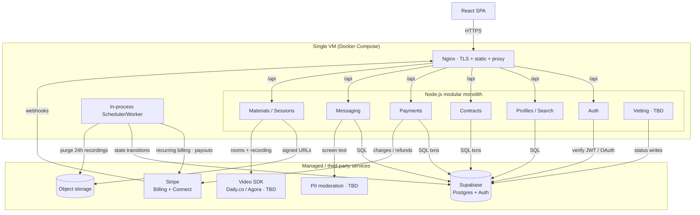
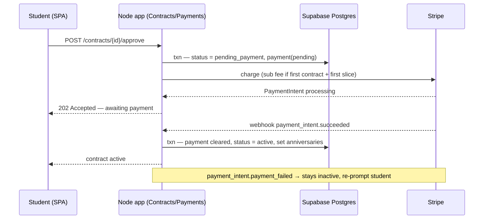
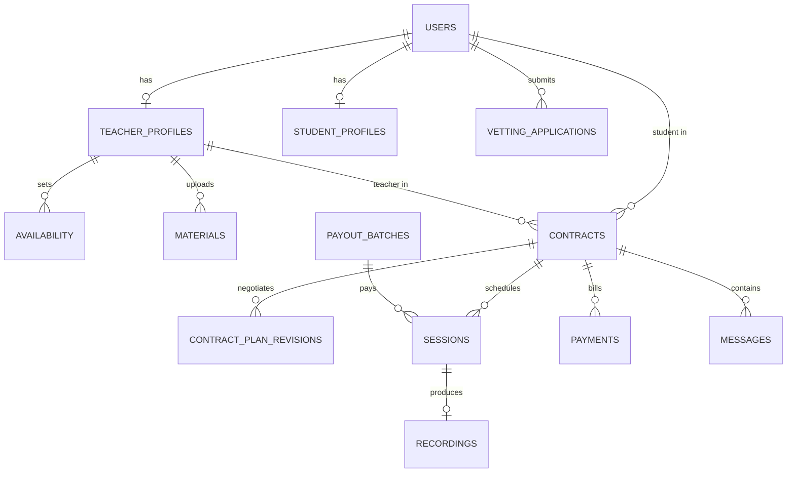

# Nisbah Learning — System Design Document

## 1. Overview

Nisbah Learning is a **web-only** two-sided marketplace connecting students with Islamic teachers for paid one-on-one lessons (Quran, Hadith, Arabic, Fiqh, Usul, Aqidah). Students discover teachers, negotiate a contract, pay on a recurring monthly schedule, attend live video sessions, watch recordings, and read uploaded materials. Teachers list themselves, run sessions, and receive biweekly payouts net of platform commission. Admins resolve vetting edge cases, flagged messages, and disputes.

The system is deliberately sized for **product validation**, not scale: 300 MAU, ~100 video-hours/month. The architecture is a **modular monolith** (Node.js + TypeScript) on a **single VM behind Nginx**, leaning on managed services (Supabase, Stripe, a video SDK, object storage) so the team writes business logic, not infrastructure.

**Out of scope:** native mobile apps; the automated vetting *algorithm* (the pipeline boundary and status machine are designed, the scoring logic is TBD); group/multi-party classes; in-house video infrastructure; the exact commission percentage and platform subscription fee amount.

## 2. Requirements

### 2.1 Functional Requirements

- **Auth & roles.** Email+password and Google OAuth, identical flow for both roles; role (`student` | `teacher`) chosen at signup. Admin is an internal role.
- **Teacher profile (public to signed-in users).** Photo (≤5 MB, optional), name + verified tick, hourly rate, subjects, certifications (required), ijaza (required), experience (optional), 1–2 min intro video, languages, preferred session length (≤2 h), availability (own timezone, displayed converted), ratings/reviews, expected reply time, completion badges, credibility score.
- **Student profile (private).** Photo, name, prior studies — visible only to a teacher in an active contract with that student.
- **Verification.** Every teacher is vetted at signup → `verified` (composite ≥0.85, no anomalies), `listed` unverified (0.55–0.85), or `rejected` (<0.55 or anomalies); ambiguous/anomalous cases go to an admin queue. Process completes ≤24 h. Unverified teachers are fully bookable; the tick is a trust signal, not a gate. Admin can promote/revoke verification.
- **Search & filters.** Subject, price band, rating floor, language, timezone (UTC−11..+13), availability day or Open Availability, gender.
- **Contract negotiation.** Student requests a teacher → teacher proposes a plan (subject, total duration, sessions/week, session length, total price) → student approves or requests changes (loop) → on approval **and** first-charge clearing, the contract is `active`. Terms: ≥1 month, ≥4 sessions.
- **Recurring payments.** Per active contract, monthly charge = `total_price ÷ length_months` on the contract anniversary. One platform subscription fee per student per month on the student's subscription anniversary (day their first-ever contract activated). First charge (subscription fee if first contract + first month's slice) taken at approval; contract activates only when it clears.
- **Failed charges.** 3 retries at +1 h / +6 h / +24 h; all fail → contract `paused` (chat, video, recordings, materials locked); 14 days paused → auto-cancel.
- **Refunds.** Mid-contract student cancel: current-month subscription fee not refunded, current-month contract slice refunded, future months never billed. Cancel ≥24 h before contract start: full refund.
- **Teacher payouts.** Biweekly, for sessions actually delivered, minus commission. If a slice is refunded mid-contract, the teacher is still paid for delivered sessions; the platform absorbs the gap. No teacher subscription.
- **In-app messaging.** All student↔teacher conversation is in-app; every message is screened for PII before delivery; flagged messages go to admin.
- **Materials.** Teachers upload books/PDFs; students read in-app while the contract is active.
- **Sessions, timezones, rescheduling.** Times stored in UTC, displayed in viewer-local time with the teacher's original local time in brackets (`Mon 3:00 PM EST (originally 8:00 PM PKT)`). Students may request out-of-availability times; teacher accepts or counters. Cancel/reschedule requires ≥24 h notice; rescheduled into the same or following week.
- **Recordings.** Each session is cloud-recorded; available for **24 h after the session**, then purged.

### 2.2 Non-Functional Requirements

- **Scale.** ~300 MAU; ~100 concurrent-equivalent video-hours/month. Single VM is sufficient; no horizontal scaling required.
- **Durability & consistency.** Contracts and payments require strong consistency and durability — handled via Postgres transactions and Stripe as the system of record for money; payment state changes are idempotent against Stripe webhook IDs.
- **Recordings retention.** Hard 24 h TTL post-session, then deleted from object storage.
- **Availability.** Best-effort single-VM (~99% — SPOF accepted at this stage). RTO of minutes-to-hours via daily VM image rebuild; **RPO for business data is effectively zero** because all durable state lives in Supabase / object storage / Stripe, not on the VM.
- **Security.** TLS at Nginx; private media served only via short-lived signed URLs minted after an authz check; student-profile access enforced by Supabase Row-Level Security; secrets in environment, not image.
- **Observability.** Structured app logs, Stripe webhook audit trail, scheduler job logs (billing runs, retries, payout batches, recording purges).

## 3. Architecture

**Components.**

- **React SPA → Nginx → Node monolith.** Nginx terminates TLS, serves the built SPA's static assets, and reverse-proxies `/api` to the Node process. Both run as containers via a single Docker Compose file on one VM.
- **Auth module.** Delegates identity to **Supabase Auth** (email/password + Google OAuth); the app verifies Supabase-issued JWTs and maps them to a `users` row and role.
- **Profiles + Search.** Reads/writes profile data in Postgres; filtered search is a parameterized SQL query (300 users — no search engine needed). Computes timezone-converted availability for display.
- **Contracts.** Owns the request → propose → revise → approve state machine. Approval and first-charge clearing are committed together so a contract is never `active` without cleared payment.
- **Payments.** Wraps **Stripe Billing** (recurring contract slices + monthly platform subscription fee + retry schedule) and **Stripe Connect** (biweekly teacher payouts with commission split). Stripe is the source of truth for money; webhooks (received through Nginx) drive local payment state idempotently.
- **Messaging.** Persists messages in Postgres; every message is run through a **PII moderation** step (provider/algorithm TBD) before delivery; flagged items routed to the admin queue.
- **Materials & Sessions.** Binary files (photos, intro videos, PDFs, recordings) live in **object storage**; Postgres holds only object keys. Private files are served via short-lived signed URLs the API mints *after* checking contract/role authorization. Live video uses a **third-party SDK — open decision between Daily.co and Agora** — with cloud recording and a "recording ready" webhook.
- **Scheduler / Worker.** An in-process scheduler (single VM, single instance — no distributed locking needed) runs: daily recurring-billing sweep on contract & subscription anniversaries, the 3-retry ladder, pause-after-3-fails, auto-cancel after 14 days paused, the biweekly payout batch, and the 24 h recording purge.

**Infrastructure justification.** No message queue or cache: at 300 MAU the load fits one VM with direct Postgres access; introducing Kafka/Redis would be unjustified operational weight for product validation. Supabase removes auth + DB ops. Stripe removes PCI scope and billing-engine complexity. Object storage decouples large media from the disposable VM.

**Critical flow — contract approval, first charge, activation:**

A **Deployment & Recovery** note: the app is shipped as a Docker Compose stack (Nginx + Node) on a single VM; the VM **provider is left open** (Hetzner/DigitalOcean/Vultr vs AWS/GCP). The VM is **stateless** — all durable state is in Supabase, object storage, and Stripe. A provider-scheduled **daily image snapshot** is taken; on VM failure a new VM is created from the latest image and DNS is repointed (minutes-to-hours RTO). No warm standby — unjustified cost at this scale.

## 4. API Design

REST over HTTPS, JSON, Supabase JWT in `Authorization`. Core, non-obvious endpoints:

| Method & Path | Request (key fields) | Response (key fields) | Status |
|---|---|---|---|
| `POST /auth/signup` | `email`, `password` \| OAuth token, `role` | `user_id`, `role` | 201 / 409 |
| `POST /teachers/applications` | `certifications[]`, `ijaza[]`, `experience[]?`, `intro_video` (object keys) | `application_id`, `status=processing` | 202 |
| `GET /teachers` | filters: `subject`, `price_band`, `rating_min`, `language`, `tz`, `day`\|`open`, `gender` | `teachers[]` (profile + `verified`, availability in viewer tz w/ original) | 200 |
| `POST /contracts` | `teacher_id` | `contract_id`, `status=requested` | 201 |
| `POST /contracts/{id}/plan` | `subject`, `total_months`, `sessions_per_week`, `session_length`, `total_price` | `revision_id`, `status=proposed` | 201 |
| `POST /contracts/{id}/approve` | — | `status=pending_payment`, `payment_intent` | 202 / 402 |
| `POST /contracts/{id}/cancel` | — | `refund` (slice refunded; sub fee not; or full if ≥24 h pre-start) | 200 |
| `POST /contracts/{id}/messages` | `body` | `message_id`, `status=delivered`\|`flagged` | 201 |
| `GET /media/{object_key}/url` | — (authz: active contract / role) | `signed_url`, `expires_in` | 200 / 403 |
| `POST /webhooks/stripe` | Stripe event (signed) | `received` | 200 |

Non-obvious contracts: `approve` returns `202` — activation is asynchronous, confirmed by the Stripe webhook, not synchronously. `GET /media/.../url` never returns the object directly; it returns a short-lived signed URL only after an authorization check. `messages` may return `status=flagged` (held for admin) rather than an error.

## 5. Data Model

Postgres (Supabase). Money stored in **integer minor units** (cents); all timestamps **UTC `timestamptz`**; teacher availability also stores the teacher's IANA timezone for the "(originally …)" display. Student-profile rows protected by **RLS**: readable only by the owner and by a teacher joined through an `active` contract.

Key tables (selected columns):

- **`users`** — `id`, `email`, `role` (`student|teacher|admin`), `auth_provider`, `created_at`.
- **`teacher_profiles`** — `user_id`, `photo_key?`, `hourly_rate_cents`, `subjects[]`, `certifications[]`, `ijaza[]`, `experience[]?`, `intro_video_key`, `languages[]`, `pref_session_minutes` (≤120), `verification_status` (`verified|listed|rejected`), `credibility_score`, `expected_reply_minutes`. Index: `(verification_status)`, GIN on `subjects`, `languages`.
- **`student_profiles`** — `user_id`, `photo_key?`, `name`, `prior_studies`. RLS-restricted.
- **`availability`** — `teacher_id`, `weekday`, `start_utc`, `end_utc`, `teacher_tz` (IANA), `open_availability` (bool).
- **`contracts`** — `id`, `student_id`, `teacher_id`, `subject`, `total_months`, `sessions_per_week`, `session_minutes`, `total_price_cents`, `status` (`requested|proposed|pending_payment|active|paused|cancelled|completed`), `start_at`, `contract_anniversary_dom`, `paused_at?`. Index: `(status)`, `(teacher_id)`, `(student_id)`.
- **`contract_plan_revisions`** — `contract_id`, `proposed_by`, terms snapshot, `created_at` (negotiation history).
- **`payments`** — `id`, `contract_id?`, `student_id`, `kind` (`first_charge|slice|subscription_fee`), `amount_cents`, `status` (`pending|cleared|failed|refunded`), `retry_count`, `next_retry_at?`, `stripe_payment_intent_id` (unique — webhook idempotency).
- **`payout_batches`** — `id`, `teacher_id`, `period_start`, `period_end`, `gross_cents`, `commission_cents`, `net_cents`, `stripe_transfer_id`, `status`.
- **`sessions`** — `id`, `contract_id`, `scheduled_start_utc`, `scheduled_end_utc`, `status` (`scheduled|delivered|cancelled|rescheduled`), `delivered_at?`, `payout_batch_id?`.
- **`recordings`** — `session_id`, `object_key`, `available_until` (= session end + 24 h). Worker deletes rows + objects past `available_until`.
- **`messages`** — `id`, `contract_id`, `sender_id`, `body`, `status` (`delivered|flagged`), `created_at`.
- **`vetting_applications`** — `user_id`, `document_keys[]`, `composite_score?`, `status` (`processing|auto_verified|auto_listed|admin_queue|rejected`), `decided_at`. *(Scoring algorithm TBD.)*

No sharding/partitioning — single small Postgres instance is far within capacity at this scale.

## 6. Trade-offs & Alternatives

- **Modular monolith on one VM → vs microservices.** *Why:* 300 MAU and a small team; one deployable maximizes iteration speed and minimizes ops. *Gave up:* independent scaling and fault isolation per module, and the single VM is a SPOF — accepted because all durable state is external and recovery is a daily-image rebuild.
- **Supabase managed Postgres + Auth → vs self-hosted Postgres + hand-rolled auth.** *Why:* removes auth, OAuth, and DB operational burden; RLS cleanly enforces student-profile privacy. *Gave up:* some control and a vendor dependency; mitigated since data is standard Postgres and portable.
- **Stripe Billing + Connect → vs a custom billing/payout engine.** *Why:* the recurring model (per-contract anniversaries + separate subscription anniversary), retry ladder, refunds, and marketplace split payouts are exactly Stripe's domain; keeps PCI scope out. *Gave up:* fee per transaction and Stripe-shaped data modeling; acceptable versus building a correct money system from scratch.
- **Buy video (Daily.co / Agora — TBD) → vs self-hosted SFU.** *Why:* 1:1 video + cloud recording + "recording ready" webhook is commodity; self-hosting WebRTC infra is disproportionate at ~100 h/mo. *Gave up:* per-minute cost and provider lock-in for recordings (mitigated by the hard 24 h purge — little is retained).
- **No queue/cache → vs Redis + a job queue.** *Why:* request volume and the scheduler's daily/biweekly cadence fit a single in-process scheduler against Postgres; one instance means no distributed-lock complexity. *Gave up:* horizontal worker scaling and sub-second fan-out — neither is needed yet; revisit if MAU grows an order of magnitude.

**Rough monthly cost (validation scale):** single small VM ($10–40) + Supabase (free–$25) + object storage (a few $) + video SDK usage (~100 h, usage-priced, low tens of $) + Stripe (per-transaction, no fixed fee) ≈ **~$50–120/month** plus payment processing fees. The dominant variable cost is video minutes; everything else is near-flat at this scale.

---

*Open items deferred by design: automated vetting scoring algorithm, PII-moderation provider, video SDK choice (Daily.co vs Agora), VM provider, commission percentage, and platform subscription fee amount.*
