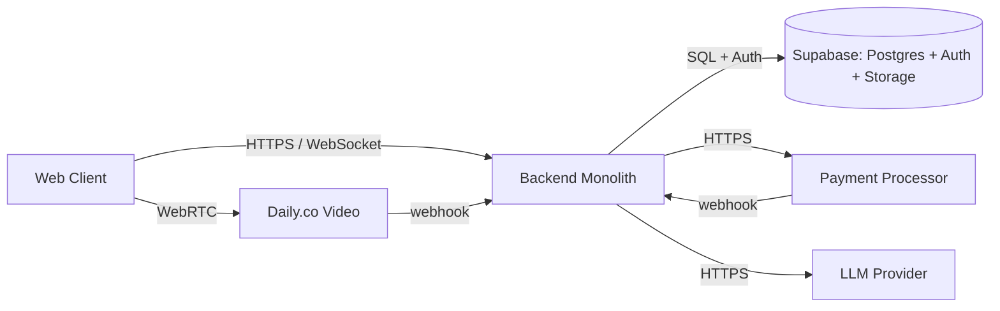
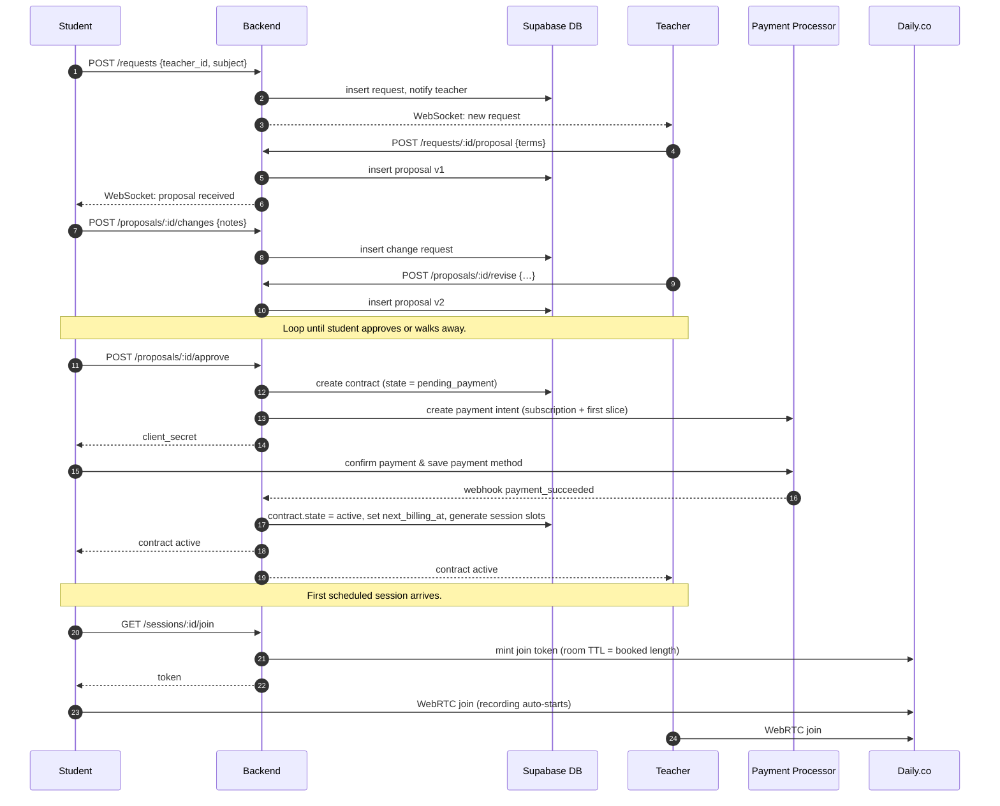
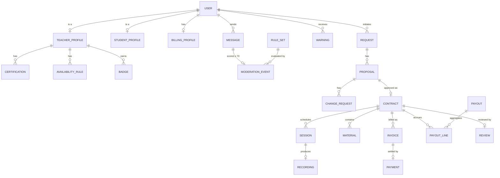
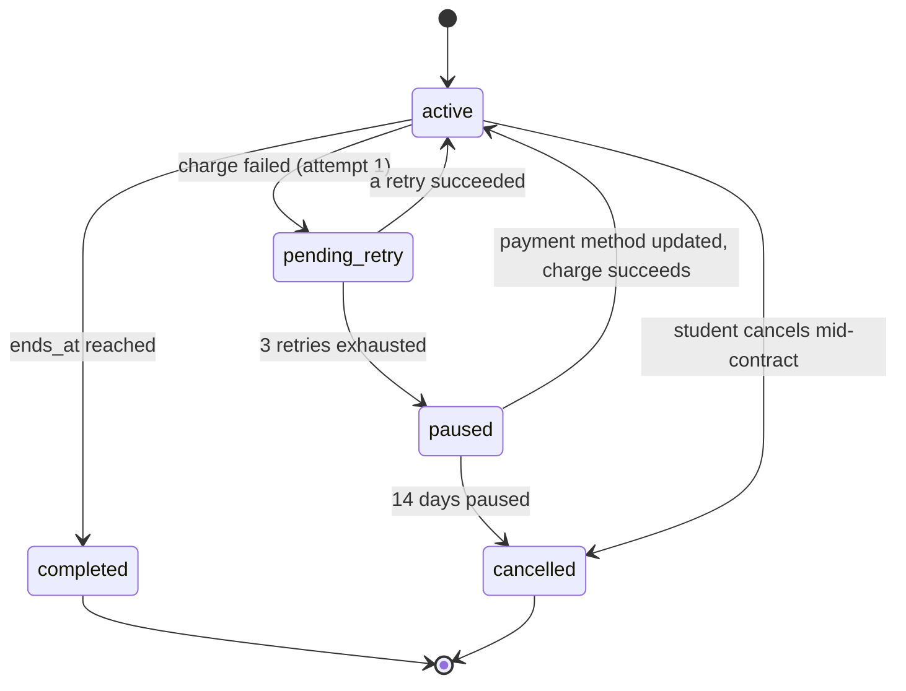

# Nisbah Learning — System Design Document

## 1. Overview

Nisbah Learning is a **web-only** marketplace that connects students with Islamic teachers for one-on-one lessons in subjects such as Quran, Hadith, Arabic, Fiqh, Usul, and Aqidah. Students browse public teacher profiles, message a chosen teacher, agree on a study plan, pay a recurring monthly fee, and attend recurring video sessions delivered through the platform itself. All chat is monitored in real-time by an LLM-backed moderation layer to keep contact details on the platform, every video session can be recorded for the student to revisit, and teacher credentials drive a verification badge ("verified tick") shown on the profile.

This design covers a v1 sized for **~300 concurrent users**, ~60 video-hours of usage per month in normal operation, and ~100 video-hours per month at peak. Native mobile apps, group classes, pre-recorded course sales, and teacher-to-teacher collaboration are explicitly out of scope — and the product strategy is **web-only as a permanent stance**, not a phase-1 limitation.

The infrastructure choices are now concrete: **Supabase** for the Postgres database and authentication, **Daily.co** for video conferencing (Daily-hosted infrastructure), and an **LLM provider** (e.g., Claude API) for the two workloads where rules-based code is insufficient: real-time message moderation and teacher credential vetting. Object storage is described generically; **Supabase Storage** is the natural co-located default.

## 2. Requirements

### 2.1 Functional Requirements *(plain-language, non-technical)*

This section describes what the product does from a user's point of view. It avoids technical terms on purpose — it should be readable by anyone on the team, not just engineers.

#### Who uses the platform

- **Student.** Looks for a teacher, pays for lessons, attends sessions, watches recordings, reads materials.
- **Teacher.** Lists themselves on the marketplace, accepts students, runs sessions, gets paid every two weeks.
- **Admin.** Reviews teacher applications when the automatic check is unsure, handles flagged messages and disputes.

#### Authentication (same for students and teachers)

The sign-in flow is **identical for students and teachers** — they pick a role at sign-up; all auth options are available to both. Supported sign-in methods:

- **Email + password**
- **Google Sign-In** (OAuth)
- The auth layer (Supabase Auth) supports additional OAuth providers (Apple, etc.) at trivial cost should they be added later. Only Google is enabled in v1.

#### Teacher profile (public)

Anyone signed in can view a teacher's profile. Each profile shows:

- Profile photo *(optional — max 5 MB upload)*
- Name (with a **verified tick** next to it if the teacher has passed verification — see *Verification* below)
- Hourly rate
- Subjects taught (Quran, Hadith, Arabic, Fiqh, Usul, Aqidah)
- Certifications (mandatory at sign-up)
- Ijaza — chains of authorization (mandatory at sign-up)
- Experience (optional — new teachers can list without prior experience)
- A short intro video (1–2 minutes maximum)
- Languages of instruction
- Preferred session length (1 hour, 1.5 hours, or 2 hours — capped at 2 hours)
- Availability — shown in the viewer's local time **with the teacher's original local time in brackets** (e.g., `3:00 PM EST (originally 8:00 PM PKT)`). Teachers may also choose **Open Availability**.
- Ratings and reviews
- Expected reply time
- Completion badges (one per finished contract)
- Credibility score

#### Student profile (private)

A student's profile is **never shown publicly**. It is only visible to a teacher once they are in an active contract together. It contains:

- Profile photo *(optional — max 5 MB upload)*
- Name
- What the student has already studied (so the teacher can tailor lessons)

#### Verification (verified vs unverified teachers)

Every teacher goes through the **vetting process** at sign-up. Outcomes:

- **Listed and verified.** Appears in search, shows the **verified tick**.
- **Listed, not yet verified.** Appears in search and **can be fully booked** — just no tick.
- **Rejected.** Cannot list.

Unverified teachers are not handicapped: they appear in search, can be messaged, and can take contracts on equal footing. The tick is a **trust signal**, not a permission gate. Admin can later promote an unverified teacher to verified, or revoke verification.

#### Onboarding

**Teacher onboarding:**

1. Teacher signs up (email + password or Google Sign-In via Supabase Auth).
2. Submits application: **certifications (required)**, **ijaza (required)**, **experience documents (optional)**, **intro video**.
3. System runs **automated vetting** on the documents (Section 7.2).
4. **Composite confidence ≥ 0.85, no anomalies** → `listed` and `verified` (tick granted).
5. **Composite 0.55–0.85** → `listed` but not verified.
6. **Composite < 0.55, or anomalies** → admin queue.
7. Full process completes **within 24 hours** (auto or admin path).

**Student onboarding** is one step: pick role at sign-up, fill in name + (optionally) prior studies. Browsing is free; nothing is paid until a contract is approved.

#### Search and filters

- **Subject** — Quran, Hadith, Arabic, Fiqh, Usul, Aqidah
- **Price (per hour)** — Less than $10, $11–$20, $21–$30, $31–$40, $41–$50, More than $50
- **Rating** — 3 stars and up, 4 stars and up, 5 stars
- **Language** — English, Arabic, Urdu, Bengali, Other
- **Time zone** — UTC−11 through UTC+13
- **Availability** — Monday through Sunday (plus an "Open Availability" filter)
- **Gender** — Male, Female

#### Contract flow

1. **Student requests** a specific teacher.
2. **Teacher proposes a plan** (subject, total duration, sessions/week, session length, total price).
3. Student reviews:
   - **Approves** → contract starts; first month's payment is taken.
   - **Requests changes** → teacher revises or declines; loop until approval or walk-away.
4. **On approval and payment clearing, the contract is active.**

Contract terms: subject, total duration (≥ 1 month, ≥ 4 sessions at 1/week), sessions/week, session length, total price.

#### Payments and payouts (the recurring model)

**Student side.** Billing is **recurring monthly on the contract's anniversary** of the start date. Each month:

```
monthly_charge_for_a_contract = (contract_total_price ÷ contract_length_in_months)
```

A **single platform subscription fee** is also charged once per month per student (regardless of contract count), on its own **subscription anniversary** — the day of the month when their first-ever contract activated. So a student with two active contracts pays:

```
1 × subscription_fee  (on subscription anniversary)
+ contract_A_total ÷ contract_A_months  (on contract A's anniversary)
+ contract_B_total ÷ contract_B_months  (on contract B's anniversary)
```

**First charge.** Happens at contract approval: subscription fee (if this is the student's first-ever active contract) + first month's slice. Contract activates only when this clears.

**Failed recurring charges.** Up to **3 retries** (at +1 h, +6 h, +24 h after initial failure). If all 3 fail → contract is **paused** (chat, video, recordings, materials inaccessible). After **14 days paused** → auto-cancel.

**Mid-contract cancellation by student.**
- Subscription fee for the current month: **not refunded**.
- Contract slice for the current month: **refunded**.
- Future months: never billed.

**Cancellation ≥ 24 h before contract start.** Full refund of everything charged.

**Teacher payouts.**
- No teacher subscription. Joining is free.
- Paid **every two weeks** for sessions delivered.
- Platform takes a commission percentage (% TBD).
- If a student cancels mid-contract and gets the current-month slice refunded, the teacher is **still paid** for sessions actually delivered. **The platform absorbs the gap.**

#### Messaging and monitoring

- All conversation between student and teacher happens **inside the app**.
- Every message runs through a **two-layer moderation system** (see Section 8 for the full design):
  1. **Layer 1 — Rule engine.** Every message is scored by a deterministic rule engine (explicit PII, implicit off-platform attempts, obfuscation signals). Cheap and fast.
  2. **Layer 2 — LLM review.** Only messages scoring **≥ 70** are held and sent to the LLM for a final verdict. Most messages (~95%+) skip this step and deliver immediately.
- When the LLM verdict is `FLAG` (or in the rare case the rule engine has decisive evidence on its own):
  - The original message is **hidden from both sender and recipient**.
  - In its place, a **system-generated warning** is shown to both: *"This message was blocked because it appears to contain contact information. Sharing contact details outside the platform is not allowed."*
  - The sender's warning counter is incremented.
- Warning escalation:
  - **1st flag → warning.** Sender notified; message hidden.
  - **2nd flag → warning.** Sender notified; message hidden.
  - **3rd flag → automatic ban + admin escalation.** The case is forwarded to the admin queue with all three flagged events (full original content + conversation context).
- **Every message that crossed the rule-engine threshold (≥ 70) is stored** with full context — including LLM false positives (messages the LLM cleared). This dataset is the **training corpus for a future traditional ML moderation model** that will eventually replace the LLM (see Section 8.7).

#### Video sessions

- 1-on-1 video calls via Daily.co.
- **Screen share + recording** supported.
- Recording processed within 24h; available to the student during the contract.
- **When the contract ends, all recordings are deleted immediately — no grace period.**
- **Sessions hard-capped at 2 hours** — the Daily.co token TTL is `booked_length`; the room auto-ends.

#### Books and study materials

- Teachers upload books/PDFs.
- Students read in-app while the contract is active.

#### Time zones

- All session times stored in **UTC** internally; displayed in the viewer's local time.
- **Teachers set availability in their own local timezone.**
- **Students see availability converted to their own timezone with the teacher's original local time in brackets** — e.g., `Mon 3:00 PM EST (originally 8:00 PM PKT)`.
- Teachers can choose **Open Availability** (no fixed time preference; available throughout the day).
- Students can request a time outside posted availability; teachers accept or propose another.

#### Session cancellation and rescheduling

- ≥ 24 h notice required.
- Cancelled sessions are rescheduled into the same or following week.

### 2.2 Non-Functional Requirements

| Area | Target for v1 |
|---|---|
| **Concurrent users (peak)** | ~300. |
| **Video usage — regular / peak** | ~60 / ~100 video-hours per month (peak ~ 5–10 simultaneous sessions). |
| **Availability** | 99.5% monthly for app and API. Video uptime delegated to Daily.co. |
| **Page load** | 95% of typical-internet users see first content within 2.5 s; search results within 800 ms p95. |
| **Message delivery latency** | **Most messages (rule score < 70):** p95 < 300 ms end-to-end (rule eval + DB persist + WebSocket push). **Escalated messages (rule score ≥ 70, ~3–5% of traffic):** p95 < 1.5 s, dominated by the LLM call (p95 ≤ 1.2 s). |
| **Video join time** | p95 < 5 s from clicking *Join* to seeing peer media. |
| **Vetting decision latency** | Automated path p95 < 5 minutes. Admin-escalated path within 24 hours (hard SLA). |
| **Recording availability** | Within 24 h of session end (hard SLA). |
| **Recurring charge** | Anniversary charge fires within 1 h of midnight UTC on the anniversary day. Up to 3 retries (at +1 h, +6 h, +24 h). |
| **Durability** | Contracts, payments, messages, flagged-message events: zero acceptable loss (Supabase Postgres durability). Recordings: durable until contract ends. |
| **Consistency** | Strong for payments and contract state. Eventual for review aggregates. |
| **Security** | TLS in transit, encryption at rest, role-based authorization, contract-scoped access to private data. |
| **Compliance** | **Formal certifications (SOC 2, ISO 27001, formal GDPR) are not pursued in v1.** The platform is too small to justify the audit cost, has no enterprise customers requiring them, and operates outside heavily-regulated verticals (healthcare, finance). Basic data-subject rights (export, delete) are implemented as ethical defaults. PCI scope is minimized by delegating all card handling to the payment processor. Revisited if/when the platform onboards enterprise customers or expands into regulated markets. |
| **Accessibility** | WCAG 2.1 AA. |
| **Browser support** | Last two major versions of Chrome, Edge, Safari, Firefox. |
| **Observability** | Logs + alerts on critical flows (payments, video, vetting, moderation). Detail in Section 13. |

## 3. Architecture

### 3.1 High-level architecture

A **modular monolith** on top of **Supabase** (Postgres + Auth + Storage), with background work running in the same process via a database-backed job queue.



#### Components

- **Web client.** SPA. Talks to backend over HTTPS + WebSocket. Uses Daily.co browser SDK for WebRTC.
- **Backend monolith.** Modules: `Identity` (over Supabase Auth), `Profiles`, `Search`, `Messaging`, `Moderation`, `Vetting`, `Contracts`, `Scheduling`, `Payments`, `Media`, `Notifications`.
- **Background jobs.** Library-style job runner (`pg-boss` / `Oban` / equivalent) **in-process**. Handles: vetting decisions, recording post-processing, anniversary billing fires, recurring-charge retries, bi-weekly payouts, session reminders, immediate recording deletion on contract end.
- **Supabase.** Postgres database, Auth (email/password + Google), and Storage (S3-compatible bucket for profile photos, intro videos, books, certifications).
- **Daily.co.** Video SDK + Daily-hosted infrastructure. Recording stored on Daily.
- **Payment processor.** Stripe-class. Off-session recurring charges.
- **LLM provider.** Used for the two workloads in *LLM usage* below.

#### LLM usage — where and why

LLM calls add cost, latency, and non-determinism, so they're used only where rules-based code is insufficient.

- **Message moderation (real-time).** Every message is scored by a **rule-based engine** with weighted categories (explicit PII, implicit off-platform, obfuscation signals). Only messages scoring **≥ 70** are escalated to the LLM, which returns a binary `CLEAR` / `FLAG` verdict using the conversation context. Most messages skip the LLM entirely, keeping cost and latency low. Storage of every escalated event is designed to feed a future traditional ML classifier (Section 8.7) that will eventually replace the LLM call.
- **Teacher credential vetting.** OCR turns scanned certificates/ijaza into text; an LLM extracts structured fields (issuer, named scholars, dates), checks plausibility, produces a confidence score. Rules cannot reason about ijaza chain plausibility; the only alternative would be full manual admin review, which doesn't scale even at v1 volume.

#### Deferred infrastructure

| Signal | What we add |
|---|---|
| Search latency degrades or teacher count > a few thousand | Dedicated search index. |
| Background jobs starve API requests | Separate worker process / queue. |
| WebSocket fan-out becomes a bottleneck | Externalize pub-sub. |
| A specific module needs independent scaling | Extract that module into its own service. |

### 3.2 Critical flow — student requests teacher → contract approved → first session



### 3.3 Search at small scale

Search runs **inside Supabase Postgres**. The `teacher_profiles` table has indexes on `subjects`, `hourly_rate`, `language`, `gender`, `rating_avg`, `is_verified`, `open_availability`, and a generated availability column for day-of-week filtering. Free-text search on bio/name uses Postgres `tsvector`. Ranking is a simple weighted score (rating × experience × responsiveness, with a small boost for `is_verified=true`).

The `Search` module exposes a single `searchTeachers(filters)` function so the implementation can be swapped later.

### 3.4 Real-time messaging

A single WebSocket connection per logged-in user, **multiplexed across all of that user's threads** — meaning every chat conversation the user has open shares *one* socket connection rather than opening a separate connection per thread. Each frame is tagged with `thread_id` so the client routes it to the correct conversation in the UI. This keeps connection counts low (one per user, not one per chat).

Messages flow through the moderation pipeline (Section 8) before being delivered. For a few hundred concurrent users this fits in one process. If a second app instance is needed for HA, the two instances coordinate via Postgres `LISTEN/NOTIFY`.

### 3.5 Recurring billing job

Every hour, a scheduled job:

1. Selects contracts whose `next_billing_at <= now()` and whose state is `active` or `pending_retry`.
2. Calculates the charge: this contract's monthly slice + (subscription fee, if today is the student's subscription anniversary and not yet billed this month).
3. Fires an off-session payment intent.
4. **On success** → updates `next_billing_at` to the next anniversary, resets `retry_attempts` to 0.
5. **On failure** → sets state to `pending_retry`, schedules the next retry at +1 h / +6 h / +24 h, increments `retry_attempts`. **After 3 retry attempts fail → state becomes `paused`.** After 14 days paused → `cancelled`.

Idempotency key per attempt: `contract_id + anniversary_date`.

## 4. API Design

REST + JSON over HTTPS. WebSocket for chat. Auth via Supabase-issued session JWT cookie.

### 4.1 Public endpoints (no auth)

| Method | Endpoint | Description | Key request fields | Key response fields |
|---|---|---|---|---|
| `POST` | `/api/v1/auth/signup` | Create account (delegates to Supabase Auth). | `role`, `email`, `password`, `name` | `user_id`, `role`, `next_step` |
| `POST` | `/api/v1/auth/login` | Sign in (email + password). | `email`, `password` | session cookie |
| `POST` | `/api/v1/auth/google` | Sign in / sign up via Google. | OAuth code | session cookie |

The auth endpoints are **the same for students and teachers**; role is chosen at sign-up and stored in the `users` row.

### 4.2 Browsing (auth required)

| Method | Endpoint | Description | Key request fields | Key response fields |
|---|---|---|---|---|
| `GET` | `/api/v1/teachers` | Search teacher directory. | `subject`, `price_bucket`, `min_rating`, `language`, `tz`, `day`, `gender`, `open_availability` | `teachers[]` (each with `is_verified`), `next_page` |
| `GET` | `/api/v1/teachers/:id` | Public teacher profile. | — | `profile` (incl. `is_verified`, `photo_url`), `availability_local[]` (with `original_local` in brackets), `reviews[]` |

### 4.3 Onboarding

| Method | Endpoint | Description | Key request fields | Key response fields |
|---|---|---|---|---|
| `POST` | `/api/v1/teachers/applications` | Submit teacher application. | `subjects[]`, `languages[]`, `cert_files[]` *(required)*, `ijaza_files[]` *(required)*, `experience_files[]` *(optional)*, `intro_video_file`, `photo_file` *(optional)* | `application_id`, `status` |
| `GET` | `/api/v1/teachers/applications/me` | Own application status. | — | `listing_state`, `is_verified`, `decision_reason?` |
| `GET` | `/api/v1/admin/vetting/queue` *(admin)* | List escalated applications. | — | `applications[]` with `auto_score`, `flags[]` |
| `POST` | `/api/v1/admin/vetting/:id/decision` *(admin)* | Resolve. | `listing_state`, `is_verified`, `reason` | result |
| `POST` | `/api/v1/admin/teachers/:id/verification` *(admin)* | Grant/revoke verified tick. | `is_verified`, `reason` | profile |

### 4.4 Contract negotiation

| Method | Endpoint | Description | Key request fields | Key response fields |
|---|---|---|---|---|
| `POST` | `/api/v1/requests` | Student requests a teacher. | `teacher_id`, `subject`, `note` | `request_id` |
| `POST` | `/api/v1/requests/:id/proposal` *(teacher)* | Propose plan. | `subject`, `total_weeks`, `sessions_per_week`, `session_length_minutes`, `total_price` | `proposal_id`, `version` |
| `POST` | `/api/v1/proposals/:id/changes` *(student)* | Request changes. | `notes` | `change_request_id` |
| `POST` | `/api/v1/proposals/:id/revise` *(teacher)* | Revise or decline. | `revised_terms?`, `decline_reason?` | new `version` |
| `POST` | `/api/v1/proposals/:id/approve` *(student)* | Approve; contract created. | — | `contract_id`, `payment_client_secret` |

### 4.5 Sessions, scheduling, recordings

| Method | Endpoint | Description | Key request fields | Key response fields |
|---|---|---|---|---|
| `GET` | `/api/v1/teachers/me/availability` | Own availability. | — | `rules[]` (teacher TZ), `open_availability` |
| `PUT` | `/api/v1/teachers/me/availability` | Set availability. | `rules[]` or `open_availability: true` | echo |
| `GET` | `/api/v1/contracts/:id/sessions` | Sessions for contract. | — | `sessions[]` each with `viewer_local` + `teacher_local` + `teacher_tz_label` |
| `POST` | `/api/v1/sessions/:id/cancel` | Cancel a session (≥ 24 h). | `reason` | `status`, `makeup_session_id?` |
| `POST` | `/api/v1/sessions/:id/reschedule` | Propose new time. | `new_start_utc` | `pending_session_id` |
| `GET` | `/api/v1/sessions/:id/join` | Get Daily.co token. | — | `room_url`, `token`, `hard_end_at` |
| `GET` | `/api/v1/sessions/:id/recording` | Daily-hosted playback URL. | — | `url`, `expires_at` |

### 4.6 Messaging *(WebSocket)*

`wss://<host>/ws` — authenticated, multiplexes all threads for the user.

- Client → server: `{ "op": "send", "thread_id", "body" }`
- Server → both parties (clean message): `{ "op": "msg", "thread_id", "id", "from", "body", "ts" }`
- Server → both parties (blocked message): `{ "op": "blocked", "thread_id", "id", "system_warning": "...", "ts" }`
- Server → sender on flag: `{ "op": "warn", "warning_count", "reason", "is_ban": bool }`

REST fallback: `GET /api/v1/threads/:id/messages?before=…`.

### 4.7 Payments, billing & payouts

| Method | Endpoint | Description | Key request fields | Key response fields |
|---|---|---|---|---|
| `GET` | `/api/v1/me/billing` | Billing summary. | — | `subscription_anniversary_day`, `next_charges[]`, `payment_method` (`brand`, `last4`), `paused_contracts[]` |
| `PUT` | `/api/v1/me/billing/payment-method` | Update saved PM. | processor token | `brand`, `last4` |
| `POST` | `/api/v1/contracts/:id/cancel` | Cancel a contract. | `reason`, `effective` (`now` / `pre_start`) | `refund_breakdown`, `effective_at` |
| `POST` | `/api/v1/contracts/:id/refund-request` | Pre-start refund. | `reason` | `status`, `refund_amount` |
| `GET` | `/api/v1/teachers/me/payouts` | Payout history. | — | `payouts[]` |
| `POST` | `/api/v1/webhooks/payments` | Processor webhook. | signed event | `200 OK` |
| `POST` | `/api/v1/webhooks/video` | Daily.co webhook. | signed event | `200 OK` |

### 4.8 Materials & moderation review

| Method | Endpoint | Description | Key request fields | Key response fields |
|---|---|---|---|---|
| `POST` | `/api/v1/contracts/:id/materials` *(teacher)* | Upload PDF. | multipart file | `material_id` |
| `GET` | `/api/v1/contracts/:id/materials` | List. | — | `materials[]` |
| `GET` | `/api/v1/materials/:id/read` | Get presigned URL. | — | `url`, `expires_at` |
| `GET` | `/api/v1/admin/moderation/events` *(admin)* | Flagged-message log. | filter params | `events[]` (incl. `original_body`, `llm_reason`, `action_taken`) |
| `POST` | `/api/v1/admin/moderation/events/:id/label` *(admin)* | Apply training label (for future ML migration). | `label`, `notes` | `event` |

## 5. Data Model

Single Supabase Postgres database. UTC (`timestamptz`) for times. Soft deletes (`deleted_at`) for user-facing entities; **hard deletes** for time-bound media (recordings on contract end — no grace period).

### 5.1 Entity overview



### 5.2 Core tables

#### `users` *(extends Supabase `auth.users`)*

Identity (email, password hash, OAuth links) lives in Supabase's managed `auth.users`. We do **not** duplicate it. `public.users` holds only **app-specific fields** and FKs back to `auth.users.id` 1:1.

| Column | Type | Notes |
|---|---|---|
| `id` | `uuid` PK, FK → `auth.users.id` | 1:1 with Supabase Auth |
| `role` | `enum('student','teacher','admin')` | app-level role chosen at sign-up |
| `timezone` | `text` | IANA, e.g. `Asia/Riyadh` |
| `gender` | `enum('male','female')` | |
| `warning_count` | `int` default 0 | |
| `banned_at` | `timestamptz` nullable | |
| `created_at`, `deleted_at` | `timestamptz` | |

Index: `(role, deleted_at)`.

#### `teacher_profiles`
| Column | Type | Notes |
|---|---|---|
| `user_id` | `uuid` PK FK→users | |
| `display_name` | `text` | |
| `photo_url` | `text` nullable | **optional**; max 5 MB at upload |
| `intro_video_url` | `text` | ≤ 2 min after transcode |
| `hourly_rate_usd` | `numeric(8,2)` | |
| `subjects` | `text[]` | fixed enum |
| `languages` | `text[]` | fixed enum |
| `experience_years` | `int` nullable | **optional** — null for fresh teachers |
| `bio_tsv` | `tsvector` GENERATED | for search |
| `preferred_session_minutes` | `int[]` | subset of {60, 90, 120} |
| `expected_reply_minutes` | `int` | rolling avg |
| `rating_avg` | `numeric(3,2)` | denormalized |
| `rating_count` | `int` | |
| `credibility_score` | `int` | |
| `listing_state` | `enum('pending_auto','pending_admin','listed','rejected')` | drives search visibility |
| `is_verified` | `boolean` default false | drives the tick |
| `verified_at` | `timestamptz` nullable | |
| `verified_by` | `enum('auto','admin')` nullable | |
| `open_availability` | `boolean` default false | when true, no fixed rules used |

Indexes: GIN on `subjects`, GIN on `languages`, GIN on `bio_tsv`, B-tree on `(listing_state, is_verified DESC, rating_avg DESC)`.

#### `student_profiles`
| Column | Type | Notes |
|---|---|---|
| `user_id` | `uuid` PK FK→users | |
| `display_name` | `text` | |
| `photo_url` | `text` nullable | **optional**; max 5 MB; visible only to teachers in active contract |
| `prior_studies` | `text` | private; only readable by teachers in active contract |

#### `billing_profiles`
One row per student; created on first contract approval.

| Column | Type | Notes |
|---|---|---|
| `user_id` | `uuid` PK FK→users | |
| `processor_customer_id` | `text` | e.g., Stripe customer ID |
| `default_pm_token` | `text` | saved payment-method handle |
| `pm_brand` | `text` | **payment-method brand (e.g., `Visa`, `Mastercard`, `Amex`) — for UI display only** |
| `pm_last4` | `text` | **last 4 digits of the card — for UI display only** |
| `subscription_anniversary_day` | `int` 1–28 | day-of-month set when the first contract activated; clamped to 28 to avoid Feb edge cases |
| `next_subscription_billing_at` | `timestamptz` nullable | next scheduled subscription charge; null if no active contracts |

#### `certifications`

| Column | Type | Notes |
|---|---|---|
| `id` | `uuid` PK | |
| `teacher_id` | `uuid` FK | |
| `kind` | `enum('certificate','ijaza','experience_letter')` | At least one `certificate` **and** at least one `ijaza` are required at application submission time. `experience_letter` is optional. |
| `file_url` | `text` | object storage |
| `auto_score` | `numeric(4,3)` | LLM confidence 0–1 |
| `auto_findings` | `jsonb` | issuer, named scholar chain, etc. |

#### `availability_rules`
| Column | Type | Notes |
|---|---|---|
| `id` | `uuid` PK | |
| `teacher_id` | `uuid` FK | |
| `weekday` | `int` 0–6 | |
| `start_local` | `time` | in teacher TZ |
| `end_local` | `time` | |
| `valid_from` | `date` | |

Ignored when `teacher_profiles.open_availability = true`.

#### `requests`, `proposals`, `change_requests`
Standard ID + FK chain. `proposals` carries the full contract terms and a `version` integer. `change_requests` records the student's notes against a proposal version. The version that the student approves becomes the contract's terms.

#### `contracts`
| Column | Type | Notes |
|---|---|---|
| `id` | `uuid` PK | |
| `student_id`, `teacher_id` | `uuid` FK | |
| `proposal_id` | `uuid` FK | approved version |
| `state` | `enum('pending_payment','active','pending_retry','paused','completed','cancelled','refunded')` | |
| `started_at`, `ends_at` | `timestamptz` | |
| `subject` | `text` | denormalized |
| `sessions_per_week`, `session_length_minutes`, `total_weeks` | `int` | |
| `total_price_usd` | `numeric(10,2)` | |
| `monthly_slice_usd` | `numeric(10,2)` | `total / total_months`, locked at signing |
| `total_months` | `int` | locked at signing |
| `commission_rate` | `numeric(5,4)` | snapshot at approval |
| `next_billing_at` | `timestamptz` nullable | anniversary |
| `retry_attempts` | `int` default 0 | **max 3**; reset on success |
| `paused_at` | `timestamptz` nullable | |
| `cancelled_at` | `timestamptz` nullable | |

Indexes: `(student_id, state)`, `(teacher_id, state)`, `(state, next_billing_at)`.

#### `invoices` and `payments`

`invoices`:

| Column | Type | Notes |
|---|---|---|
| `id` | `uuid` PK | |
| `student_id` | `uuid` FK | |
| `contract_id` | `uuid` FK nullable | null for subscription-only invoices |
| `kind` | `enum('subscription','contract_slice','combined')` | |
| `period_label` | `text` | e.g. `2026-06` |
| `amount_usd` | `numeric(10,2)` | |
| `state` | `enum('open','paid','failed','void')` | |
| `idempotency_key` | `text` UNIQUE | |

`payments`:

| Column | Type | Notes |
|---|---|---|
| `id` | `uuid` PK | |
| `invoice_id` | `uuid` FK | |
| `processor_intent_id` | `text` | |
| `state` | `enum('processing','succeeded','failed','refunded')` | |
| `amount_usd` | `numeric(10,2)` | |
| `failure_reason` | `text` nullable | |
| `created_at`, `updated_at` | `timestamptz` | |

#### `sessions`
| Column | Type | Notes |
|---|---|---|
| `id` | `uuid` PK | |
| `contract_id` | `uuid` FK | |
| `start_utc`, `end_utc` | `timestamptz` | |
| `state` | `enum('scheduled','in_progress','completed','cancelled','no_show','rescheduled')` | |
| `cancelled_by` | `enum('student','teacher','system')` nullable | |
| `original_session_id` | `uuid` nullable | makeup linkage |
| `video_room_id` | `text` | Daily.co room ID |

Indexes: `(contract_id, start_utc)`, `(state, start_utc)`.

#### `recordings`
| Column | Type | Notes |
|---|---|---|
| `id` | `uuid` PK | |
| `session_id` | `uuid` FK UNIQUE | |
| `storage_url` | `text` | Daily-hosted URL |
| `bytes` | `bigint` | |
| `available_at` | `timestamptz` | session_end + processing |

On contract end, the cleanup job **immediately** calls Daily.co's delete API and removes the `recordings` row. No `delete_at` deferral, no grace period.

#### `messages`

| Column | Type | Notes |
|---|---|---|
| `id` | `uuid` PK | |
| `thread_id` | `uuid` FK | |
| `sender_id` | `uuid` FK | |
| `body` | `text` | displayed body; for `pending` rows this is the original body held back from the recipient; for `blocked` rows this is the system warning text |
| `moderation_state` | `enum('clean','pending','blocked')` | `pending` while the LLM is reviewing; resolves to `clean` or `blocked` within ~1.2 s p95 |
| `created_at` | `timestamptz` | |

For blocked messages, the **original content is not stored in `messages`** — it lives in `moderation_events.original_body` so the moderation audit/training dataset is the single source of truth.

#### `rule_sets` *(versioned moderation configuration)*

The full Layer 1 rule definition is stored as data, not code. Exactly one ruleset is active at a time.

| Column | Type | Notes |
|---|---|---|
| `version` | `text` PK | semver-style, e.g. `1.2.0` |
| `definition` | `jsonb` | `{ categories: [{ name, rules: [{ id, pattern_spec, weight }] }] }` — full ruleset definition |
| `created_at` | `timestamptz` | |
| `created_by` | `uuid` FK → users (admin) | |
| `active_from` | `timestamptz` | |
| `active_to` | `timestamptz` nullable | null = currently active |
| `notes` | `text` | what changed and why |

Index: `(active_to)` — partial-index on `active_to IS NULL` for the "fetch active ruleset" query.

#### `moderation_events` *(every ≥ 70 event; ML-migration-ready)*

One row per message that scored **≥ 70** at the rule engine. Captures the input, the rule signals, the LLM verdict, the outcome, and a slot for admin labels. This is the **training corpus** for the future traditional ML model that will replace the LLM.

| Column | Type | Notes |
|---|---|---|
| `id` | `uuid` PK | |
| `message_id` | `uuid` FK → messages UNIQUE | |
| `thread_id` | `uuid` FK | |
| `sender_id` | `uuid` FK → users | |
| `sender_role` | `enum('student','teacher')` | denormalized — useful as an ML feature |
| `recipient_id` | `uuid` FK → users | |
| `recipient_role` | `enum('student','teacher')` | denormalized |
| `contract_id` | `uuid` FK nullable | were the two in an active contract? |
| `original_body` | `text` | **the unredacted message text** — primary input feature |
| `rule_score` | `int` 0–100 | computed total at evaluation time |
| `rule_matches` | `jsonb` | `[{ rule_id, category, weight, matched_substring }, …]` |
| `rule_set_version` | `text` FK → `rule_sets.version` | which ruleset evaluated this message |
| `llm_input_context` | `jsonb` | snapshot of the last 5 messages passed to the LLM (so a future model can be trained on the same context the LLM saw) |
| `llm_verdict` | `enum('CLEAR','FLAG')` nullable | null only if the LLM call errored |
| `llm_reason` | `text` nullable | natural-language explanation — the soft label |
| `llm_confidence` | `numeric(4,3)` nullable | 0–1 |
| `llm_model_version` | `text` nullable | e.g. `claude-haiku-4-5-20251001` — cohort tag for training-set hygiene |
| `outcome` | `enum('delivered_false_positive','blocked_warning','blocked_banned')` | the final action; serves as the *hard signal* for training |
| `warning_number` | `int` nullable | 1, 2, or 3 — only set when `outcome` is `blocked_*` |
| `admin_review` | `jsonb` nullable | `{ reviewed_by, reviewed_at, label, notes }` — the hardest label, applied later |
| `created_at` | `timestamptz` | |

Indexes:

- `(sender_id, created_at DESC)` — admin "show me this user's full moderation history".
- `(outcome, created_at)` — escalation queue + dataset filtering.
- `(rule_set_version, created_at)` — cohort analysis when ruleset changes.
- `(llm_verdict, llm_confidence)` — assemble training cohorts ("LLM `FLAG` with confidence ≥ 0.9").

**ML training queries this schema supports out of the box:**

- *Confirmed positives*: `WHERE outcome IN ('blocked_warning','blocked_banned') AND admin_review->>'label' IN ('confirmed', null)`
- *Confirmed false positives*: `WHERE outcome = 'delivered_false_positive'`
- *Same-ruleset cohort*: `WHERE rule_set_version = 'X.Y.Z'`
- *Negative examples*: sample randomly from `messages WHERE moderation_state = 'clean'` (those never created a `moderation_events` row).

#### `warnings`
Per-user ledger of warnings — one row per LLM `FLAG` verdict. `users.warning_count` is a maintained denormalization. On the **third warning**, `users.banned_at` is set and the corresponding `moderation_events.outcome = 'blocked_banned'` row surfaces in the admin escalation queue.

#### `payouts`, `payout_lines`, `refunds`
- `payout_lines` — daily accruals per session: gross, commission, net.
- `payouts` — bi-weekly aggregate; references the lines.
- `refunds` — outbound refund records, tied to a payment.

USD in v1; `numeric(10,2)`.

#### `materials`, `reviews`, `badges`
- `materials` — books/PDFs bound to a contract. Access via short-lived presigned URLs gated by contract membership.
- `reviews` — one per completed contract.
- `badges` — one per completed contract.

### 5.3 Sharding / partitioning

Not needed at v1 scale. Likely future partitioning candidates: `messages` and `moderation_events`, partitioned by `created_at` month if/when they grow.

## 6. Trade-offs & Alternatives

### 6.1 Modular monolith over microservices
**Decision.** One deployable, factored into modules.
**Why.** A team this small and a user base this small cannot justify the operational tax of microservices.
**Gave up.** Independent scaling per module. Mitigated by clear module boundaries.

### 6.2 In-process background jobs over a separate worker fleet
**Decision.** DB-backed job queue running inside the API process.
**Why.** Eliminates an entire piece of infrastructure. Dozens to low hundreds of jobs/day fit in one process.
**Gave up.** Jobs compete with API CPU. Mitigated by per-type concurrency caps.

### 6.3 DB-backed search over a dedicated search index
**Decision.** Postgres `tsvector` + GIN.
**Why.** Fewer than 100 teachers expected. Postgres handles it trivially; no extra system to operate.
**Gave up.** Advanced relevance tuning at scale. Swappable behind the `Search` module.

### 6.4 Two-layer moderation (rule engine first, LLM second) with ML migration in mind
**Decision.** Layer 1 is a deterministic rule engine with weighted scoring; only messages scoring ≥ 70 hit the LLM. Every escalated event is stored in `moderation_events` with full context, designed as the training corpus for a future traditional ML classifier.
**Why.** A rule engine is fast, free, predictable, and catches the bulk of literal violations. The LLM adds catch quality on paraphrased / contextual attempts but is too expensive and slow to put in the synchronous path of every message. Tiering the system this way keeps p95 latency low for the 95%+ of messages that never need an LLM call. Designing storage with ML migration in mind means each LLM verdict becomes a labeled example for the eventual ML replacement.
**Gave up.** Some operational complexity (two layers, versioned rule sets, pending-state UX). Per-message LLM cost on escalated traffic. Accepted because the alternative — LLM on every message — was uneconomic at scale even with cheap models.

### 6.5 Recurring monthly billing over upfront escrow
**Decision.** Bill the student monthly on contract anniversary; subscription billed monthly on its own anniversary.
**Why.** Lower friction; consumer-style cash flow.
**Gave up.** Dunning complexity (3 retries → pause → cancel); bad-debt absorption for the brief retry window.

### 6.6 Bi-weekly teacher payouts with platform-absorbed mid-cancel risk
**Decision.** Pay teachers for delivered sessions even if the student later cancels and is refunded.
**Why.** Teacher cash flow alignment; no retroactive clawback.
**Gave up.** A few percentage points of margin on mid-cancel cases.

### 6.7 Processor-driven payments over an internal wallet
**Decision.** Money flows through the payment processor. No wallet/ledger.
**Why.** Wallets make sense for tipping, instant payouts, multi-party splits — none of which apply. Wallets also risk money-transmitter regulatory exposure.
**Gave up.** Future features that need a wallet (tipping, in-app credits). Can be added later.

### 6.8 Immediate recording deletion on contract end (no grace)
**Decision.** Recordings are deleted **the moment** a contract ends — no grace period.
**Why.** Simple promise to the student ("your contract is your access window"). Operationally trivial — one trigger, no scheduled deletion logic. Storage cost is bounded; long-term PII surface is reduced.
**Gave up.** Students who wait until after the contract ends to grab a recording are out of luck. Mitigated by in-product warnings as the contract end date approaches.

### 6.9 Supabase + Daily.co — accepted vendor lock-in
**Decision.** Supabase for Postgres + Auth (+ Storage). Daily.co for video.
**Why.** Both deliver large slices of the platform out-of-the-box (auth, OAuth, MFA, password reset; video, recording, screen share) that a small team would otherwise have to build.
**Gave up.** Lock-in. Migration cost if/when needed is real but bounded.

## 7. Vendor & SDK Selection

### 7.1 Video conferencing SDK — chosen: Daily.co

**Decision: Daily.co with Daily-hosted infrastructure.**

| Criterion | Daily.co | Agora | LiveKit (Cloud) |
|---|---|---|---|
| 1-on-1 quality | Excellent | Excellent | Excellent |
| Screen share | Yes | Yes | Yes |
| Cloud recording | Yes | Mature | Yes |
| Recording storage | **Daily-hosted (no bucket to manage)** | BYO bucket | BYO bucket |
| Browser SDK ergonomics | **Very clean, React-first APIs** | Mature | Mature |
| Hard session-length cap | Configurable token TTL | Configurable | Configurable + room timeout |
| Pricing | Per-minute | Per-minute | Per-minute + bandwidth |

**Why Daily.co.** Daily-hosted recording means we don't operate a recording storage bucket or post-processing pipeline. SDK ergonomics are the cleanest of the three for a web-only team. Cost is predictable at our volume. The 2-hour hard cap is enforced via room token TTL = `booked_length`.

### 7.2 Automated teacher vetting — chosen: OCR + LLM

**Decision: OCR + LLM document analysis** with admin escalation for low-confidence cases (24h hard SLA).

**Why an LLM is genuinely needed here.** Credential documents are unstructured text + layout. The system must extract issuing institution, named scholars in an ijaza chain, dates, and judge plausibility. Rules cannot do this; the only alternative is full manual review, which doesn't scale.

**Pipeline.** OCR → LLM extracts structured fields, judges plausibility, flags anomalies, cross-checks issuer against an admin-curated allow-list → composite confidence score → decision matrix:

| Composite score | Anomalies? | `listing_state` | `is_verified` |
|---|---|---|---|
| ≥ 0.85 | none | `listed` | `true` (auto) |
| 0.55 – 0.85 | none | `listed` | `false` |
| < 0.55, or any anomaly | — | `pending_admin` | `false` |

## 8. Message Moderation Design

Real-time moderation is the central trust mechanism of the marketplace. The system is **two-layer**: a fast deterministic **rule-based scoring engine** runs on every message; only messages that score above the escalation threshold are passed to an **LLM** for the final verdict. Every escalated message — including LLM false positives — is stored in `moderation_events` to build a labeled corpus for the future ML model that will eventually replace the LLM call.

### 8.1 Goals

- Detect and suppress explicit PII (phone numbers, emails, locations).
- Detect implicit off-platform / meet-up attempts (meeting proposals, location hints, platform migration).
- Keep LLM costs low by short-circuiting obvious-clean messages at the rule layer.
- Build a labeled dataset of moderation decisions to migrate off the LLM later.
- Enforce a per-user warning and ban policy.

### 8.2 Layer 1 — Rule-Based Scoring Engine

Three rule categories. Each matched rule contributes a weight to a running total. The total is **capped at 100** and treated as a confidence percentage.

#### Category A — Explicit PII

| Rule | Examples | Weight |
|---|---|---|
| Phone number (standard format) | `+12262916018`, `201-768-xxxx` | 40 |
| Phone number (spelled-out digits) | `two zero one seven six eight` | 40 |
| Email address (standard format) | `user@domain.com` | 40 |
| Email address (obfuscated) | `adam max at dev dot in` | 40 |
| Street address or postal code | `123 Main St`, `M5V 2T6` | 35 |
| GPS coordinates | `43.6532, -79.3832` | 35 |

#### Category B — Implicit Off-Platform Attempts

| Rule | Examples | Weight |
|---|---|---|
| Meeting proposal keywords | `grab coffee`, `let's meet`, `see you IRL`, `hang out`, `in person`, `face to face` | 25 |
| Vague location with meeting intent | `near that area`, `by the park`, `downtown` | 20 |
| External platform reference | `find me on Instagram`, `DM me`, `call me`, `WhatsApp me` | 30 |
| Real-world coordination | `come over`, `drop by`, `visit me` | 25 |

#### Category C — Obfuscation Signals

| Rule | Examples | Weight |
|---|---|---|
| Digits embedded in casual sentence | `this is crazy two seven eight nine` | 20 |
| Unusual spacing between characters | `a d a m @ g m a i l` | 20 |
| Symbol substitution | `@` → `[at]`, `.` → `[dot]` | 15 |
| Mixed digit formats | numeric + spelled-out digits in one message | 15 |

### 8.3 Scoring & Decision Logic

```
total_score = min(sum of matched rule weights, 100)
```

| Score | Action |
|---|---|
| **< 70** | **Delivered immediately**. No moderation event recorded. No LLM call. |
| **≥ 70** | **Held** in `pending` state. Passed to Layer 2 (LLM). A `moderation_events` row is always written for these — regardless of the LLM's verdict — because both confirmed violations *and* LLM false positives are valuable training data. |

> *Resolved spec note: the moderation spec also mentioned a 50% threshold in places. The 70 threshold from the Decision section is the operational rule and the one this design uses.*

The message is **never delivered while awaiting LLM review** — it stays in `messages.moderation_state = 'pending'` until the LLM returns. The sender's UI may show a brief "delivering…" indicator (typical ~1.2 s).

### 8.4 Layer 2 — LLM Review

The LLM receives:

- **The original message body**.
- **The matched rules and their weights** (so the LLM can see *why* the rule engine escalated).
- **The last 5 messages in the conversation** for context.
- **The active `rule_set_version`** (informational — affects how the LLM interprets the rule signals).

Output is binary:

| Verdict | Effect |
|---|---|
| `CLEAR` | Original message delivered. `moderation_events.outcome = 'delivered_false_positive'`. No warning counter change. Stored as a labeled false positive for the future ML model. |
| `FLAG` | Message hidden; both sender and recipient see a system warning. Sender's warning counter is incremented. `outcome = 'blocked_warning'` or `'blocked_banned'` depending on the warning number. Stored as a confirmed violation. |

**LLM detection scope** (the prompt instructs the model to flag for):

- Explicit PII not caught by rules.
- Meeting coordination, including indirect phrasing.
- Implicit off-platform attempts ("I know a place near you").
- Novel obfuscation patterns not yet codified as rules.
- Contextual intent across multiple messages (which is why we pass the last 5 messages).

### 8.5 Warnings & Escalation

Warnings are incremented **only on LLM `FLAG` verdicts**.

| Warning count for sender | Action |
|---|---|
| 1st | Message hidden; sender shown a warning notice. |
| 2nd | Message hidden; sender shown a second warning notice. |
| 3rd | Message hidden. **Account immediately banned**. Case escalated to admin queue. |

The escalation queue gives admin full context:

- User ID and profile.
- **All three flagged events** for this user, each with `original_body`, `rule_matches`, `rule_score`, `llm_verdict`, `llm_reason`, `llm_input_context` (the 5-message conversation snapshot), and timestamps.
- The admin then chooses: **permanent ban**, **restore** (zero the counter), or **further notice** (keep banned, log decision).

### 8.6 Pipeline

```mermaid
sequenceDiagram
    participant Sender
    participant API as Backend
    participant Rules as Rule Engine
    participant LLM as LLM Moderation
    participant Recipient

    Sender->>API: WS send { thread_id, body }
    API->>Rules: score(body, ruleset)
    Rules-->>API: { score, matches, ruleset_version }

    alt score < 70
        API->>API: persist messages (state=clean)
        API-->>Sender: ack
        API-->>Recipient: msg frame
    else score >= 70
        API->>API: persist messages (state=pending)
        API->>LLM: classify(body, matches, last_5_msgs, ruleset_version)
        LLM-->>API: { verdict, reason, confidence, model_version }
        API->>API: insert moderation_events (full context)

        alt verdict = CLEAR
            API->>API: messages.state = clean
            API-->>Sender: ack
            API-->>Recipient: msg frame
        else verdict = FLAG
            API->>API: messages.state = blocked, increment warning_count
            alt warning_count == 3
                API->>API: users.banned_at = now(); enqueue admin escalation
                API-->>Sender: ban notice
            else
                API-->>Sender: warning notice
            end
            API-->>Sender: blocked frame (system warning)
            API-->>Recipient: blocked frame (system warning)
        end
    end
```

### 8.7 Storage — the database part (designed for ML migration)

Every escalated event captures **everything needed to reproduce the decision and train a future model**:

- **The input** — `original_body`, the conversation context snapshot.
- **The rule signals** — which rules fired, their weights, the total score.
- **Provenance** — which `rule_set_version` was active, which LLM model evaluated it.
- **The verdict** — `llm_verdict` (soft label).
- **The final outcome** — what actually happened to the message.
- **Optional admin label** — hardest signal, applied later via the admin review endpoint.

Two new tables drive this (see Section 5.2 for full column definitions):

- **`rule_sets`** — versioned rule configuration. Each row is a complete ruleset (categories, rules, weights) as a `jsonb` blob with `active_from` / `active_to`. Exactly one ruleset is "active" at any time.
- **`moderation_events`** — one row per `≥ 70` event, FK to `rule_sets.version` and to the message.

When the dataset is large enough (target: **~10k labeled events with admin-applied hard labels**), the team trains a traditional ML classifier (gradient boosting or a small fine-tuned text classifier) offline and swaps the LLM call for the model in the moderation runtime. **No schema migration is required** — `moderation_events` keeps recording either way; the team simply versions the model alongside the rule set.

### 8.8 Rule Maintenance — versioned configuration

Rules are stored in the `rule_sets` table as a `jsonb` definition, not as hardcoded application logic. Workflow:

1. Admin notices a new evasion pattern by querying `moderation_events.original_body` for false negatives (messages reported by users that scored < 70).
2. Admin drafts a new rule or tweaks weights and writes a new `rule_sets` row.
3. The new row is marked active (`active_from = now()`); the previous row gets `active_to = now()`.
4. Future moderation evaluations use the new ruleset. Historical `moderation_events` rows remain attributable to the older `rule_set_version` — critical for training-set hygiene (you don't want to mix rule generations when training a model).

Periodic review (monthly):

- **False-positive rate** = (LLM `CLEAR` events) ÷ (total ≥ 70 events).
- **False-negative rate** = user-reported messages that scored < 70 and were retroactively confirmed as violations.

Both feed back into rule tuning.

### 8.9 What we deliberately do not moderate

- Doctrinal content. Out of scope; pluralism across mainstream Islamic schools is expected.
- Profanity. Not the abuse vector this product cares about.
- General PII other than contact-bridge attempts.

## 9. Scheduling & Time Zones

- Every user has a `timezone` field (IANA name).
- **Teachers set availability in their own local timezone** via recurring weekly rules (`weekday`, `start_local`, `end_local`), or by selecting **Open Availability**.
- Backend materializes rules into UTC slots per week.
- **Student-facing UI shows the time in the student's timezone, with the teacher's original local time in brackets**, e.g., `Mon 3:00 PM EST (originally 8:00 PM PKT)`.
- Conflict detection at booking time — the same UTC slot can't be double-booked for either side.
- DST handled by storing in IANA local time, materializing per week.

## 10. Payments — full detail

### 10.1 The student side

**At contract approval (first charge):**

```
first_charge =
    (subscription_fee  if this is the student's first-ever active contract, else 0)
  + monthly_slice_for_this_contract
```

**Subsequent monthly contract anniversaries:** `monthly_slice_for_this_contract`.

**Subscription anniversary** (day of student's first contract activation): `subscription_fee`.

Hourly billing job fires off-session intents; each attempt has an idempotency key.

**Multi-contract example.** Student S, subscription anniversary day 14, fee $20.
- Contract A — May 14, 6 mo, $300 total → slice $50.
- Contract B — Jun 3, 3 mo, $600 total → slice $200.

| Date | Fires | Amount |
|---|---|---|
| Jun 3 | Contract B anniversary | $200 |
| Jun 14 | Subscription anniversary + Contract A anniversary | $20 + $50 = **$70** |
| Jul 3 | Contract B anniversary | $200 |
| Jul 14 | Subscription anniversary + Contract A anniversary | **$70** |

### 10.2 Failed charges, retry, pause, cancel



Retry schedule: **+1 h, +6 h, +24 h** after the initial failure. After 3 exhausted retries → `paused`. While paused: chat / video / recordings / materials inaccessible to the student.

### 10.3 Refunds

| Scenario | Subscription portion | Contract slices |
|---|---|---|
| Student cancels ≥ 24 h **before contract start** | Refunded | Refunded |
| Student cancels mid-contract | **Not refunded** for the current month | **Refunded** for the current month; future months never billed |
| Platform cancels for cause | Pro-rated if no other active contracts | Refunded for current month; future months never billed |
| Auto-cancels after 14-day pause | n/a | n/a |

### 10.4 Teacher payouts

Bi-weekly. Aggregates `payout_lines` from `state='completed'` sessions, net of commission. Already-accrued lines are paid even when a student gets a current-month refund — **platform absorbs the gap**.

### 10.5 Tax / compliance

Deferred to the processor's tax tooling.

## 11. Media Handling

| Asset | Upload | Processing | Retention |
|---|---|---|---|
| **Profile photo** (optional, max **5 MB** server-side check) | Direct multipart → Supabase Storage | Image resize | Until profile deleted |
| **Intro video** | Multipart → Supabase Storage | Transcode + length cap (≤ 2 min) | Until profile deleted |
| **Certifications / ijaza / experience docs** | Multipart → Supabase Storage | OCR + LLM vetting | Forever (audit) |
| **Session recording** | Daily.co (Daily-hosted) | 24 h processing | **Deleted immediately on contract end — no grace period** (cleanup job calls Daily's delete API + removes the `recordings` row) |
| **Books / PDFs** | Multipart → Supabase Storage | Virus scan | Bound to contract; revoked on `paused` or contract end |

All client access via short-lived presigned URLs gated by authorization checks. 2-hour hard cap enforced at booking + Daily.co room TTL = `booked_length`.

## 12. Security & Privacy

- **Authentication.** Supabase Auth. **Same sign-in options for students and teachers**: email + password, or Google Sign-In. Sessions via Supabase-issued JWT cookies (httpOnly, sameSite=strict).
- **Authorization.** Role-based at module level; **contract-scoped** for sensitive resources. Teacher can read student's `prior_studies` only during an active contract. Recordings, materials, chat thread access suspended while a contract is `paused`.
- **Encryption.** TLS 1.2+; Supabase-managed at-rest encryption; Supabase Storage server-side encryption.
- **PII minimization.** Student profile private by default; original message content stored only in `moderation_events.original_body` for admin/ML review, never displayed in chat UI.
- **Audit.** Admin actions (vetting decisions, verification grant/revoke, bans, refunds, moderation-event labeling) write to an append-only `audit_log`.
- **Retention.** Recordings deleted immediately on contract end. Messages retained for contract lifetime + 90 days for dispute support. `moderation_events` retained indefinitely (training corpus).
- **Abuse reporting.** Both sides can report a user; reports flow to admin.
- **PCI scope.** No raw card numbers stored; only saved-payment-method handles and display fields (brand, last4).

## 13. Observability & Operations

We track a small set of metrics chosen because they correspond to **failures users would notice first**. The selection is deliberately tight — at v1 scale, more metrics means more noise, not better operations.

- **Logs.** Structured JSON, centralized.
- **Key business SLIs (why these and not more):**
  - **Payments** — `first-charge success rate`, `recurring-charge success rate`, `paused contracts count`. Direct revenue and product-access blockers.
  - **Video** — `join success rate`, `recording-availability SLA breaches`. The loudest user complaints.
  - **Vetting** — `admin SLA breach count`. Teachers stuck > 24 h is a hard product promise.
  - **Moderation** — `messages blocked per day`, `% of messages escalated to LLM` (target ~3–5%), `LLM call p95 latency`, `LLM error rate`, `LLM false-positive rate` (CLEAR ÷ total escalations). Spikes indicate abuse waves, regex-tuning issues, or LLM-provider degradation. Trends in false-positive rate drive ruleset version review.
- **Tracing.** Request-scoped trace IDs propagated to background jobs and outbound HTTP.
- **Alerts.** SLO-based: error rate > 1%, payment webhook failures, recurring-charge success < 95%, vetting SLA at risk, LLM moderation error rate > 2%.
- **Admin console.** Vetting queue, verification grant/revoke, moderation event log (with labeling for future ML training), banned users, refund/payout overrides, billing-state inspection.
- **Backups.** Supabase point-in-time recovery (≥ 7 days). Storage versioning enabled for cert/ijaza buckets.

Standard low-level metrics (per-endpoint RPS / p95 latency / error rate) are emitted automatically by the framework and dashboarded; they're not in the alert set unless an SLO is breached.

## 14. Rollout Plan

| Phase | Scope | Exit criterion |
|---|---|---|
| **1. Foundations** | Supabase Auth (email + Google) for both students and teachers; optional profile photo (5 MB cap); teacher onboarding + OCR/LLM vetting + verification badge; admin vetting queue; public directory; search/filters (incl. Open Availability filter). | A test student or teacher can sign up via email or Google, upload an optional 4 MB photo (and have a 6 MB upload rejected), and see verified/unverified teachers with correct tick rendering. |
| **2. Messaging & Moderation** | Real-time chat over WebSocket; rule-engine scoring (Categories A/B/C) with versioned `rule_sets`; pending-state UX for messages held for LLM review; LLM `CLEAR`/`FLAG` verdicts; blocked-message UX (both parties see system warning); `moderation_events` with admin review/labeling endpoint; warning ledger; 3rd-flag auto-ban + admin escalation. | A literal phone-number message scores ≥ 70, is held, returns FLAG, blocks correctly. A paraphrased message ("DM me on insta") scores ≥ 70, returns FLAG. An ambiguous "let's meet next week" scores ≥ 70, returns CLEAR, delivers, and lands in the dataset as a false positive. 3rd FLAG bans and escalates. Every escalated event is persisted with `rule_score`, `rule_matches`, `rule_set_version`, `llm_input_context`, `llm_verdict`, `llm_model_version`. |
| **3. Contracts & Billing** | Request → propose → revise → approve loop; first charge; recurring monthly billing on contract + subscription anniversaries; dunning (3 retries → pause → 14-day cancel); mid-cancel refund; pre-start refund. | Simulated contract: approve → first charge → next month's anniversary → simulated decline → 3 retries → pause → recovery → cancellation refund. |
| **4. Sessions & Video** | Availability calendar (incl. Open Availability); TZ display with teacher-local in brackets; scheduling; Daily.co integration with recording + screen share + 2-hour hard cap; immediate-delete on contract end. | E2E session works; recording arrives within 24 h; a 2:01 session is auto-terminated; contract end deletes all recordings within minutes. |
| **5. Materials, Reviews, Badges** | Book uploads; in-app reader; reviews; badges; credibility score. | Completed test contract produces a review and a badge; teacher's credibility score updates. |
| **6. Hardening** | Observability polish; runbooks; accessibility audit; load test. | SLOs met under simulated peak (300 concurrent users, 10 simultaneous sessions, billing job firing for hundreds of contracts in the same hour, LLM moderation under p95 latency target). |

## 15. Open Questions / Decisions Deferred

- **Commission percentage.** TBD; market benchmarking required.
- **Subscription fee amount.** TBD.
- **Tax handling per jurisdiction.** Defer to processor tooling.
- **Group sessions / cohort classes.** Not in v1.
- **UI localization.** Likely needed early; track separately.
- **Recording archive after contract end** as a paid add-on — deferred until demand is observed.
- **Whether to surface "unverified" explicitly in search** — UX call in design phase.
- **ML moderation cutover criteria.** When is the dataset large enough and labels reliable enough to swap the LLM out for a trained ML model? Revisit at ~10 k labeled events.

## 16. Appendix

### 16.1 Glossary

**Islamic terminology:**

- **Quran** — central religious text of Islam.
- **Hadith** — recorded sayings and actions of the Prophet Muhammad ﷺ.
- **Arabic** — the language of classical Islamic scholarship.
- **Fiqh** — Islamic jurisprudence.
- **Usul** — *usul al-fiqh*, principles underlying Fiqh.
- **Aqidah** — Islamic theology / creed.
- **Ijaza** — a license/authorization a scholar grants to a student, often with a documented chain back to early sources.

**Technical terminology:**

- **p95 / 95th percentile** — performance target for the typical user: "p95 < 1.5 s" means 95% of operations are at or under 1.5 s.
- **First contentful paint** — moment the page first shows rendered content.
- **WCAG 2.1 AA** — Web Content Accessibility Guidelines, conformance level AA. Standard consumer-website accessibility target.
- **UTC** — Coordinated Universal Time. Single timezone for backend storage; converted at display time.
- **Off-session payment** — a charge against a saved payment method without the user present in the browser. Required for recurring billing.
- **PCI scope** — the systems that handle raw card data. Minimized here by delegating to the processor.
- **Soft delete** — marking a row deleted (e.g., `deleted_at` set) so it disappears from UI but stays in the DB.
- **Hard delete** — permanent removal of the row and any stored bytes (used for recordings on contract end).
- **OAuth** — protocol for delegated authentication. Google Sign-In is an OAuth implementation.
- **LLM** — Large Language Model. Used here for credential vetting and message moderation.

### 16.2 Filter value enumerations

```
subjects:           [quran, hadith, arabic, fiqh, usul, aqidah]
price:              [lt10, 11_20, 21_30, 31_40, 41_50, gt50]
rating:             [3plus, 4plus, 5]
languages:          [english, arabic, urdu, bengali, other]
timezones:          UTC-11 .. UTC+13
days:               [mon, tue, wed, thu, fri, sat, sun]
genders:            [male, female]
availability_modes: [scheduled, open]
```

### 16.3 Sample data shapes

`GET /api/v1/teachers?subject=quran&price_bucket=21_30&min_rating=4&language=arabic`

```json
{
  "teachers": [
    {
      "id": "5d5c…",
      "display_name": "Ustadh A.",
      "is_verified": true,
      "photo_url": "https://…/a.jpg",
      "intro_video_url": "https://…/a.mp4",
      "hourly_rate_usd": 25.00,
      "subjects": ["quran", "arabic"],
      "languages": ["arabic", "english"],
      "rating_avg": 4.8,
      "rating_count": 41,
      "credibility_score": 37,
      "expected_reply_minutes": 22,
      "open_availability": false,
      "next_availability": {
        "viewer_local": "2026-05-12T17:00:00-04:00",
        "teacher_local": "2026-05-13T02:00:00+05:00",
        "teacher_tz_label": "PKT"
      },
      "preferred_session_minutes": [60, 90]
    }
  ],
  "next_page": "eyJjdXJzb3IiOi…"
}
```

`GET /api/v1/me/billing`

```json
{
  "subscription_anniversary_day": 14,
  "next_subscription_billing_at": "2026-06-14T00:00:00Z",
  "payment_method": { "brand": "Visa", "last4": "4242" },
  "next_charges": [
    { "contract_id": "c-9f1…", "next_billing_at": "2026-06-14T00:00:00Z",
      "amount_usd": 50.00, "components": { "contract_slice": 50.00 } },
    { "subscription": true, "next_billing_at": "2026-06-14T00:00:00Z",
      "amount_usd": 20.00 }
  ],
  "paused_contracts": []
}
```

`GET /api/v1/admin/moderation/events?since=2026-05-01`

```json
{
  "events": [
    {
      "id": "ev-…",
      "message_id": "m-…",
      "thread_id": "t-…",
      "sender": { "id": "u-…", "role": "student" },
      "recipient": { "id": "u-…", "role": "teacher" },
      "contract_id": "c-…",
      "original_body": "Hey ustadh, can we move this to whats app? 0301-1234567",
      "rule_score": 85,
      "rule_matches": [
        { "rule_id": "A.phone_standard", "category": "A", "weight": 40, "matched_substring": "0301-1234567" },
        { "rule_id": "B.external_platform", "category": "B", "weight": 30, "matched_substring": "whats app" },
        { "rule_id": "C.symbol_substitution", "category": "C", "weight": 15, "matched_substring": "whats app" }
      ],
      "rule_set_version": "1.2.0",
      "llm_input_context": [ /* last 5 messages */ ],
      "llm_verdict": "FLAG",
      "llm_reason": "Direct request to move conversation off-platform and shares a phone number.",
      "llm_confidence": 0.97,
      "llm_model_version": "claude-haiku-4-5-20251001",
      "outcome": "blocked_warning",
      "warning_number": 2,
      "admin_review": null,
      "created_at": "2026-05-10T11:42:13Z"
    }
  ]
}
```
